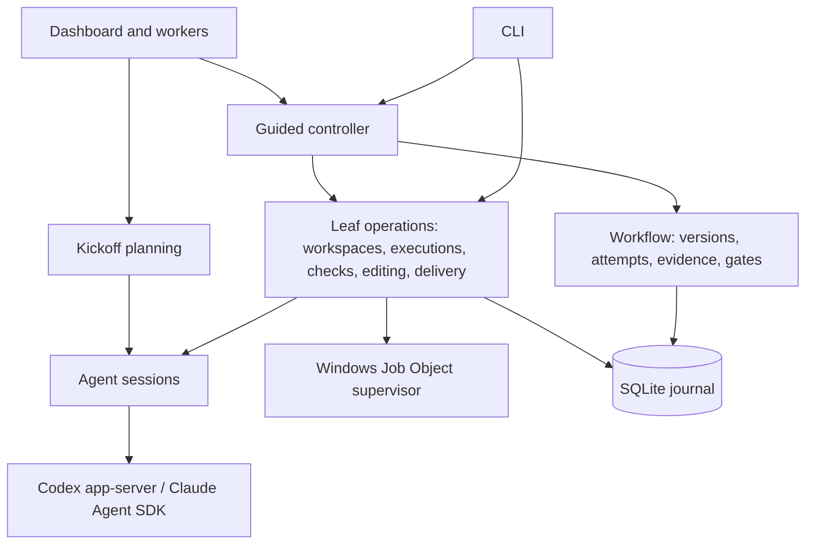

# Architecture

This describes the system as it is built. [DESIGN.md](../DESIGN.md) records product intent,
[WORKFLOW.md](WORKFLOW.md) describes automatic-mode behaviour in detail and [PLAN.md](PLAN.md) lists
the next changes.

## Invariants

These hold across every component. Changes that weaken them are bugs.

- **The controller owns truth.** Task state lives in the SQLite journal and changes only through
  controller code. Agent replies, dashboard requests and CLI input are proposals that the controller
  validates. A model reply alone cannot pass a gate or complete a task.
- **Evidence is artifact-bound.** Every check, review, assessment and delivery names the exact
  requirement version, attempt and content digest it applies to. Changing the content invalidates
  earlier evidence; a newer failed or pending result is never hidden by an older pass.
- **Unknown is never success.** Missing output, an unconfirmed process exit, an unknown token count
  or an unverifiable process identity is recorded as unknown and blocks progress where proof is
  required.
- **No replay of uncertain dispatch.** Once a provider turn, command or Git write may have started,
  it is never automatically repeated. Recovery reconciles what happened from durable records and
  receipts, or stays blocked.
- **State and journal move together.** Every state change and its events are written in one `BEGIN
  IMMEDIATE` transaction.

## Components

The guided controller (`orchestration/guided/`) is a sequential state machine over leaf operations. Each
leaf is independently durable and recoverable, and the low-level CLI commands call them directly.

## From request to plan

A **kickoff** (`orchestration/kickoff.ts`, prompts in `orchestration/prompts/planner.ts`) is a planning conversation
stored as a session with `kickoff.*` events.
The planner receives the pinned base commit, approved reference folders and the repository-read
tools; it cannot edit files or run commands. It asks structured questions for consequential
ambiguity and finally returns a JSON guided plan. Planning answers bind to the displayed turn and
questions. Changing hints or references invalidates an earlier proposal. No provider call is spent on
naming: until a plan exists the sidebar shows a short title derived from the request (its first
sentence or line, without control characters or markup delimiters, at most 60 characters at a word
boundary; `orchestration/task-title.ts`), and then the latest proposed plan's `brief.title`.

The planning contract requires acceptance based on observable behaviour, rather than source-text
searches or exact test names. Consequential dependency uncertainties must be resolved with available
read tools or raised as questions before a final proposal. Claims about standards conformance and
integration require evidence appropriate to those claims; mocked tests or metadata alone do not
establish them. The independent reviewer challenges gaps against the approved criteria. These are
provider instructions, not a deterministic proof of plan quality or a new controller gate.

Converting a proposal creates an unapproved guided task. `domain/guided-plan.ts` normalizes the plan once
and hashes it into an approval digest covering the brief, slices, file scopes, preparation,
validation and acceptance commands, expected output, providers, models, workflow and review
policies, the selected quality passes as full definitions, selected context, references and delivery
messages. Approval must name both the exact
requirement version and that digest. The controller, not the planner, decides repository, base,
workspace adapter and providers.

Plan validation simulates file existence through the ordered slices: edits and deletions must target
existing paths, creations must be absent (including Windows case collisions), and deleted paths
cannot be recreated later. Review must use the other provider from implementation.

## Workflow model

`domain/workflow.ts` holds the task record. A **brief** has a title, outcome, distinct criteria, plan and
optional 1 to 64 ordered **slices**, each naming the exact task criteria it delivers. Slices must
cover every criterion; the final slice is verified against all of them.

| Concept | Meaning |
| --- | --- |
| Version | Incremented on revision. Approval names one version |
| Attempt | One implementation try, with a fresh id; retries clear current evidence |
| Evidence | `quality` (naming its quality pass), `validation`, `review` or `verification`, each `passed`, `failed` or `skipped`, with source `controller`, `agent` or `synthetic` |
| Gates | The latest evidence of each kind for the current attempt and artifact must pass, including a `quality` assessment of each selected lens (the plan's lenses for a guided task, `simplification` for a low-level task), all active criteria must be mapped, and pending decisions must be accepted |
| Slice progress | Delivery of an intermediate slice records its commit, advances the index and clears the attempt |

Task phases are `draft`, `ready`, `running`, `stop_requested`, `recovery_required`, `stopped`,
`failed`, `awaiting_verification`, `awaiting_decision` and `complete`. Synthetic evidence is
accepted only on tasks permanently marked synthetic (the demo).

## Guided state machine

The guided state is saved in the task record. It refers to the current repository snapshot by its
artifact digest with a small summary (head, instructions digest, file count, changed paths); the
snapshot itself is written once to the content-addressed `snapshots` table and read through
`orchestration/guided/snapshots.ts`, so a state change never re-serialises file inventories, diffs or
the Git index. Evidence binding still compares the same digests. Each step journals its intent
(`guided.step_requested`) with the known result ids and the controller identity before calling a
leaf operation, then settles by adopting exactly one new result that matches that origin and
request.

| Stage | Handler (`orchestration/guided/stages/`) | Work |
| --- | --- | --- |
| `workspace` | `workspace.ts` | Create the task worktree (Git or Orca) |
| `execution` | `execution.ts` | Create the implementation execution and session, resuming the slice conversation when allowed |
| `preparation` | `preparation.ts` | Optional approved restore command, before scope |
| `scope` | `scope.ts` | Snapshot, verify size limits and build the exact edit policy |
| `implementation` | `implementation.ts` | Supervised native editing by the implementer |
| `quality_pass` | `quality-pass.ts` | Each selected edit quality pass, once per slice, as a scoped implementer turn |
| `refresh` | `preparation.ts` | Optional scoped generation after editing, followed by declared prerequisite restoration against the final inputs |
| `readiness` | `readiness.ts` | Run each approved mechanical check on the current artifact, using a separate bounded slice allowance |
| `validation` | `checks.ts` | Run the approved behavioural validation command |
| `submission` | `submission.ts` | Submit the implementation with the latest passing check |
| `review_execution` | `execution.ts` | Create the review (or arbitration) execution |
| `review` | `review.ts` | Independent artifact review by the other provider |
| `assessment` | `assessment.ts` | Record one quality lens assessment per step until every selected lens is recorded |
| `verification` | `checks.ts` | Run acceptance against the active criteria |
| `delivery` | `delivery.ts` | Verified local commit, then the next slice or `complete` |

Each handler has three parts: the result ids that already exist before dispatch, `perform` (dispatch
the leaf operation) and `settle` (adopt the result). `settle` returns a typed outcome (`advance`,
`wait` for a person, `stop` as blocked, `missing` result, or `rerouted` when a repair or arbitration
already sent the task back), and the controller (`controller.ts`) applies it as one journaled
change. The controller owns runner ownership, the drive loop, retry, recovery and revision; the exact
leaf requests that a step dispatches and later requires its result to match are built in one place
(`specs.ts`), and every agent prompt is in `prompts.ts`. Structured values are compared with
`domain/deep-equal.ts` (order-insensitive, `undefined` treated as absent, as in the stored JSON).

Statuses are `draft`, `ready`, `running`, `awaiting_scope`, `awaiting_assessment`,
`awaiting_answer`, `blocked`, `recovery_required` and `complete`.

In **automatic** mode (the default for new plans) scope is authorized by plan approval, review
follows submission, and the reviewer's verdict on each selected quality lens becomes agent evidence
at `assessment` before verification; a failed lens counts as a blocking finding. Edit quality passes
run between `implementation` and validation on the slice's first successful implementation only
([quality passes](WORKFLOW.md#quality-passes)). Declared read-only formatting, lint and type checks run at `readiness` after the refresh.
Their failures use `workflowPolicy.readinessRounds` (five by default, up to ten), persisted in
`readinessCycle`. All attempts rerun readiness, but behavioural repairs and manual retries never
replenish it. Submission independently checks that every readiness command passed on the exact
artifact and instructions; readiness cannot substitute for validation. Ordinary behavioural
validation and acceptance failures return to
implementation with their evidence within `workflowPolicy.repairRounds`, shared with blocking
review repairs (five by default, up to ten). Review can continue beyond two repairs when the
artifact changes and the reviewer evidences resolution of at least one preceding blocker using
controller-assigned identities, with dispositions for all prior blockers. Unchanged artifacts,
no resolved blockers and missing progress
evidence stop early or go to an optional approved arbitrator. Every repair decision is journaled
with its reason, evidence identity and shared budget in the settlement transaction. In **supervised** mode the controller stops at
`awaiting_scope` for file authorization and at `awaiting_assessment` after submission for one human
quality assessment covering every selected lens (skipped when none is selected), then reviews; failed checks stop for a manual retry. The mode is part of
the approved plan and changes only through a revision. Details are in [WORKFLOW.md](WORKFLOW.md).

Every stop records a typed reason next to the human-readable note: `stopReason: { code, message, at }`
on the guided state, and `reasonCode` on the journal event that made the change. It is set exactly
while the status is `draft`, `awaiting_*`, `blocked` or `recovery_required`, and cleared whenever
work resumes. The codes are listed and documented in `orchestration/guided/stop-reasons.ts`: waits
(`APPROVAL_REQUIRED`, `SCOPE_AUTHORIZATION_REQUIRED`, `ASSESSMENT_REQUIRED`, `AGENT_QUESTION`, ...),
settled failures (`PREPARATION_FAILED`, `CHECKPOINT_CHANGED`, `PROMPT_BUDGET_EXCEEDED`, `QUALITY_PASS_FAILED`, `CHECK_TIMEOUT`,
`CHECK_NO_PROGRESS`, `CHECK_REPAIR_EXHAUSTED`, `REVIEW_MISSING_LENS`, `REVIEW_REPAIR_EXHAUSTED`,
`REVIEW_PROGRESS_UNCONFIRMED`, `ARBITRATION_UNRESOLVED`, `DELIVERY_FAILED`, ...)
and results that cannot be adopted (`RESULT_MISMATCH`, `OPERATION_NEEDS_RECOVERY`,
`SETTLEMENT_UNCONFIRMED`, ...). A failure without a specific code is `UNEXPECTED_ERROR` before dispatch
or `RECOVERY_REQUIRED` after it.

A blocked readiness, validation or acceptance check whose stop is an infrastructure problem (`CHECK_TIMEOUT`,
`CHECK_INTERRUPTED`, `CHECK_EXIT_UNCONFIRMED`, `CHECK_OUTPUT_UNAVAILABLE` or `CHECK_ERROR`) and whose
retained record proves a settled process tree can be rerun with `GuidedTasks.rerunChecks`
(`orchestration/guided/rerun.ts`): the same check spec on the same execution and attempt, after a
fresh snapshot confirms the artifact is unchanged, with no agent turn
([rerun checks](WORKFLOW.md#rerun-checks)).

A slice's acceptance checks run as consecutive `verification` steps. Which one is due is not stored
in the guided state: `dueAcceptance` (`orchestration/guided/specs.ts`) derives it from the
execution's own check records as the first approved check without a passed run of exactly its
request. Requests bind the artifact, so a repair (a new execution) starts again from the first
check and a rerun on the same artifact resumes at the stopped one. Verification evidence carries
the check name, and `Workflow.sliceBlockers` gates delivery on the latest result of every name.

One guided controller runs per task at a time, and up to `maxConcurrentTasks` tasks run at once
([parallel tasks](#parallel-tasks-and-concurrency)). Ownership has no expiry and is kept across an
uncertain shutdown. Stop requests are persisted and forwarded as an `AbortSignal` to the running
leaf.

## Display-only live monitoring and pause

The shared compact task and planning network and dedicated observability page read actual communication
from the existing task and session journals (`persistence/activity.ts`,
`server/view-model/activity-events.ts`, `server/view-model/observability.ts`). Bounded pages retain
original journal, session, run, provider item and result identities; cross-journal clock ordering
is presentation order, never causal proof. Provider metadata capture (`providers/activity.ts`)
adds no tool permission or model call. The authenticated, revision-cached
`GET /api/v1/tasks/:id/observability` and `GET /api/v1/kickoffs/:id/observability` routes
use the same projection and supply graph semantics. Planning reads its own session; task reads
deduplicate linked sessions across versions, including planning before conversion. Vue folds those updates for
historical replay without borrowing current successful outcomes. The default refresh is one
second, paused during replay and while hidden. Shared connector and participant components
show directional traffic, pulsing live nodes and the current unfinished operation. Correlated
calls retain independent activity so one tool completion cannot hide another running call;
compact groups retain the active operation's label. Motion stops for replay and stale reads.
Live connector dots always animate; reduced-motion preferences suppress node pulsing.
See [OBSERVABILITY.md](OBSERVABILITY.md) for
capture coverage, redaction, grouped participants, replay windows and unavailable measurements.

`server/live-changes.ts` reads the task worktree against its recorded pinned base, independently of
journal revision. The authenticated `/api/v1/tasks/:id/live-changes` route re-verifies workspace
identity, then reads tracked and untracked paths and at most one selected unified patch. It never
claims a lease, runs an agent, writes the index or records workflow evidence. External diff drivers, clean/process filters
and text conversion are disabled. Previews reject filesystem links, bound output and line counts,
and explicitly report truncation or unavailability. Reads can race with editing and are labelled
observations, never stable artifacts. Delivered slices remain part of the comparison with the task base.
The visible task screen polls at `liveChangesIntervalMs`; hidden pages stop polling.

`server/view-model/repairs.ts` renders recorded repair decisions with their progress assessment,
triggering result and artifact, concrete failure diagnostics, and the relevant readiness or shared behavioural budget before and after the decision. `repair-results.ts` links each decision to the next attempt's observed checks and review verdict, stopping at the next decision, manual retry or delivery; changed bytes never establish a fix. The task screen
keeps the remaining allowance visible; the timeline retains the full history.

`GuidedTasks.pause` persists a request without aborting the active operation. Before the next dispatch,
the controller checks that flag and journals `guided.paused` with `USER_PAUSED` in the same transaction
as its state change, with no dispatch intent. A settled failure or human question retains its own
reason, and uncertain settlement still requires recovery. Continuing a paused task preserves the
attempt, conversations and evidence; a changed workspace still faces the existing artifact checks.
Stop and pause requests both count in the usage report's stop interventions.

`orchestration/guided/guidance.ts` owns version/slice-bound guidance, its fixed queue limits and
prompt contract. Queue and cancellation writes share a transaction with their events. Only an
implementation, edit pass or independent review dispatch can atomically select a matching batch
into `Pending.guidance`; prompts read that immutable batch, not the later queue. A completed
operation consumes it once. Proven absence of dispatch restores it; uncertain operations retain
their pending intent. Delivery refuses any unassigned queue with `GUIDANCE_PENDING` rather than
silently ignoring it. Revision clears the queue, retaining its history in the journal.

`server/view-model/guidance.ts` owns form availability, cancellation and historical statuses.
Assigned means a journaled step intent, not confirmed provider receipt. Draft identity binds to
version, approval digest and slice while request keys track current decisions. Guidance routes
remain available during an active worker without starting or interrupting one.

`orchestration/guided/spending.ts` derives task-wide turn and token allowance from `taskUsage`.
The approved workflow policy requires `maxTaskTurns` and `maxTaskTokens`. Before journaling a
provider-capable step intent, `begin` checks the ledger in its state-change transaction; a refusal
journals `guided.spending_blocked` and its measured snapshot without consuming guidance or dispatching.
The gate applies to implementation, edit quality passes and review (including arbitration). Ordinary
checks, result adoption and verified delivery remain available. There is no mutable per-attempt
budget balance to reset; all linked sessions and plan versions continue to count.

Codex input includes cache reads; Claude adds its separately reported cache reads and writes.
Incomplete usage cannot establish token headroom. An already running turn settles normally and can
exceed the threshold. These limits count requested Grampus provider turns, not provider-internal
model rounds, and do not impose a dollar billing cap or govern unconverted planning conversations.
`server/view-model/spending.ts` supplies labels from the same calculation, and the plan revision
form changes cumulative totals only through fresh approval.

## Persistence

`persistence/store.ts` uses Node's built-in SQLite with WAL, `synchronous=FULL`, foreign keys and a
15-second busy timeout ([parallel tasks](#parallel-tasks-and-concurrency)). There is one schema,
version 12, with no migrations. A new or empty
file gets the schema; any other version, or a version 12 file missing a table, is refused with a
clear error after a read-only inspection, so the file is never modified. The default journal is
`grampus.sqlite` in the data directory.

| Table | Contents |
| --- | --- |
| `tasks`, `events` | Task JSON state (including guided state and slice progress) and its ordered journal. An indexed generated column holds the guided runner's ownership token, so counting the runner pool never parses task state |
| `snapshots` | Repository snapshots referred to by guided state, keyed by artifact digest and written once |
| `sessions`, `session_events` | Agent conversations, kickoffs and their events (prompts with their usage stage, tool calls, coalesced output, usage, replies) |
| `workspaces`, `workspace_events` | Worktree reservations, identities and lifecycle events |
| `executions`, `execution_events` | Immutable task/version/attempt/workspace/session bindings with a role and a usage stage |
| `execution_leases` | At most one current owner per workspace |
| `checks` | Command, before/after snapshots, process identities and result |
| `implementations` | Edit policy, dispatch boundary, process proof and snapshots per editing turn |
| `deliveries` | Checked snapshot, commit request, dispatch boundary and accepted commit |
| `health` | The latest integration health result (one row); informational, never evidence |
| `comparisons`, `comparison_events` | Shared-plan batches, exact approval, sequential driver ownership, manual selection and integration evidence |

State is loaded from snapshots rather than rebuilt from events. History is append-only through the
application interface. Deletion writes a tombstone (`orchestration/task-lifecycle.ts`); it never removes
workspaces or history. Full check output and supervisor receipts live beside the journal in
`<journal>.checks/`.

Streamed provider text is display-only and is not journaled chunk by chunk.
`execution/output-buffer.ts` holds a run's `output.delta` text in memory and appends it as one
`output.delta` session event at most every `outputFlushIntervalMs` (1 s) or `outputFlushBytes`
(8 KiB), whichever comes first, and always before any other event of that run, before a stop request
and before the run's result, so journal order is unchanged. A flush is a single insert that never
rewrites the session record. A crash loses at most one interval of streamed text; results, usage,
tool decisions and every other event are journaled as they happen.

## Workspaces

`repository/workspaces.ts` reserves a task workspace in the journal before asking Git or Orca to create
anything, pins the base ref to a commit and never replays creation.

- **Git:** `git worktree add` on branch `grampus/<task-id>`, locked with the workspace id, at a
  destination outside existing worktrees. Inherited `GIT_*` variables are stripped and automatic
  CRLF conversion is disabled for the checkout command only. Git's exit is recorded as confirmed
  (`git.exited`) only when Node saw it end with an exit code or signal; an error alone, such as a
  failed kill after the timeout, leaves it unconfirmed, so recovery first proves the recorded Git
  process is gone.
- **Orca** (`repository/orca.ts`): one `worktree create` call with `--no-parent --setup skip`, without
  launching an agent. Grampus records Orca's worktree id and stable instance identity, and every
  later operation re-verifies that identity. Orca owns the worktree lifecycle; Grampus never edits
  Orca metadata directly or applies raw Git lifecycle writes to Orca worktrees. Remote Orca hosts are
  refused.

Recovery adopts a created worktree only when its identity, clean pinned base and approved version
all match. An unused failed standalone reservation can be released (metadata only). Worktree removal
is not automated.

`repository/orca-presentation.ts` projects guided journal facts onto ready, adopted local
Orca worktrees while the dashboard is open. It uses supported `worktree set` calls for
the display name, comment, board status and unread marker. The creation reservation's
name and comment are untouched until its identity has been adopted. Every changed card
is preceded by an exact instance, repository, path, branch and archive check; a second
journal observation discards a snapshot that changed during that check. No CLI call runs
inside a journal transaction. A slow scan never overlaps itself, and shutdown waits for
settlement before closing the journal.

The projection is disposable, never completion evidence. `completed` requires both
guided completion and the controller's delivered task phase for the approved version,
with no pending operation or owner. Each new attention observation marks unread once;
Grampus never clears unread. Failed card writes may be retried because they only assign
display values; provider dispatch and Git writes retain their no-replay rules. Projection
errors stay outside workflow state and appear on the task page. The dashboard restart
rebuilds the view from the journal. Closed dashboards leave the last observed card intact.

`grampus ui --orca` opens and focuses a local embedded browser tab. The authenticated
`POST /api/tasks/:id/open-orca` route opens the task in its exact recorded workspace,
including during an active action. It accepts no caller-supplied URL or workspace selector.
Browser creation must return a validated page id before focus, and navigation is never
automatically replayed. Task links carry the per-launch token and task route in the
fragment; the client stores the token and replaces the fragment with the task route.
Raw navigation errors are withheld because they can contain that token. Remote overrides
are refused for dashboard navigation. Native agent conversations remain **Planned**.

The native command plugin in `plugins/orca/` runs the short-lived `grampus open --orca`
or `grampus close` commands. `scripts/build-orca-plugin.mjs` packages it for a specific
Node, launcher and Orca CLI. `server/desktop-launch.ts` serialises startup using a
separate SQLite mutex, records the child's PID before its IPC startup permit, and
reconnects only after authenticated instance proof. A live or unverifiable owner blocks
replacement. The detached dashboard owns its lifetime; neither a plugin reload nor
closing Orca kills it. This does not add workflow records or change the journal schema.

Install and update build the production package inside the immutable snapshot, then
publish it at `<installation directory>/orca-plugin` before changing `current.json`.
Publication or selection failure restores the preceding package. The installed
`plugins/orca/installed.mjs` entry resolves `current.json` on each command and loads
that snapshot's command worker. This also works when Orca copied the package into
its own plugin directory. Unselected snapshots cannot change command behaviour;
the stable `bin/launch.mjs` launcher selects the application independently of the
checkout. Orca installation and enablement remain explicit through its supported UI.

`server/desktop-discovery.ts` validates private, bounded local endpoint receipts,
bound to application, journal, host and process identity. Installed snapshots share
their installation identity so a new launcher can reconnect to a still-running build.
`server/desktop-service.ts` shares graceful shutdown between foreground signals and
the authenticated `/api/desktop/close` route. New actions are refused once shutdown is
accepted, and active dashboard jobs prevent shutdown. `/api/desktop` proves identity
without returning the access token. Shutdown retires only that instance's receipt.
Browser reuse refreshes authentication through the token fragment before focusing the
exact page id. See [ORCA.md](ORCA.md) for setup and operation.

## Executions, sessions and leases

An **execution** (`execution/executions.ts`) binds one attempt to a workspace and a fresh Grampus session in a
given role, with a usage stage fixed at creation: `implementation` for the first implementation of a
slice, `repair` for any later implementation attempt in the same slice (automatic repairs and
explicit retries), `review`, or `arbitration` for a fresh arbitrator. Every turn or operation claims the workspace lease (`execution/execution-state.ts`) under a run id
and lease kind (`conversation`, `snapshot`, `check`, `submission`, `assessment` (used by every
quality lens assessment), `verification`, `completion`, `implementation` or `delivery`). The lease is held until process exit is confirmed.
Session state, task outcome, journal events and lease release settle in one transaction, fenced on
the exact run id. There is no expiry or heartbeat takeover. Leases coordinate Grampus processes
sharing one journal; they do not lock out editors or other tools.

A session (`execution/sessions.ts`) records its provider, the provider runtime it was created for
(executable path, reported version and, for Claude, the pinned SDK version), provider conversation id,
model, phase and the active run's controller and provider process identities. Each `turn.requested`
event names the turn's stage: its execution's stage, `quality_pass` for an edit quality pass in the
implementation conversation, or `planning` for a turn outside any execution. Each turn starts an owned provider process,
runs one turn and waits for exit. Within a slice, retries create new execution and evidence records
but may resume the same provider conversation; `execution/session-context.ts` starts a fresh one at the
configured turn or context-size threshold, or when the Codex toolset changed. Implementation and
review never share a conversation, and arbitration always starts fresh.

## Agent adapters

Both adapters return the same validated reply: `kind` is `message`, `question` or `review`, with
question ids, findings (`blocking` or `suggestion`, with evidence) and, for reviews, one
assessment per requested quality lens (`lenses`). Malformed replies fail the turn. The reply contract
is pinned in `providers/reply-schema.ts`; see [External boundaries](#external-boundaries) for how
provider protocol messages are validated.

- **Codex** (`providers/codex.ts`) runs `codex app-server` over stdio JSON-RPC
  (`process/process.ts`), forcing ChatGPT login and refusing other authentication. Codex is pinned:
  the executable is the native `codex.exe` vendored by the exact `@openai/codex` dependency (source
  `bundled`), or `GRAMPUS_CODEX_COMMAND`, resolved by `providers/executables.ts`. A `codex` on PATH is
  never used, so a standalone or desktop Codex updating itself does not change what Grampus runs. The
  binary is found by fixed paths under the package's `node_modules/@openai`: the platform package
  nested in `@openai/codex` or flattened beside it, binary in `vendor/<target>/bin` or
  `vendor/<target>/codex`; npm's `.codex-XXXX` staging folders are ignored and the package's script
  launcher is never run. Sessions recorded before pinning keep their `path` or `npm-vendored` source.
  Threads start or resume
  with `approvalPolicy: untrusted` and a read-only sandbox, and the controller verifies both before
  inference. Resume requests set `excludeTurns: true`: Codex retains the conversation history but
  returns metadata without saved turns, keeping unused history out of the bounded RPC response.
  Repository tools are app-server dynamic tools. File edits arrive as
  `item/fileChange/requestApproval`; the controller checks each patch against the active turn and
  the exact edit policy, journals the decision and grants single-use approval. Command execution
  requests are declined. Server requests are answered only through the request handler and validated
  by their own schemas; they are never treated as notifications, so they are not reported as protocol
  drift, while a request method Grampus does not know is refused and journaled once as
  `protocol.unrecognized`.
- **Claude** (`providers/claude.ts`) uses the pinned `@anthropic-ai/claude-agent-sdk` and its bundled
  executable, unless `GRAMPUS_CLAUDE_COMMAND` overrides it. `providers/executables.ts` resolves the
  bundled executable from the SDK's platform package the way the SDK does, and the adapter passes that
  exact path to the SDK, so `doctor` reports the program a turn starts. It requires a first-party subscription
  and no API key source. Editing turns get native `Read`, `Edit` and `Write`, which a `PreToolUse`
  hook and permission callback restrict to authorized paths, plus the repository MCP server
  (`providers/claude-repository.ts`) and, when deletions are approved, an in-process delete tool
  (`providers/claude-files.ts`). `ToolSearch` and external MCP tools are allowed only during an active turn.
  Tool decisions are journaled before permission is granted.

Neither provider gets a shell. Configured MCP integrations stay available (`providers/integrations.ts` carries
source-project connections into worktrees); external actions need explicit task authorization.

Implementation also receives `grampus_run_check` (`execution/implementation-commands.ts` and
`providers/implementation-tools.ts`), selecting an approved formatter, readiness command, validation command or focused diagnostic family by identifier.
A family binds its executable, argument prefix, timeout, selectable named flags and file suffixes. Agents
may choose parameter values and current inventory paths within that grammar, without a shell. It runs through the supervisor under the existing implementation
lease. Child check records name `implementationId`; settlement never releases the parent lease.
Before parent settlement, outstanding child receipts must prove confirmed exit or the implementation
stays in recovery. Diagnostics never supply acceptance. Explicitly reusable diagnostics can satisfy readiness or validation
only through a new controller adoption record after the implementer has settled. An optional
slice `formatting` command runs automatically after editing, within the approved file scope.
Native writes are suspended while a command runs; final evidence binds to the formatted artifact.

`repository/read-loop.ts` replaces a third identical read of unchanged content with a compact cursor
reminder and terminates the turn on the eighth. Changed content remains readable. Both providers
settle a detected loop without automatically replaying their turn.

Kickoff planning receives bounded historical command durations for the same repository and pinned
base. Timed-out durations are lower bounds; planning must split oversized suites with headroom,
preserving full coverage. This advice never rewrites an approved command or deadline at runtime.

## Repository access

`repository/repository-tools.ts` implements one controller-owned toolset for both providers:
`grampus_list_files`, `grampus_read_file`, `grampus_read_files`, `grampus_search`, `grampus_read_changes`,
`grampus_read_check`, `grampus_read_dependency` and `grampus_suggest_reference_folder`. Planning
reads immutable Git blobs at the pinned commit; execution reads the captured workspace inventory and
allows current bytes only for authorized paths; review reads the submitted snapshot. Every tool goes
through one path: it needs an owned turn to start, journals `repository.tool_requested` and then
`repository.tool_result` exactly as the model receives it, and checks ownership again before returning,
so a turn that settled meanwhile gets no result. Only the list, read and search tools take a `root`;
the advertised JSON Schemas and the enforced argument schemas list the same fields. Reference folders (`repository/reference-folders.ts`, up to
16) are read-only roots, pinned Git subtrees or hashed plain-folder inventories. Read access never
implies write scope. Budgets are in [REPOSITORY-CONTEXT.md](REPOSITORY-CONTEXT.md).

## Artifacts, checks and the Windows supervisor

Explicit discard (`orchestration/task-discard.ts`) hides a recovery-blocked task only after every
recorded controller is proved absent on this host. It checks ownership outside the write lock and
revalidates the complete ownership snapshot inside the transaction. The tombstone, approval
withdrawal, dead guided runner release and containing comparison's approval withdrawal commit with
their journal events. Discard preserves task and operation outcomes, pending intents, execution
leases and files; it is not settlement proof and never replays work. Retained workspace leases
continue to prevent reuse. Deleted tasks cannot dispatch further work. Ordinary deletion and reset
still refuse uncertain operations.

A repository snapshot (`repository/artifacts.ts`, `repository/repository-evidence.ts`) hashes HEAD, index entries, the raw
bytes of tracked and non-ignored untracked files and discovered `AGENTS.md`/`CLAUDE.md` instructions
into a SHA-256 artifact digest. A stable capture takes two matching reads. Git plumbing reads raw
blobs without filters or diff drivers. Ignored dependencies, environment and external services are
outside the digest. Symlinks and submodules are refused.

Checks (`verification/checks.ts`) run an approved executable with literal arguments at the workspace root, with
no shell. The request and before-snapshot are durable before dispatch. On Windows, a hidden detached
Node host (`process/check-host.ts`) runs PowerShell from the native helper directory, so supervisor
compilation cannot pick up incompatible framework assemblies from the dashboard's launch directory
(for example PowerShell 7's installation directory). PowerShell compiles `process/native/check.cs` and starts the tool
directly inside a Job Object (kill-on-close, no breakaway). After the root exits the supervisor
waits up to 100 ms for the job to drain, terminates any remaining descendants and confirms zero
active processes before writing a flushed receipt. The tool's stdout and stderr are inherited file
handles on the durable logs in the receipt directory, so output reaches the logs as the tool writes it
and a check stopped by its timeout keeps everything it printed until then (a tool that buffers its
own output, for example a script that captures child output to print at the end, loses that buffer).
The supervisor reports the tool's elapsed time in its result and receipt (`elapsedMs`). A check passes
only with exit code zero, a settled job and unchanged repository inputs. A timed-out check stops with
`CHECK_TIMEOUT` and a note such as `Validation 'Tests' exceeded its 300 s limit after 300.4 s; partial
output retained (5120 bytes).` Timeouts are 100 to 600000 ms; output above 2 MiB
combined stops the job; the journal keeps a 64 KiB preview per stream and full logs stay on disk
(`verification/check-output.ts`). Acceptance (`domain/acceptance.ts`) also compares approved stdout, JSON, stderr and
file observations against retained output and the after-snapshot. Preparation reuses the same runner
with its own purpose and cannot supply validation or acceptance evidence.

Native editing (`execution/implementations.ts`, `execution/implementation-worker.ts`, `execution/edit-policy.ts`) runs the
provider in the same supervised process tree. After confirmed exit, only the authorized file
contents and named creations and deletions may have changed; HEAD, index, other files, modes and
instructions must be unchanged. Scope covers regular UTF-8 files up to 1 MiB each and 4 MiB per
slice, at most 64 paths.

Every provider turn prompt fits one budget (`promptLimits.turnBytes`, 256 KiB of UTF-8, enforced by
`providers/prompt-budget.ts`). It is sized for the smallest provider limits: Codex refuses turn input
over 1,048,576 characters, and the budget uses under half of a 200k-token Claude context window at a
conservative 3 bytes per token. Builders charge the text a turn must carry first (the request, task
context, guidance, review history, check evidence and repository instructions), then fill what remains
in priority order: Codex's editable file contents, then selected files, changed files and their diffs,
each supplied once. With exploration anything that does not fit is deferred to the paging repository
tools. Without it, required context that cannot fit refuses the turn before any provider starts, with
`PROMPT_BUDGET_EXCEEDED`; selected context is sized at approval so a starting prompt always fits, but
the diffs of a repair can still grow past it. The assembled prompt is checked again before dispatch.
The implementation worker builds its prompt in `execution/implementation-prompt.ts` and records a refusal
as a settled turn result (`refused: 'prompt_budget'`), not a crash.

## Delivery

Delivery (`execution/deliveries.ts`, `execution/delivery-worker.ts`, `execution/delivery-operation.ts`, `repository/delivery-git.ts`)
requires every gate on the current artifact. The supervised worker stages the checked worktree,
compares staged paths, modes and raw blob hashes with the checked snapshot, then commits with the
repository's own identity, hooks and signing, adding a unique `Grampus-Delivery` marker. The
controller verifies parent, marker, tree, index, working files and instructions before recording
delivery and slice progress in one transaction. `mode: "no_change"` proves an already satisfied
outcome without staging. For Orca, the instance identity is checked before staging, before
committing and after. Failures keep the index, files and any commit for inspection; there is no
reset, amend or push.

## Recovery

Recovery is explicit (`task-recover` and the per-operation `*-recover` commands) and follows the
same rules everywhere:

- The previous controller must be absent on the same host. Windows process creation times
  (`process/process-identity.ts`) distinguish a recycled PID from the original owner; unknown or live owners
  block recovery.
- A recorded pre-dispatch boundary proves nothing was launched and can be released without a
  receipt.
- After dispatch, a supervised operation needs a matching terminal receipt (`verification/check-recovery.ts`).
  PID absence alone never proves settlement.
- Settled results are adopted only if their origin and request match. Lost successes are recorded as
  interrupted, never accepted.
- Recovery never sends a provider turn, reruns a command or repeats a Git write, and does not start
  the next step automatically.

## Parallel tasks and concurrency

Several guided tasks run at once, each in its own worktree, from separate processes (one dashboard
worker or `task-run` per task) over one journal.

- **Bounded runner pool.** A task has at most one owning controller (`guided.owner`, fenced on its
  token, no expiry). Up to `maxConcurrentTasks` tasks (default 2, 1 to 4) may own a runner at once
  (`orchestration/guided/runner-pool.ts`). A claim that starts work (run, authorize, assess, answer,
  retry, rerun checks) counts the owners from the indexed `runner` column inside its `BEGIN
  IMMEDIATE` claim transaction, so counting and claiming are atomic across processes, and fails with
  `RunnerPoolFullError` when the pool is full. An owner kept for recovery after an uncertain stop
  still holds its slot. Recovery, workspace release and revision start no agent turn or check and are
  not limited; recovery may always displace its own task's dead owner, so a pool full of crashed
  owners can still be recovered.
- **Refused, never queued.** There is no background scheduler: a queued task would have to start
  without a click whenever a slot freed, possibly when nobody is watching. A refused claim changes
  nothing. The CLI names the running tasks and the command to repeat; the dashboard answers 409
  before starting a worker (the worker's own claim stays authoritative if another task takes the
  slot first) with the error code `pool_full`, and shows the pool in `GET /api/v1/overview` as
  `pool: { running, limit, owners }`. The view model disables the actions that would claim a slot,
  with the reason, while the pool is full. Approving an automatic plan while the pool is full
  approves it without starting it and answers `{ ok: true, started: false }`.
- **Agent concurrency.** A task runs one agent turn or check at a time (stages are sequential and
  its workspace lease admits one operation), so `maxConcurrentTasks` is also the shared limit on
  active guided agents across tasks. Planning conversations and low-level CLI commands are not
  counted.
- **One source repository, several tasks.** Each task gets its own worktree on its own branch
  `grampus/<task-id>` at a distinct destination (reservation paths are unique in the journal).
  `git worktree add` and delivery commits in different worktrees change only per-worktree state
  (index, HEAD), their own branch ref and content-addressed objects written atomically. A stress
  run of 60 concurrent worktree creations and 60 concurrent commits, four at a time, on one
  repository (Git 2.53) saw no lock failure, so creation is not retried, which would replay a Git
  write; a failed creation still stops in `recovery_required` for explicit recovery.
- **Journal contention.** Each process has its own connection to the WAL journal and every write is a
  short `BEGIN IMMEDIATE` transaction. Process identity queries start PowerShell, so the ones on the
  hot path (claiming a runner, a provider process starting, `git worktree add` starting) run before
  the write lock is taken. The busy timeout (`processLimits.journalBusyMs`, 15 s) outlasts the
  slowest work still done under the lock, identity queries during explicit recovery
  (`identityTimeoutMs` each), so a concurrent task's write waits instead of failing with
  `SQLITE_BUSY`.
- **Per-task resources.** The dashboard keeps one job per task id and one worker process per action.
  Each run worker refreshes stale health first; two runs starting together may both refresh, which
  only replaces the single `health` row twice. Check receipts get a fresh directory under
  `<journal>.checks/`, the native supervisor is one Job Object per check, streamed output buffers and
  Claude usage polling belong to one run, and stall detection reports each task separately. The
  repository inventory cache is per process.

## Dashboard server

`server/ui-server.ts` serves the dashboard client and a JSON API over the same journal; it is not a
second workflow engine.

- The client is the Vue 3 + Vite + Nuxt UI application in `web/`, built to `web/dist` (`npm run build`
  builds the server and then the client; the installer builds it inside each snapshot).
  `server/static-client.ts` serves `index.html` at `/`, `favicon.svg` and the hashed bundles under
  `/assets/`, with an explicit content type per extension. Request paths are decoded and checked
  segment by segment and the resolved file must stay inside the client folder; anything else is 404.
  Without a build, `/` answers 503 with a page saying how to build it, and the API keeps working.

- Listens on all IPv4 interfaces (`0.0.0.0`) by default; `dashboardListenOnLan: false` restricts it to
  `127.0.0.1`. Uses port 4317 installed or 4318 development unless `config.json` sets
  `dashboardPort` ([CONFIGURATION.md](CONFIGURATION.md)). Startup links and private desktop discovery
  receipts continue to use loopback. `server/browser-ports.ts` refuses a port on the
  Fetch standard's blocked list, which browsers would not connect to, and for port 0 exchanges a blocked
  ephemeral port for another (at most `serverLimits.ephemeralPortAttempts` tries).
- Direct dashboard access on the configured interfaces is the default. `dashboardRequireAccessLink: true` requires the
  random 32-byte per-launch bearer token on browser API calls (constant-time comparison). Startup
  links carry it in the URL fragment. Private desktop receipts always retain a token and discovery
  and shutdown always require it, independently of browser access settings.
- `server/request-origin.ts` requires the `Host` header to match the IP address and port of the
  receiving socket when LAN access is enabled, or the loopback origin otherwise. Any `Origin` must
  equal that request origin. Arbitrary DNS hosts, including rebinding hosts, and API requests marked
  `Sec-Fetch-Site: cross-site` are refused in both access modes.
- Strict CSP (`default-src 'none'`, self-hosted scripts and styles only, `frame-ancestors 'none'`),
  `nosniff`, `no-referrer` and `no-store` on every response, the client's files included. Assets are
  local; there is no CDN. The client is built for this policy: no inline scripts or styles, no runtime
  style injection (the Nuxt UI colour plugin is not installed; `web/src/theme/theme.css` declares its
  variables), icons bundled at build time and system fonts only.
- Every task decision carries a **decision key** built from version, digest, status, stage,
  artifact, instructions digest, execution ids, the failed check on display and, for answers, the
  exact turn and questions. Commands that need one take its SHA-256 digest (`task-rerun-checks`). The
  controller rechecks it, so a stale tab cannot approve a changed plan or authorize different bytes.
- Actions run in separate Node worker processes (`server/ui-worker.ts`) using the same controller, so
  restarting the server is never evidence that work stopped. A worker that fails reports its message
  and, for a typed stop, its reason code as a JSON line on stderr; the server journals it as
  `dashboard.action_failed` (action, bounded plain-text note, reason code, exit code) on the task or
  planning conversation, so the failure survives a restart. Settled jobs are dropped from the
  in-memory job list after five minutes (`serverLimits.settledJobRetentionMs`).
- `GET /api/health` returns the stored [health](#health-and-stalls) with version warnings;
  `?refresh=1` runs the checks first (the Health screen's **Check again**, which then rereads the
  overview). Besides `/api/v1/`, the client reads only `GET /api/tasks/:id/report` and the paged
  `GET /api/tasks/:id/check-output`, and posts lookups (`/api/repositories/inspect`,
  `/api/repositories/files`, `/api/references/suggest`), creation (`/api/kickoffs`, `/api/tasks`),
  `/api/settings` and the action routes; their response shapes are typed in `server/api-types.ts` too. The legacy polls
  (`/api/state`, `GET /api/tasks/:id`, `/api/tasks/:id/events`) were removed with the legacy client.
- Every route parses its body with its own schema (`server/api-schemas.ts`); unknown fields are ignored
  because the browser posts whole forms. Failures map to statuses by error class
  (`server/errors.ts`): 400 with field-level `issues` for an invalid body or a controller refusal,
  404 for an unknown route or record, 409 when the decision key, turn key or proposal digest no
  longer matches the current state, an action is already running or the runner pool is full, 413 and 415 for oversized or
  non-JSON bodies. A stale key that orchestration itself detects inside its transaction (a race after
  the server's check) is still a plain refusal (400).
- Read routes under `/api/v1/` serve the [view model](#dashboard-view-model-and-api-v1). Every route
  answers every failure, including 401 and 403, with the typed envelope
  `{ error: { status, code, message, issues? } }` (`ErrorV1`, `errorResponse`).

## Dashboard view model and API v1

The server decides everything the dashboard presents; the client draws it. `server/api-types.ts` pins the
v1 response types (type declarations only, no imports, so `web/` imports it with `import type` through a
relative path and `vue-tsc` checks the client against it). `server/view-model/` holds pure functions from
journal facts and the dashboard's in-memory state (workers, stalls, available quality passes and the runner
pool read once per request; `ViewContext`) to those DTOs; nothing there writes.

| Route | DTO | Contents |
| --- | --- | --- |
| `GET /api/v1/provider-models` | `ProviderModelsV1` | Explicit local-agent discovery, separate from polling. Codex `model/list` and Claude `supportedModels()` run without an inference turn; bounded control deadlines and pagination refuse incomplete results. Each provider returns suggestions or an unavailable message independently |
| `GET /api/v1/overview` | `OverviewV1` | Application, health summary (`ready`, `degraded`, `blocked`, `unknown` with a reason naming the integration and capability), runner pool (guided runners owned, `maxConcurrentTasks` and the owning task ids), the attention queue across tasks and planning conversations (kind, one-sentence reason, stop reason code, resolving actions; most urgent first), task and planning summaries, recent verified deliveries with an evidence summary. A task whose facts cannot be read is listed with status `unknown` and a `blocked` attention item naming the error category (for example a missing snapshot record), and a redacted line is logged, so it never fails the whole overview |
| `GET /api/v1/tasks/:id` | `TaskDetailV1` | Header (status, label, one-sentence explanation, note in UI language, next step: automatic, human with action ids, or none), workflow strip, current activity (no percentages), decisions, results (criteria coverage, checks with sizes for paging, findings, lens assessments, edit passes, commits, unresolved items), usage, details (approval digest, artifact, changed paths, plan, scope file contents only while authorization is pending, references, timeline head) |
| `GET /api/v1/tasks/:id/timeline?cursor=&limit=` | `TimelinePageV1` | Journal events newest first: type, time, human summary, note, reason code; `cursor` is the journal sequence to page before |
| `GET /api/v1/tasks/:id/observability?before=`, `GET /api/v1/kickoffs/:id/observability?before=` | `ObservabilityV1` | Shared bounded activity projection with explicit task or planning subject, participants, original event identities, correlation and replay updates. Task reads include each linked planning session once; planning reads only its own session and requires a live planning conversation |
| `GET /api/v1/tasks/:id/changes?path=` | `ChangeV1` | One retained change, before and after |
| `GET /api/v1/settings` | `SettingsV1` | The `config.json` path, whether the saved file differs from the settings this dashboard started with (a restart applies it), why the saved file would be refused at the next start, and the save action: one field per setting holding the stored value (empty keeps the default), bound to the file's revision |
| `GET /api/v1/orca-worktrees` | `OrcaWorktreesV1` | Local, unarchived Orca worktrees across repositories (`orca worktree list`, at most `viewModelLimits.orcaWorktreeChoices`, the rest counted) grouped by repository with full paths, for New task to fill its folder from. Display only: `available` is false when the dashboard has no Orca client or Orca does not answer, and nothing is decided from the list |
| `GET /api/v1/kickoffs/:id` | `KickoffDetailV1` | Discussion (answers as text, plan replies described), pending questions with suggestions, proposal and digest, context, references and suggestions, planner activity, actions, and the last failed dashboard action: this dashboard's settled worker, or else the latest journaled `dashboard.action_failed` that no later planning event or turn has superseded |

- **One status vocabulary.** `working`, `awaiting_human`, `verified`, `failed`, `blocked`, `unknown`,
  `idle`, `complete` and `stopping` (`view-model/status.ts`). Every `StopReasonCode` has a label, a
  one-sentence reason, an attention kind and a presentation status in one exhaustive table, so a new code
  does not compile until it is described. Settled failures are `failed`; infrastructure stops (timeouts,
  unconfirmed exits) and recovery are `blocked`; a stale plan is `unknown`. A controller that owns a
  running task but was not started by this dashboard is `working` (workers outlive a dashboard restart).
- **Trustworthy evidence labels.** Workflow stages, criteria, checks and lenses say who established a
  result: `controller-verified` (checks, acceptance, the verified commit), `agent-reported` (implementation,
  edit passes, the independent review and its lens verdicts) or `human-assessed` (a supervised assessment).
  A stage stopped before a result is `unknown`, never passed.
- **Actions in one place.** `view-model/actions.ts` decides which actions exist for a state and stop reason,
  their labels, consequences, the decision key they carry (`expected`), the form they need and why one is
  disabled, and documents the mapping from `ActionView.id` to the existing POST route and body. Each
  `ActionView.request` is the exact request to send; forms list fields whose values are written at a JSON
  pointer in the body (answers at `/answers/<id>`, a revision at `/plan/...`), so the client assembles no
  business data. The server still re-checks every key.
- **UI language once.** Controller notes are rewritten on the server: control characters removed and CLI
  command names replaced (`task-retry` becomes "a repair attempt", `task-authorize` "the file authorization
  button" and so on).
- **Bounded and cached.** Journal facts are cached by journal revision (`viewModelLimits.cachedViews`);
  DTOs are rebuilt per request because workers and stalls change without a journal write. Responses never
  carry file inventories, snapshots or raw check output: check output stays on the paged
  `/api/tasks/:id/check-output` route and file contents on `/changes`.

## External boundaries

Every value that crosses a process, file or network boundary is parsed with a zod schema beside the
module that owns the contract, and a mismatch is a categorised `BoundaryError` (`process/boundary.ts`)
carrying its kind, source and field-level issues, never an `undefined` discovered later. Issues name
fields, not values, and are bounded.

| Boundary | Schema module | On mismatch |
| --- | --- | --- |
| Codex app-server responses and notifications | `providers/codex-protocol.ts` | `ProtocolError` (provider, method). Control notifications and responses fail the turn; malformed progress or usage is journaled as `protocol.malformed` and skipped; unknown methods are journaled once per session as `protocol.unrecognized` with a sanitised excerpt and ignored |
| Claude Agent SDK messages | `providers/claude-protocol.ts` | `ProtocolError` for init and result; unknown message types are `protocol.unrecognized`. The known type list is checked against the pinned SDK at compile time |
| Structured agent replies | `providers/reply-schema.ts` | `agent-reply` error; the turn fails |
| JSON-RPC envelope | `process/process.ts` | The transport fails |
| Supervisor output, check host request, completion receipts, process identity | `process/supervisor-protocol.ts` | Supervisor protocol failure (`supervisor_lost`), refused receipt, or an unknown process observation |
| Worker request and result files | `execution/worker-files.ts` | The worker stops before any provider or Git work; a bad result is the run's error |
| Stored integration health | `health/health-record.ts` | `journal-record` error naming the `health` table |
| Journal records: tasks with their guided state, and the execution-layer tables | `persistence/records.ts` (task fields from `domain/workflow.ts`, guided state from `orchestration/guided/state.ts`, plan from `domain/guided-plan.ts`) | `journal-record` error naming the table. Records are validated in place on every read so their stored bytes, which fences and digests compare, are unchanged. Stored shapes check structure; value bounds were enforced when the value was accepted |
| Kickoff session events | `orchestration/kickoff.ts` | `journal-record` error naming the event type |
| Orca CLI JSON | `repository/orca-protocol.ts` | `orca-output` error naming the command |
| Git plumbing output | `repository/git-output.ts` | `git-output` error |
| Repository tool arguments from agents | `repository/repository-tool-arguments.ts` | The tool call fails with a message the agent can act on |
| MCP configuration files | `providers/integrations.ts` | The file is refused; unsupported server transports are not carried over |
| Dashboard request bodies and worker requests | `server/api-schemas.ts` | 400 with issues |
| CLI options and input files | `cli-input.ts` | `cli-input` error naming the argument or file |

Unrecognised-message excerpts are bounded by `boundaryLimits` in `config/limits.ts`: strings are
shortened, secret-looking keys redacted, nesting and entries capped and control characters removed.

## Configuration

Fixed bounds live in `config/limits.ts`, each documented with what it bounds. Operational values
(dashboard port, usage polling, streamed output batching, defaults for new plans) live in `config/settings.ts`; an optional
`config.json` in the data directory overrides them and is validated strictly. The CLI loads it once at
startup and passes the loaded values to dashboard and implementation workers in their requests. The
dashboard's Settings screen is the only writer of the file: `POST /api/settings` validates the
overrides, refuses them with 409 if the file changed since it was shown (its SHA-256 revision) and
replaces the file through a temporary file and a rename. A running process never reloads it; the
saved values apply at the next start.
Defaults are copied into a plan when it is created, so settings never change an approved plan or
recorded evidence. Details are in [CONFIGURATION.md](CONFIGURATION.md).

## Usage accounting

Providers report cumulative usage per provider session: input, output, cache read
(`cachedInputTokens`), cache write (`cacheWriteInputTokens`: Claude's cache creation tokens, Codex's
`cacheWriteInputTokens`) and, for Claude only, estimated USD. Claude usage is sampled every 15 seconds
(`usagePollIntervalMs`) during a turn and replaced by the final result; interim snapshots are marked
incomplete. A failed Claude result whose counters are all zero (the SDK documents zeroed crash and
startup-error results) reports no usage rather than zero. Claude's estimated USD never becomes billed
cost, which is always unknown.

**Counters across resumed sessions.** Grampus starts a new provider process for every turn and resumes
the conversation. Both providers continue their counters across that resume rather than restarting
them per process:

- Claude Agent SDK 0.3.302: the `result` message's `modelUsage` and `total_cost_usd` are documented as
  cumulative for the query and "a resumed or forked session continues from the totals its transcript
  saved, when it has them (so the first result already carries the earlier turns)"; a mid-session
  `/clear` resets them. A live check on 19 October 2026 (one turn, then two separate processes each
  resuming the session for one turn) confirmed it: each process's usage sample before its turn already
  showed the previous total, and each result continued from it. The usage endpoint polled during a
  turn reports the same session totals.
- Codex app-server 0.163.0: `thread/tokenUsage/updated` `total` is per thread. A live check (a turn,
  then `thread/resume` in a new app-server process and a second turn) showed the restored total
  reported straight after the resume and the next turn continuing from it; none of 494 local Codex
  rollout files showed a thread total decreasing.

`reporting/task-usage.ts` therefore turns each provider session's snapshots into per-turn usage: a
turn adds its latest values minus the session's previous known totals. When a turn's first
observation is below the previous total in any field, its counters restarted (a transcript without
saved totals, or a reset), and its own values are its usage instead, so both behaviours count every
token once. A turn without observations has unknown usage and marks the totals partial; the next
observed turn of the same provider session also carries its spend, so provider totals stay right
while that stage's figure absorbs it. A restarted turn whose first observation already exceeds the
previous totals in every field cannot be told apart from a continuing one and would be undercounted;
neither pinned provider restarts its counters on resume.

**Stages and counters.** Each turn is attributed to the stage recorded on its `turn.requested` event
(`planning`, `implementation`, `quality_pass`, `repair`, `review`, `arbitration`). Per stage and
provider the report, `task-show` and the task poll show turns, failed and interrupted turns, unsettled
turns, wall time (turn request to recorded result, settled turns only) and the usage fields; per task
they show the provider totals, total turns, repair attempts (implementation executions with stage
`repair`) and human interventions after approval. Interventions count these guided events after the
first `guided.approved`: `guided.answers_supplied`, `guided.scope_authorized`,
`guided.assessment_supplied`, `guided.retry_requested`, `guided.preparation_retry_requested`,
`guided.checks_rerun_requested`, `guided.recovery_requested`, `guided.workspace_released`,
`guided.revised`, `guided.guidance_queued`, `guided.guidance_cancelled`, `guided.stop_requested`, `guided.pause_requested` and later `guided.approved` (approvals of revised plans).
Continuing a stopped task with `task-run` and low-level CLI commands are not counted. Unknown values
stay null and never count as zero; a total that misses some turn's measurement is marked partial.

Repair decisions also have a `guided.repair_decided` event: source, action, reason, triggering
result id, a bounded diagnostic or finding excerpt, execution/review ids, artifact, progress and shared budget before the decision. The
linked session retains the review's individual blocker dispositions and provider usage. Tokens
are measured per provider turn and aggregated by stage, not separately for every controller
decision or individual tool call. Checks retain their own timings and results. These records
support analysing repair yield, repeat findings, intervention rate and spend by stage; there
is no automatic cross-task benchmark or causal attribution of tokens to individual findings.

## Fixed model assignments and comparisons

`domain/model-profiles.ts` validates saved role assignments, including provider-specific effort
and the editing-provider constraint that preserves independent review. A selected profile is
copied into `GuidedPlan.modelProfile`; its effective implementation, review and arbitration
choices are normalised into the same approval digest as the work specification. The planner's
session also receives its selected model and effort. Repairs choose their assignment from retained
slice executions, and each edit pass uses its approved override or inherits implementation.
A model or effort change starts a fresh conversation at a settled boundary. Sessions retain
requested model separately from provider-observed model; `turn.requested` snapshots the configuration
before connection, so later role changes cannot rewrite earlier usage attribution.

`domain/comparison.ts` defines comparison records and two separate hashes: the shared work digest
excludes model choices and workspace destinations; batch approval binds every member's exact plan
digest and execution order. A revision-backed plan cannot seed a comparison from its old base.
`orchestration/comparisons.ts` atomically creates and approves member tasks, then drives them
sequentially under durable ownership. Ordinary task dispatch also checks comparison membership and
order. Settled failures are retained outcomes; human boundaries, pauses and uncertain operations
wait. A dead driver needs explicit recovery, with no provider dispatch replay.

`domain/comparison-retries.ts` derives explicit retry requests, their dispatch and settlement from
`comparison_events`. These decisions do not change the frozen member configurations or approval digest.
The driver drains queued requests after the active run settles, before starting another profile;
an idle or completed comparison can drive them immediately. An active retry temporarily owns the
comparison turn while the initial cursor stays fixed. A started request never becomes pending
again after recovery, so uncertain dispatch cannot be replayed. Retry eligibility is shared with
the dashboard. An explicit retry of the current supervised checkpoint takes priority over earlier
failed runs, so their queued repairs cannot prevent the current run from reaching settlement.
Eligibility is defined in `orchestration/comparison-retry-policy.ts`. Duplicate requests, stale decisions,
unsettled operations, spending stops and requested integration are refused. Retained files,
conversations, evidence and both repair counts keep the ordinary task contracts.
Task claims recheck comparison membership inside the claim transaction; advancing a comparison
rechecks the member's current ownership and settlement under the same SQLite write lock.

The `comparisons` and `comparison_events` tables are part of journal schema 12. State changes and
events share a transaction. Schema versions other than 8 are refused without migration.
Member tasks keep the existing execution, workspace, evidence, spending and verified-delivery
contracts. Shared planning is retained once at comparison level rather than charged to every member.
`orchestration/comparison-integration.ts` separates manual preference from an explicit fast-forward
of the clean source branch at the pinned base. Intent is durable before Git may write; uncertain
integration is reconciled against exact branch, commit, raw files and index, never repeated.

`reporting/run-metrics.ts` adds per-model scorecards and observed workflow timing to the existing
usage ledger. `providers/subscription-limits.ts` retains bounded provider-reported subscription
observations; these never establish per-task allowance consumption or pass a gate.
`reporting/run-export.ts` captures full task or comparison records transactionally, then reads
raw attachments and optional retained-commit patches outside the SQLite lock. JSON, gzip JSON
and CSV downloads are explicit authenticated routes, separate from bounded dashboard polling.
Each oversized or missing attachment has a coverage status. Exports do not claim provider-internal
inference details or subscription billing. See [WORKFLOW.md](WORKFLOW.md#model-profiles-and-comparisons).

## Health and stalls

Health is observation, not evidence: nothing in the workflow reads it to pass a gate, and the adapters
still refuse what they cannot use when a turn starts.

- **What runs is what is checked.** `providers/executables.ts` resolves the Codex and Claude programs
  for the adapters and for `doctor` alike. `doctor` (`health/doctor.ts`) starts the Codex app-server
  with the adapter's own arguments and environment and runs the adapter's handshake (`initialize` with
  `experimentalApi`, `account/read`, then `mcpServerStatus/list` without a thread); for Claude it
  creates a real `ClaudeSession` with the adapter's options and asks only control requests
  (`accountInfo`, `mcpServerStatus`). No thread or turn is ever started, so inference is always
  `untested`. Git (the executable found on PATH, which is the one run), Node (`node:sqlite`, engine
  version), Windows PowerShell with the supervisor files, and Orca (`worktree current` only with
  `--orca`) are checked too. Every failure, including one starting a provider (for example spawn
  `EINVAL` for a script) or reading package metadata, becomes a failed row of its integration; the
  report itself never rejects.
- **Typed, stored result.** `health/health-record.ts` pins the report: per integration a status, the
  executable, version, SDK version and fingerprint, and capability rows (`executable`, `version`,
  `auth`, `handshake`, `mcp`, `inference`, `sqlite`, `supervisor`) with a sanitised, bounded detail.
  Statuses are `healthy`, `failed`, `untested`, `not_configured`, `auth_unavailable` and
  `temporarily_unavailable`; an integration takes its worst tested row. The latest report is the
  single row of the `health` table, written by `grampus doctor`, by the dashboard at start when the
  stored result is older than `healthCheckIntervalMs`, by a dashboard run worker before a guided run
  under the same rule, and by **Check again** (`GET /api/health?refresh=1`).
- **Version change warning.** Each session records the provider runtime it was created for. The
  health view (`health/health.ts`) compares the current Codex version, Claude version and Agent SDK
  version with the latest session of each provider on the task of the most recent accepted delivery,
  and warns, for example, "Codex changed from X to Y since the last successful delivery; capabilities
  are untested on this version". It never blocks: treat it as a prompt to run a small task first and
  to re-record the protocol fixtures if the provider changed. Delivering on the new version clears it.
- **Stalls.** Guided turns have no deadline. The dashboard server runs `health/stalls.ts` every
  `stallLimits.scanIntervalMs`: a running session or check of a guided task whose own journal (any
  session event, or any execution event of a check) and, for a check, its output logs have been silent
  for `stallWarningMs` is shown as `stalled` on the task summary and task view, and one
  `guided.stall_detected` task event is appended per silence (it names the activity it measured from,
  so a rescan or restart does not repeat it). Nothing is stopped, interrupted or recovered; the user
  decides with the existing stop control.
- **Protocol drift canary.** `test/fixtures/protocol/` holds a real, sanitised Codex handshake capture,
  a constructed Codex conversation turn and a constructed Claude SDK turn typed against the pinned SDK.
  `test/protocol-replay.test.ts` replays them through the real adapters (`connectCodex` with a
  replaying app-server, `connectClaude` with a recorded query) and asserts the typed events and reply.
  Re-record a fixture when a provider changes; a failing replay names the message that drifted.

## Limits

- Windows only. macOS and Linux supervision and installers are **Planned**.
- No background scheduler, retention cleanup, push or pull request delivery.

## Module map

Paths are under `src/`. Folders group modules by responsibility; they are not strict layers.

| Folder | Files | Responsibility |
| --- | --- | --- |
| `/` | `cli.ts` | Command parsing and entry point (`dist/src/cli.js`, also the installed launcher target); Ctrl+C handling |
| | `comparison-cli.ts` | Profile catalogue, metrics, comparison decisions and export commands |
| | `cli-input.ts` | Validated CLI option values and input files |
| `config/` | `runtime.ts` | Application root, version, installed or development channel, data directory, update |
| | `limits.ts` | Fixed, documented bounds bound into approval, evidence or recovery; not configurable |
| | `settings.ts` | Operational settings, their defaults and the validated optional `<data directory>/config.json`, which the Settings screen saves |
| | `environment.d.ts` | Typed declarations of the environment variables Grampus reads |
| `persistence/` | `store.ts` | SQLite schema, version check, transactions and journal access |
| | `records.ts` | Schemas of the execution-layer journal records, validated on every read |
| | `errors.ts` | `RecordNotFoundError` and `StaleStateError` |
| `domain/` | `workflow.ts`, `workflow-policy.ts` | Briefs, versions, attempts, evidence, gates, slices and completion; workflow policy validation |
| | `guided-plan.ts` | Plan normalization, slice file simulation and approval digest |
| | `restore-policy.ts` | Explicit prerequisite input/output declarations bound into approval |
| | `readiness.ts` | Approved mechanical check categories and exact-artifact readiness evidence |
| | `model-profiles.ts`, `comparison.ts` | Fixed role assignments, comparison contracts and exact dispatch order |
| | `comparison-retries.ts` | Durable explicit retry requests, active dispatch and settlement derived from the comparison journal |
| | `delivery-outcome.ts` | Verified delivered heads, including explicit no-change outcomes |
| | `quality-passes.ts` | Quality pass definitions, built-ins, plan selection and lens assessments |
| | `acceptance.ts` | Acceptance expectations and observations against retained output |
| | `deep-equal.ts` | Structural equality for stored JSON-shaped records |
| `orchestration/guided/` | `controller.ts` | Guided task controller: public API, runner ownership, drive loop, retry, recovery, revision |
| | `runner-pool.ts` | The bounded runner pool (`maxConcurrentTasks`), its typed refusal and the pool view |
| | `state.ts`, `keys.ts`, `stop-reasons.ts` | Guided state types; decision and question keys; typed stop reason codes |
| | `context.ts`, `specs.ts`, `prompts.ts` | Stage handler contract and result adoption; exact leaf requests; agent prompts |
| | `retry.ts`, `recovery.ts`, `revision.ts` | New attempts and explicit retry checks; leaf recovery; plan revision |
| | `spending.ts` | Ledger-derived task-wide provider dispatch limits and stop evidence |
| | `guidance.ts` | Bounded human guidance and immutable per-step prompt batches |
| | `repair-policy.ts` | Controller finding identities, review progress checks and repair decision evidence |
| | `rerun.ts` | Which stopped checks may be rerun without a new attempt |
| | `snapshots.ts` | Snapshot references in guided state and access to the stored snapshots |
| | `stages/*.ts` | One handler per stage (see [Guided state machine](#guided-state-machine)) |
| `orchestration/` | `guided-status.ts` | Task views and next actions |
| | `kickoff.ts`, `prompts/planner.ts`, `planner-progress.ts`, `task-title.ts` | Planning conversations and planner prompts, live planner progress and the provisional title from the request |
| | `comparisons.ts`, `comparison-integration.ts` | Sequential comparisons, manual preference and explicit verified fast-forward integration |
| | `comparison-retry-policy.ts` | Settled retry eligibility shared by comparison orchestration and the dashboard |
| | `task-lifecycle.ts`, `task-discard.ts` | Reset and delete with tombstones; explicit abandonment retaining uncertain workspace leases |
| `execution/` | `sessions.ts`, `session-context.ts` | Conversation turns, recovery and resume-or-fresh decisions |
| | `output-buffer.ts` | Coalescing streamed provider output per run |
| | `executions.ts`, `execution-state.ts` | Execution bindings, leases and settlement |
| | `edit-policy.ts`, `implementations.ts`, `implementation-worker.ts` | Edit scope, patch authorization and supervised editing |
| | `directory-scope.ts`, `native-creations.ts`, `phase-timing.ts` | Portable directory grants, journal-derived creation coverage and monotonic phase observations |
| | `implementation-prompt.ts` | The exact implementation turn prompt, built within the turn budget |
| | `implementation-commands.ts`, `diagnostic-budget.ts` | In-turn finishing, pending-command settlement, exact-input reuse and durable slice-wide diagnostic allowances |
| | `deliveries.ts`, `delivery-worker.ts`, `delivery-operation.ts` | Local commit delivery and verification |
| | `worker-files.ts` | Validated worker request files and implementation results |
| | `agent-timeout.ts` | Opt-in provider deadlines for low-level session and implementation commands; guided turns have none |
| `providers/` | `types.ts`, `index.ts` | Provider contract, reply validation, usage, connector |
| | `reply-schema.ts` | Structured reply, usage and turn result schemas; the provider output format |
| | `prompt-budget.ts` | The one byte budget every turn prompt shares, and its dispatch-time check |
| | `codex.ts`, `codex-protocol.ts` | Codex app-server threads, turns, approvals and dynamic tools; the pinned app-server protocol |
| | `model-catalogue.ts` | Bounded, inference-free model discovery from local Codex and Claude controls; independent unavailable results and manual-entry support |
| | `claude.ts`, `claude-protocol.ts`, `claude-repository.ts`, `claude-files.ts` | Claude SDK sessions and the validated SDK fields, repository MCP server, scoped delete tool |
| | `integrations.ts` | MCP carry-over into worktrees |
| | `executables.ts` | The Codex and Claude programs the adapters and `doctor` run, and the provider runtime recorded on sessions |
| | `subscription-limits.ts` | Validated provider observations of subscription limits |
| `repository/` | `workspaces.ts`, `orca.ts`, `orca-protocol.ts` | Git and Orca worktree lifecycle and identity; the pinned Orca CLI JSON |
| | `orca-presentation.ts` | Disposable journal projection onto Orca cards and verified desktop navigation |
| | `artifacts.ts`, `snapshot-schema.ts`, `repository-evidence.ts` | Snapshots, artifact digests, instructions and review context |
| | `git-output.ts` | Parsers for the Git plumbing output that snapshots and delivery read |
| | `repository-context.ts`, `repository-tools.ts`, `repository-tool-arguments.ts` | Pinned inventories, cache, the shared agent read tools and their argument schemas |
| | `reference-folders.ts`, `installed-dependency.ts` | Reference roots and dependency source reads |
| | `delivery-git.ts` | Raw Git plumbing for delivery and reconciliation |
| `process/` | `process.ts`, `process-identity.ts` | Shell-free subprocesses, JSON-RPC, process creation times |
| | `boundary.ts` | Categorised boundary errors, schema parsing helpers and sanitised excerpts |
| | `check-process.ts`, `check-host.ts`, `supervisor-protocol.ts` | Supervisor control, its detached host and the pinned supervisor and receipt formats |
| | `native/check.cs`, `native/check.ps1`, `native/process.ps1` | Job Object helper and process identity queries |
| `verification/` | `checks.ts`, `check-evidence.ts`, `check-output.ts`, `check-recovery.ts` | Checks and submission, check feedback, log paging, receipts |
| | `check-spec.ts`, `diagnostic-observations.ts`, `restore-reuse.ts` | Request validation, coordinated stable diagnostic captures and exact prerequisite reuse |
| `reporting/` | `report.ts`, `task-usage.ts` | Markdown report; per-task usage, per-stage counters and interventions |
| | `execution-phases.ts` | Phase aggregation without double-counting it as workflow elapsed time |
| | `run-metrics.ts`, `subscription-metrics.ts` | Model scorecards, observed timing and subscription observations |
| | `run-export.ts`, `run-patch.ts` | Retained run details, bounded attachments, verified patches and JSON, gzip or CSV exports |
| `health/` | `doctor.ts` | Inference-free checks of every integration, as a typed report |
| | `health.ts`, `health-record.ts` | Stored health, staleness and version change warnings; the pinned health record |
| | `stalls.ts` | Stall detection for running guided sessions and checks |
| | `controller-observations.ts` | Asynchronous display-only owner identity observations, independently refreshed without changing leases |
| `server/` | `ui-server.ts`, `ui-worker.ts`, `browser-ports.ts`, `request-origin.ts` | Dashboard server with configurable LAN binding, action workers, origin guards and the port browsers accept |
| | `static-client.ts` | Serving the built client from `web/dist` with a path guard and content types |
| | `api-schemas.ts`, `errors.ts` | Request body and worker request schemas, error-to-status mapping with the typed envelope |
| | `api-types.ts`, `api-v1.ts` | The typed DTOs of v1 and of the lookup and action routes (types only, shared with `web/`); the v1 read routes and their revision cache |
| | `model-api-types.ts`, `model-routes.ts` | Profile and comparison DTOs, authenticated actions and export downloads |
| `server/view-model/` | `overview.ts`, `task-detail.ts`, `kickoff-detail.ts` | Overview with the attention queue; task facts and the task page; the planning page |
| | `actions.ts`, `status.ts`, `workflow.ts` | Which actions exist and why one is disabled; status vocabulary, stop descriptions and UI language; the workflow strip |
| | `usage.ts`, `health.ts`, `plan.ts`, `timeline.ts`, `scope.ts`, `context.ts` | Usage with completeness; the health card; the plan for approval; timeline summaries and paging; scope file contents; the dashboard state the view model reads (workers, stalls, runner pool) |
| | `settings.ts` | The Settings screen: one field per setting over `config.json` and whether a restart is needed |
| | `orca-worktrees.ts` | New task's Orca repository folder choices: grouping by repository, names and labels |
| | `comparisons.ts` | Derived comparison actions, effective assignments and scorecards |
| `probes/` | `*-probe.ts`, `multifile-fixture.ts`, `probe-interruption.ts` | Opt-in live and scale probes and their fixtures |
| | `demo.ts` | Synthetic demo |

The dashboard uses a shared orange accent, responsive navigation and a breadcrumb header. The overview
puts attention items first, then recorded runner occupancy, planning and delivery counts and task rows.
Planning separates the conversation from the proposal; switching views preserves feedback drafts.
Repository resources and detailed usage open on demand. Planning usage is derived from the session
journal through the same attribution logic as task usage, so converting a proposal neither resets nor
double-counts the measurements. Live and partial counts are labelled; missing counts and cost remain
unknown. Timing distinguishes the active turn from recorded settled provider time.

Plan review shows outcome, criteria, approach, agents and quality policy with collapsed slice rows.
File permissions, exact commands and expected output remain available for inspection, and raw JSON
comes from the complete controller-normalised plan. Creating a task for review does not approve or
start it. The task's approval action binds the displayed version and digest. Execution has separate
results, plan, usage and activity/evidence views, while current decisions and stop/recovery actions
remain prominent. A request for changes in planning returns to feedback; on an unapproved task it
opens the existing complete-plan revision form, which still requires fresh approval.

The dashboard client is its own npm project in `web/` (paths under `web/src/`), typed against
`src/server/api-types.ts` with `import type` and checked by `vue-tsc`:

| Folder | Files | Responsibility |
| --- | --- | --- |
| `/` | `main.ts`, `App.vue`, `router.ts` | Entry point (token first, then routing), the shell with the overview poll, fragment routes (`#/`, `#/new`, `#/tasks/<id>`, `#/planning/<id>`, `#/health`, `#/settings`) |
| | `announcer.ts`, `settings.ts`, `markdown.ts` | Live-region announcements and the shared clock; client timing constants; sanitised Markdown |
| | `mock.ts`, `testing.ts` | Typed DTO fixtures and the fake server for Vitest |
| `api/` | `client.ts`, `usePolled.ts` | Access token, typed requests and `ApiError` (401, stale 409, `pool_full` 409); polling one request at a time, paused while hidden |
| | `actions.ts`, `useActions.ts`, `report.ts` | `ActionView` plus typed drafts to the exact request body (JSON pointer targets); sending actions with requested, stale, waiting for a runner slot and refused states; the report download |
| `pages/` | `HomePage`, `NewTaskPage`, `PlanningPage`, `TaskPage`, `ObservabilityPage`, `HealthPage`, `SettingsPage` | One screen each; observability shares task and planning replay |
| `observability/` | `useObservability.ts`, `graph.ts`, `layout.ts`, `useGraphLayout.ts` | Shared task and planning activity reads, replay folding, participant grouping and local graph layout |
| `components/` | `LiveObservability`, `ExecutionGraph`, `GraphConnector`, `GraphParticipant`, `ActivityTimeline`, `ActivityInspector` | Shared compact networks, live activity indicators and full activity inspection for tasks and planning |
| `components/` | `ActionButton`, `ActionForm`, `FormFieldInput`, `MultiSelectField`, `DecisionCard`, `DecisionQueue`, `AttentionPanel` | Actions and server-described forms |
| | `TaskHeader`, `TaskFacts`, `TaskWorkspace`, `WorkflowStrip`, `ActivityCard`, `ResultsPanel`, `CheckItem`, `CheckOutput`, `FindingList`, `UsagePanel`, `UsageSummary`, `TaskDetails`, `TimelinePanel`, `ChangesPanel`, `ReportPanel`, `ScopeReview`, `PlanCard`, `PlanPolicy`, `PlanSlice`, `CommandDetails` | Task and plan presentation |
| | `PlanningHeader`, `PlanningResources`, `PlanningComposer`, `DiscussionThread`, `PlanningContext`, `FileSearch`, `StartingFileHints`, `ReferenceFolders`, `ImportPlan` | Planning and new-task pieces |
| | `AppShell`, `AppSidebar`, `AppBreadcrumb`, `ViewTabs`, `SectionHeading`, `OverviewStats`, `UsageHeadline`, `HealthIndicator`, `HealthSummaryBar`, `TaskSummaryItem`, `StatusBadge`, `NoticeBox`, `ErrorBanner`, `EmptyState`, `EvidenceSection`, `LogViewer`, `MarkdownView`, `format.ts` | Shell and shared building blocks |
| `theme/` | `status.ts`, `tokens.ts`, `theme.css`, `colorScheme.ts` | Icon, words and colour per status (never colour alone); design tokens; static Nuxt UI variables; light and dark from the system |

## Efficient verification and workflow timing

The complete in-turn finishing cycle, explicit directory grants, restore contracts, multi-query
exploration, ranged batch reads, execution-phase measurements and comparison probe are described in
[EXECUTION-EFFICIENCY.md](EXECUTION-EFFICIENCY.md). Directory grants extend exact file actions only
when explicitly approved; neither provider gains general command execution. The optional
`deferEditableContext` experiment defaults off. Warm workers and isolated general execution remain
**Planned**, conditional on measured benefit.

Readiness and validation commands may approve `reuse: {inputs: [...]}`. This declares a local
check whose result depends only on the artifact, instructions, executable, inherited environment
and explicitly listed additional input trees. Include ignored dependencies and generated inputs.
Network, clock and other uncontrolled external inputs are ineligible. `verification/check-inputs.ts`
hashes the resolved executable and declared trees before and after execution. Missing files, links,
changing inputs or inventories over the capture bounds disable reuse. Version-manager executable
links bind both the requested path and resolved binary. No environment values are journaled.

`verification/check-reuse.ts` permits only the latest exact successful diagnostic of a completed
implementation in the same execution. The final gate takes its own lease, snapshots and fingerprints.
Matching evidence creates a new `reusedFrom` record with no process dispatch; mutations, changed
parameters, instructions, dependencies, environment, newer failures or uncertain results invalidate it.
Acceptance and scoped preparation always execute independently.

Slices approve `readinessConcurrency`, default one. Values two or three declare independent read-only
mechanical checks. The operational `maxReadinessConcurrency` ceiling defaults to two workers per
task. Every child request exists before dispatch, each has its own receipt, and a shared group lease
is retained until all children settle. An uncertain child stops further scheduling. Recovery requires
all dispatched outstanding receipts and never accepts recovered work as success. Acceptance stays
ordered. Resource use is bounded by both the task pool and per-task worker ceiling.

`reporting/workflow-timing.ts` projects every persisted workflow transition. Total elapsed time,
controller-owned active intervals, settled waiting and recovery are disjoint. It records every step
request separately by slice and journal sequence, and aggregates stages across repairs and retries.
Live steps remain live, completion freezes the clock, and clock regressions are flagged lower bounds.
A reclaim after controller death classifies the unobserved gap as recovery rather than active work.
Provider wall time includes in-turn diagnostics and must not be added to check time as disjoint work.
Timing is shown in the dashboard Usage panel, CLI, Markdown report and JSON/CSV scorecards. Linked planning
request/result intervals extend the task clock before task creation. Provider-stage accounting stays
separate, so planning tokens and elapsed time are not counted twice.

Repository tools return complete `nextCall` requests, preserving cursor mode and reference roots.
Related-file batches have bounded total output; each file retains its own continuation. Searches
include bounded neighbouring lines. The repeated-read guard remains a final bound.

Implementation messages may include evidence-bearing observations in `findings`. They remain
messages; only a review execution can provide independent review evidence, and lens assessments
and prior-blocker resolutions still require `kind=review`. Implementation observations are forwarded
to the reviewer as untrusted claims for independent investigation.
