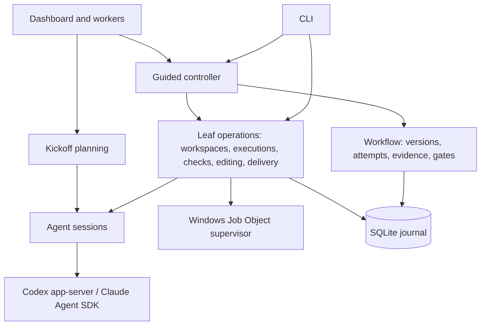

# Architecture

This describes the system as it is built. [DESIGN.md](../DESIGN.md) records product intent,
[WORKFLOW.md](WORKFLOW.md) describes automatic-mode behaviour in detail and [PLAN.md](PLAN.md) lists
the next changes. Archived checkpoint notes, with more protocol detail and their original rationale,
are in [history/ARCHITECTURE-CHECKPOINTS.md](history/ARCHITECTURE-CHECKPOINTS.md).

## Invariants

These hold across every component. Changes that weaken them are bugs.

- **The controller owns truth.** Task state lives in the SQLite journal and changes only through
  controller code. Agent replies, dashboard requests and CLI input are proposals that the controller
  validates. A model reply alone cannot pass a gate or complete a task.
- **Evidence is artifact-bound.** Every check, review, assessment and delivery names the exact
  requirement version, attempt and content digest it applies to. Changing the content invalidates
  earlier evidence; a newer failed or pending result is never hidden by an older pass.
- **Unknown is never success.** Missing output, an unconfirmed process exit, an unknown token count
  or an unverifiable process identity is recorded as unknown and blocks progress where proof is
  required.
- **No replay of uncertain dispatch.** Once a provider turn, command or Git write may have started,
  it is never automatically repeated. Recovery reconciles what happened from durable records and
  receipts, or stays blocked.
- **State and journal move together.** Every state change and its events are written in one `BEGIN
  IMMEDIATE` transaction.

## Components

The guided controller (`orchestration/guided/`) is a sequential state machine over leaf operations. Each
leaf is independently durable and recoverable, and the low-level CLI commands call them directly.

## From request to plan

A **kickoff** (`orchestration/kickoff.ts`, prompts in `orchestration/prompts/planner.ts`) is a planning conversation
stored as a session with `kickoff.*` events.
The planner receives the pinned base commit, approved reference folders and the repository-read
tools; it cannot edit files or run commands. It asks structured questions for consequential
ambiguity and finally returns a JSON guided plan. Planning answers bind to the displayed turn and
questions. Changing hints or references invalidates an earlier proposal. No provider call is spent on
naming: until a plan exists the sidebar shows a short title derived from the request (its first
sentence or line, without control characters or markup delimiters, at most 60 characters at a word
boundary; `orchestration/task-title.ts`), and then the latest proposed plan's `brief.title`.

Converting a proposal creates an unapproved guided task. `domain/guided-plan.ts` normalizes the plan once
and hashes it into an approval digest covering the brief, slices, file scopes, preparation,
validation and acceptance commands, expected output, providers, models, workflow and review
policies, the selected quality passes as full definitions, selected context, references and delivery
messages. Approval must name both the exact
requirement version and that digest. The controller, not the planner, decides repository, base,
workspace adapter and providers.

Plan validation simulates file existence through the ordered slices: edits and deletions must target
existing paths, creations must be absent (including Windows case collisions), and deleted paths
cannot be recreated later. Review must use the other provider from implementation.

## Workflow model

`domain/workflow.ts` holds the task record. A **brief** has a title, outcome, distinct criteria, plan and
optional 1 to 64 ordered **slices**, each naming the exact task criteria it delivers. Slices must
cover every criterion; the final slice is verified against all of them.

| Concept | Meaning |
| --- | --- |
| Version | Incremented on revision. Approval names one version |
| Attempt | One implementation try, with a fresh id; retries clear current evidence |
| Evidence | `quality` (naming its quality pass), `validation`, `review` or `verification`, each `passed`, `failed` or `skipped`, with source `controller`, `agent` or `synthetic` |
| Gates | The latest evidence of each kind for the current attempt and artifact must pass, including a `quality` assessment of each selected lens (the plan's lenses for a guided task, `simplification` for a low-level task), all active criteria must be mapped, and pending decisions must be accepted |
| Slice progress | Delivery of an intermediate slice records its commit, advances the index and clears the attempt |

Task phases are `draft`, `ready`, `running`, `stop_requested`, `recovery_required`, `stopped`,
`failed`, `awaiting_verification`, `awaiting_decision` and `complete`. Synthetic evidence is
accepted only on tasks permanently marked synthetic (the demo).

## Guided state machine

The guided state is saved in the task record. It refers to the current repository snapshot by its
artifact digest with a small summary (head, instructions digest, file count, changed paths); the
snapshot itself is written once to the content-addressed `snapshots` table and read through
`orchestration/guided/snapshots.ts`, so a state change never re-serialises file inventories, diffs or
the Git index. Evidence binding still compares the same digests. Each step journals its intent
(`guided.step_requested`) with the known result ids and the controller identity before calling a
leaf operation, then settles by adopting exactly one new result that matches that origin and
request.

| Stage | Handler (`orchestration/guided/stages/`) | Work |
| --- | --- | --- |
| `workspace` | `workspace.ts` | Create the task worktree (Git or Orca) |
| `execution` | `execution.ts` | Create the implementation execution and session, resuming the slice conversation when allowed |
| `preparation` | `preparation.ts` | Optional approved restore command, before scope |
| `scope` | `scope.ts` | Snapshot, verify size limits and build the exact edit policy |
| `implementation` | `implementation.ts` | Supervised native editing by the implementer |
| `quality_pass` | `quality-pass.ts` | Each selected edit quality pass, once per slice, as a scoped implementer turn |
| `refresh` | `preparation.ts` | Optional preparation again after editing, limited to the slice's file scope |
| `validation` | `checks.ts` | Run the approved validation command |
| `submission` | `submission.ts` | Submit the implementation with the latest passing check |
| `review_execution` | `execution.ts` | Create the review (or arbitration) execution |
| `review` | `review.ts` | Independent artifact review by the other provider |
| `assessment` | `assessment.ts` | Record one quality lens assessment per step until every selected lens is recorded |
| `verification` | `checks.ts` | Run acceptance against the active criteria |
| `delivery` | `delivery.ts` | Verified local commit, then the next slice or `complete` |

Each handler has three parts: the result ids that already exist before dispatch, `perform` (dispatch
the leaf operation) and `settle` (adopt the result). `settle` returns a typed outcome (`advance`,
`wait` for a person, `stop` as blocked, `missing` result, or `rerouted` when a repair or arbitration
already sent the task back), and the controller (`controller.ts`) applies it as one journaled
change. The controller owns runner ownership, the drive loop, retry, recovery and revision; the exact
leaf requests that a step dispatches and later requires its result to match are built in one place
(`specs.ts`), and every agent prompt is in `prompts.ts`. Structured values are compared with
`domain/deep-equal.ts` (order-insensitive, `undefined` treated as absent, as in the stored JSON).

Statuses are `draft`, `ready`, `running`, `awaiting_scope`, `awaiting_assessment`,
`awaiting_answer`, `blocked`, `recovery_required` and `complete`.

In **automatic** mode (the default for new plans) scope is authorized by plan approval, review
follows submission, and the reviewer's verdict on each selected quality lens becomes agent evidence
at `assessment` before verification; a failed lens counts as a blocking finding. Edit quality passes
run between `implementation` and validation on the slice's first successful implementation only
([quality passes](WORKFLOW.md#quality-passes)). Ordinary validation and acceptance failures return to
implementation with their evidence within `workflowPolicy.repairRounds`; blocking review findings
use the review repair allowance and then an optional fresh arbitrator. A repair that leaves the
failing artifact unchanged stops early. In **supervised** mode the controller stops at
`awaiting_scope` for file authorization and at `awaiting_assessment` after submission for one human
quality assessment covering every selected lens (skipped when none is selected), then reviews; failed checks stop for a manual retry. The mode is part of
the approved plan and changes only through a revision. Details are in [WORKFLOW.md](WORKFLOW.md).

Every stop records a typed reason next to the human-readable note: `stopReason: { code, message, at }`
on the guided state, and `reasonCode` on the journal event that made the change. It is set exactly
while the status is `draft`, `awaiting_*`, `blocked` or `recovery_required`, and cleared whenever
work resumes. The codes are listed and documented in `orchestration/guided/stop-reasons.ts`: waits
(`APPROVAL_REQUIRED`, `SCOPE_AUTHORIZATION_REQUIRED`, `ASSESSMENT_REQUIRED`, `AGENT_QUESTION`, ...),
settled failures (`PREPARATION_FAILED`, `CHECKPOINT_CHANGED`, `QUALITY_PASS_FAILED`, `CHECK_TIMEOUT`,
`CHECK_NO_PROGRESS`, `CHECK_REPAIR_EXHAUSTED`, `REVIEW_MISSING_LENS`, `REVIEW_REPAIR_EXHAUSTED`,
`ARBITRATION_UNRESOLVED`, `DELIVERY_FAILED`, ...)
and results that cannot be adopted (`RESULT_MISMATCH`, `OPERATION_NEEDS_RECOVERY`,
`SETTLEMENT_UNCONFIRMED`, ...). A failure without a specific code is `UNEXPECTED_ERROR` before dispatch
or `RECOVERY_REQUIRED` after it.

A blocked validation or acceptance check whose stop is an infrastructure problem (`CHECK_TIMEOUT`,
`CHECK_INTERRUPTED`, `CHECK_EXIT_UNCONFIRMED`, `CHECK_OUTPUT_UNAVAILABLE` or `CHECK_ERROR`) and whose
retained record proves a settled process tree can be rerun with `GuidedTasks.rerunChecks`
(`orchestration/guided/rerun.ts`): the same check spec on the same execution and attempt, after a
fresh snapshot confirms the artifact is unchanged, with no agent turn
([rerun checks](WORKFLOW.md#rerun-checks)).

One guided controller runs per journal at a time. Its ownership has no expiry and is kept across an
uncertain shutdown. Stop requests are persisted and forwarded as an `AbortSignal` to the running
leaf.

## Persistence

`persistence/store.ts` uses Node's built-in SQLite with WAL, `synchronous=FULL`, foreign keys and a five-second
busy timeout. There is one schema, version 1, with thirteen tables and no migrations. A new or empty
file gets the schema; any other version, or a version 1 file missing a table, is refused with a
clear error after a read-only inspection, so the file is never modified. The default journal is
`grampus.sqlite` in the data directory.

| Table | Contents |
| --- | --- |
| `tasks`, `events` | Task JSON state (including guided state and slice progress) and its ordered journal. An indexed generated column holds the guided runner's ownership token, so claiming the runner never parses other tasks |
| `snapshots` | Repository snapshots referred to by guided state, keyed by artifact digest and written once |
| `sessions`, `session_events` | Agent conversations, kickoffs and their events (prompts with their usage stage, tool calls, coalesced output, usage, replies) |
| `workspaces`, `workspace_events` | Worktree reservations, identities and lifecycle events |
| `executions`, `execution_events` | Immutable task/version/attempt/workspace/session bindings with a role and a usage stage |
| `execution_leases` | At most one current owner per workspace |
| `checks` | Command, before/after snapshots, process identities and result |
| `implementations` | Edit policy, dispatch boundary, process proof and snapshots per editing turn |
| `deliveries` | Checked snapshot, commit request, dispatch boundary and accepted commit |
| `health` | The latest integration health result (one row); informational, never evidence |

State is loaded from snapshots rather than rebuilt from events. History is append-only through the
application interface. Deletion writes a tombstone (`orchestration/task-lifecycle.ts`); it never removes
workspaces or history. Full check output and supervisor receipts live beside the journal in
`<journal>.checks/`.

Streamed provider text is display-only and is not journaled chunk by chunk.
`execution/output-buffer.ts` holds a run's `output.delta` text in memory and appends it as one
`output.delta` session event at most every `outputFlushIntervalMs` (1 s) or `outputFlushBytes`
(8 KiB), whichever comes first, and always before any other event of that run, before a stop request
and before the run's result, so journal order is unchanged. A flush is a single insert that never
rewrites the session record. A crash loses at most one interval of streamed text; results, usage,
tool decisions and every other event are journaled as they happen.

## Workspaces

`repository/workspaces.ts` reserves a task workspace in the journal before asking Git or Orca to create
anything, pins the base ref to a commit and never replays creation.

- **Git:** `git worktree add` on branch `grampus/<task-id>`, locked with the workspace id, at a
  destination outside existing worktrees. Inherited `GIT_*` variables are stripped and automatic
  CRLF conversion is disabled for the checkout command only.
- **Orca** (`repository/orca.ts`): one `worktree create` call with `--no-parent --setup skip`, without
  launching an agent. Grampus records Orca's worktree id and stable instance identity, and every
  later operation re-verifies that identity. Orca owns the worktree lifecycle; Grampus never edits
  Orca metadata or applies raw Git lifecycle writes to Orca worktrees. Remote Orca hosts are
  refused.

Recovery adopts a created worktree only when its identity, clean pinned base and approved version
all match. An unused failed standalone reservation can be released (metadata only). Worktree removal
is not automated.

## Executions, sessions and leases

An **execution** (`execution/executions.ts`) binds one attempt to a workspace and a fresh Grampus session in a
given role, with a usage stage fixed at creation: `implementation` for the first implementation of a
slice, `repair` for any later implementation attempt in the same slice (automatic repairs and
explicit retries), `review`, or `arbitration` for a fresh arbitrator. Every turn or operation claims the workspace lease (`execution/execution-state.ts`) under a run id
and lease kind (`conversation`, `snapshot`, `check`, `submission`, `simplification` (used by every
quality lens assessment), `verification`, `completion`, `implementation` or `delivery`). The lease is held until process exit is confirmed.
Session state, task outcome, journal events and lease release settle in one transaction, fenced on
the exact run id. There is no expiry or heartbeat takeover. Leases coordinate Grampus processes
sharing one journal; they do not lock out editors or other tools.

A session (`execution/sessions.ts`) records its provider, the provider runtime it was created for
(executable path, reported version and, for Claude, the pinned SDK version), provider conversation id,
model, phase and the active run's controller and provider process identities. Each `turn.requested`
event names the turn's stage: its execution's stage, `quality_pass` for an edit quality pass in the
implementation conversation, or `planning` for a turn outside any execution. Each turn starts an owned provider process,
runs one turn and waits for exit. Within a slice, retries create new execution and evidence records
but may resume the same provider conversation; `execution/session-context.ts` starts a fresh one at the
configured turn or context-size threshold, or when the Codex toolset changed. Implementation and
review never share a conversation, and arbitration always starts fresh.

## Agent adapters

Both adapters return the same validated reply: `kind` is `message`, `question` or `review`, with
question ids, findings (`blocking` or `suggestion`, with evidence) and, for reviews, one
assessment per requested quality lens (`lenses`). Malformed replies fail the turn. The reply contract
is pinned in `providers/reply-schema.ts`; see [External boundaries](#external-boundaries) for how
provider protocol messages are validated.

- **Codex** (`providers/codex.ts`) runs `codex app-server` over stdio JSON-RPC
  (`process/process.ts`), forcing ChatGPT login and refusing other authentication. The executable is
  the native `codex` on PATH or `GRAMPUS_CODEX_COMMAND`, resolved by `providers/executables.ts`; the
  working directory is never searched and npm script shims are never run. When the first `codex` on PATH
  is an npm shim (`codex.cmd`), the native `codex.exe` its package vendors for this architecture is used
  (source `npm-vendored`), found by fixed paths under the shim's `node_modules/@openai`: the platform
  package nested in `@openai/codex` or flattened beside it, binary in `vendor/<target>/bin` or
  `vendor/<target>/codex`; npm's `.codex-XXXX` staging folders are ignored. Threads start or resume
  with `approvalPolicy: untrusted` and a read-only sandbox, and the controller verifies both before
  inference. Repository tools are app-server dynamic tools. File edits arrive as
  `item/fileChange/requestApproval`; the controller checks each patch against the active turn and
  the exact edit policy, journals the decision and grants single-use approval. Command execution
  requests are declined. Codex is not version-pinned.
- **Claude** (`providers/claude.ts`) uses the pinned `@anthropic-ai/claude-agent-sdk` and its bundled
  executable, unless `GRAMPUS_CLAUDE_COMMAND` overrides it. `providers/executables.ts` resolves the
  bundled executable from the SDK's platform package the way the SDK does, and the adapter passes that
  exact path to the SDK, so `doctor` reports the program a turn starts. It requires a first-party subscription
  and no API key source. Editing turns get native `Read`, `Edit` and `Write`, which a `PreToolUse`
  hook and permission callback restrict to authorized paths, plus the repository MCP server
  (`providers/claude-repository.ts`) and, when deletions are approved, an in-process delete tool
  (`providers/claude-files.ts`). `ToolSearch` and external MCP tools are allowed only during an active turn.
  Tool decisions are journaled before permission is granted.

Neither provider gets a shell. Configured MCP integrations stay available (`providers/integrations.ts` carries
source-project connections into worktrees); external actions need explicit task authorization.

## Repository access

`repository/repository-tools.ts` implements one controller-owned toolset for both providers:
`grampus_list_files`, `grampus_read_file`, `grampus_search`, `grampus_read_changes`,
`grampus_read_check`, `grampus_read_dependency` and `grampus_suggest_reference_folder`. Planning
reads immutable Git blobs at the pinned commit; execution reads the captured workspace inventory and
allows current bytes only for authorized paths; review reads the submitted snapshot. Handlers
recheck turn ownership and journal bounded results. Reference folders (`repository/reference-folders.ts`, up to
16) are read-only roots, pinned Git subtrees or hashed plain-folder inventories. Read access never
implies write scope. Budgets are in [REPOSITORY-CONTEXT.md](REPOSITORY-CONTEXT.md).

## Artifacts, checks and the Windows supervisor

A repository snapshot (`repository/artifacts.ts`, `repository/repository-evidence.ts`) hashes HEAD, index entries, the raw
bytes of tracked and non-ignored untracked files and discovered `AGENTS.md`/`CLAUDE.md` instructions
into a SHA-256 artifact digest. A stable capture takes two matching reads. Git plumbing reads raw
blobs without filters or diff drivers. Ignored dependencies, environment and external services are
outside the digest. Symlinks and submodules are refused.

Checks (`verification/checks.ts`) run an approved executable with literal arguments at the workspace root, with
no shell. The request and before-snapshot are durable before dispatch. On Windows, a hidden detached
Node host (`process/check-host.ts`) runs PowerShell, which compiles `process/native/check.cs` and starts the tool
directly inside a Job Object (kill-on-close, no breakaway). After the root exits the supervisor
waits up to 100 ms for the job to drain, terminates any remaining descendants and confirms zero
active processes before writing a flushed receipt. The tool's stdout and stderr are inherited file
handles on the durable logs in the receipt directory, so output reaches the logs as the tool writes it
and a check stopped by its timeout keeps everything it printed until then (a tool that buffers its
own output, for example a script that captures child output to print at the end, loses that buffer).
The supervisor reports the tool's elapsed time in its result and receipt (`elapsedMs`). A check passes
only with exit code zero, a settled job and unchanged repository inputs. A timed-out check stops with
`CHECK_TIMEOUT` and a note such as `Validation 'Tests' exceeded its 120 s limit after 120.4 s; partial
output retained (5120 bytes).` Timeouts are 100 to 600000 ms; output above 2 MiB
combined stops the job; the journal keeps a 64 KiB preview per stream and full logs stay on disk
(`verification/check-output.ts`). Acceptance (`domain/acceptance.ts`) also compares approved stdout, JSON, stderr and
file observations against retained output and the after-snapshot. Preparation reuses the same runner
with its own purpose and cannot supply validation or acceptance evidence.

Native editing (`execution/implementations.ts`, `execution/implementation-worker.ts`, `execution/edit-policy.ts`) runs the
provider in the same supervised process tree. After confirmed exit, only the authorized file
contents and named creations and deletions may have changed; HEAD, index, other files, modes and
instructions must be unchanged. Scope covers regular UTF-8 files up to 1 MiB each and 4 MiB per
slice, at most 64 paths.

## Delivery

Delivery (`execution/deliveries.ts`, `execution/delivery-worker.ts`, `execution/delivery-operation.ts`, `repository/delivery-git.ts`)
requires every gate on the current artifact. The supervised worker stages the checked worktree,
compares staged paths, modes and raw blob hashes with the checked snapshot, then commits with the
repository's own identity, hooks and signing, adding a unique `Grampus-Delivery` marker. The
controller verifies parent, marker, tree, index, working files and instructions before recording
delivery and slice progress in one transaction. `mode: "no_change"` proves an already satisfied
outcome without staging. For Orca, the instance identity is checked before staging, before
committing and after. Failures keep the index, files and any commit for inspection; there is no
reset, amend or push.

## Recovery

Recovery is explicit (`task-recover` and the per-operation `*-recover` commands) and follows the
same rules everywhere:

- The previous controller must be absent on the same host. Windows process creation times
  (`process/process-identity.ts`) distinguish a recycled PID from the original owner; unknown or live owners
  block recovery.
- A recorded pre-dispatch boundary proves nothing was launched and can be released without a
  receipt.
- After dispatch, a supervised operation needs a matching terminal receipt (`verification/check-recovery.ts`).
  PID absence alone never proves settlement.
- Settled results are adopted only if their origin and request match. Lost successes are recorded as
  interrupted, never accepted.
- Recovery never sends a provider turn, reruns a command or repeats a Git write, and does not start
  the next step automatically.

## Dashboard server

`server/ui-server.ts` serves the dashboard client and a JSON API over the same journal; it is not a
second workflow engine.

- The client is the Vue 3 + Vite + Nuxt UI application in `web/`, built to `web/dist` (`npm run build`
  builds the server and then the client; the installer builds it inside each snapshot).
  `server/static-client.ts` serves `index.html` at `/`, `favicon.svg` and the hashed bundles under
  `/assets/`, with an explicit content type per extension. Request paths are decoded and checked
  segment by segment and the resolved file must stay inside the client folder; anything else is 404.
  Without a build, `/` answers 503 with a page saying how to build it, and the API keeps working.

- Listens on `127.0.0.1` only, port 4317 installed or 4318 development unless `config.json` sets
  `dashboardPort` ([CONFIGURATION.md](CONFIGURATION.md)).
- A random 32-byte token per launch is passed in the URL fragment and required as a bearer token on
  every API call (constant-time comparison).
- The `Host` header must match and any `Origin` must equal the local origin.
- Strict CSP (`default-src 'none'`, self-hosted scripts and styles only, `frame-ancestors 'none'`),
  `nosniff`, `no-referrer` and `no-store` on every response, the client's files included. Assets are
  local; there is no CDN. The client is built for this policy: no inline scripts or styles, no runtime
  style injection (the Nuxt UI colour plugin is not installed; `web/src/theme/theme.css` declares its
  variables), icons bundled at build time and system fonts only.
- Every task decision carries a **decision key** built from version, digest, status, stage,
  artifact, instructions digest, execution ids, the failed check on display and, for answers, the
  exact turn and questions. Commands that need one take its SHA-256 digest (`task-rerun-checks`). The
  controller rechecks it, so a stale tab cannot approve a changed plan or authorize different bytes.
- Actions run in separate Node worker processes (`server/ui-worker.ts`) using the same controller, so
  restarting the server is never evidence that work stopped. A worker that fails reports its message
  and, for a typed stop, its reason code as a JSON line on stderr; the server journals it as
  `dashboard.action_failed` (action, bounded plain-text note, reason code, exit code) on the task or
  planning conversation, so the failure survives a restart. Settled jobs are dropped from the
  in-memory job list after five minutes (`serverLimits.settledJobRetentionMs`).
- `GET /api/health` returns the stored [health](#health-and-stalls) with version warnings;
  `?refresh=1` runs the checks first (the Health screen's **Check again**, which then rereads the
  overview). Besides `/api/v1/`, the client reads only `GET /api/tasks/:id/report` and the paged
  `GET /api/tasks/:id/check-output`, and posts lookups (`/api/repositories/inspect`,
  `/api/repositories/files`, `/api/references/suggest`), creation (`/api/kickoffs`, `/api/tasks`) and
  the action routes; their response shapes are typed in `server/api-types.ts` too. The legacy polls
  (`/api/state`, `GET /api/tasks/:id`, `/api/tasks/:id/events`) were removed with the legacy client.
- Every route parses its body with its own schema (`server/api-schemas.ts`); unknown fields are ignored
  because the browser posts whole forms. Failures map to statuses by error class
  (`server/errors.ts`): 400 with field-level `issues` for an invalid body or a controller refusal,
  404 for an unknown route or record, 409 when the decision key, turn key or proposal digest no
  longer matches the current state or an action is already running, 413 and 415 for oversized or
  non-JSON bodies. A stale key that orchestration itself detects inside its transaction (a race after
  the server's check) is still a plain refusal (400).
- Read routes under `/api/v1/` serve the [view model](#dashboard-view-model-and-api-v1). Every route
  answers every failure, including 401 and 403, with the typed envelope
  `{ error: { status, code, message, issues? } }` (`ErrorV1`, `errorResponse`).

## Dashboard view model and API v1

The server decides everything the dashboard presents; the client draws it. `server/api-types.ts` pins the
v1 response types (type declarations only, no imports, so `web/` imports it with `import type` through a
relative path and `vue-tsc` checks the client against it). `server/view-model/` holds pure functions from
journal facts and the dashboard's in-memory state (workers, stalls, available quality passes; `ViewContext`)
to those DTOs; nothing there writes.

| Route | DTO | Contents |
| --- | --- | --- |
| `GET /api/v1/overview` | `OverviewV1` | Application, health summary (`ready`, `degraded`, `blocked`, `unknown` with a reason naming the integration and capability), runner pool (guided runners owned and `maxConcurrentTasks`), the attention queue across tasks and planning conversations (kind, one-sentence reason, stop reason code, resolving actions; most urgent first), task and planning summaries, recent verified deliveries with an evidence summary |
| `GET /api/v1/tasks/:id` | `TaskDetailV1` | Header (status, label, one-sentence explanation, note in UI language, next step: automatic, human with action ids, or none), workflow strip, current activity (no percentages), decisions, results (criteria coverage, checks with sizes for paging, findings, lens assessments, edit passes, commits, unresolved items), usage, details (approval digest, artifact, changed paths, plan, scope file contents only while authorization is pending, references, timeline head) |
| `GET /api/v1/tasks/:id/timeline?cursor=&limit=` | `TimelinePageV1` | Journal events newest first: type, time, human summary, note, reason code; `cursor` is the journal sequence to page before |
| `GET /api/v1/tasks/:id/changes?path=` | `ChangeV1` | One retained change, before and after |
| `GET /api/v1/kickoffs/:id` | `KickoffDetailV1` | Discussion (answers as text, plan replies described), pending questions with suggestions, proposal and digest, context, references and suggestions, planner activity, actions |

- **One status vocabulary.** `working`, `awaiting_human`, `verified`, `failed`, `blocked`, `unknown`,
  `idle`, `complete` and `stopping` (`view-model/status.ts`). Every `StopReasonCode` has a label, a
  one-sentence reason, an attention kind and a presentation status in one exhaustive table, so a new code
  does not compile until it is described. Settled failures are `failed`; infrastructure stops (timeouts,
  unconfirmed exits) and recovery are `blocked`; a stale plan is `unknown`. A controller that owns a
  running task but was not started by this dashboard is `working` (workers outlive a dashboard restart).
- **Trustworthy evidence labels.** Workflow stages, criteria, checks and lenses say who established a
  result: `controller-verified` (checks, acceptance, the verified commit), `agent-reported` (implementation,
  edit passes, the independent review and its lens verdicts) or `human-assessed` (a supervised assessment).
  A stage stopped before a result is `unknown`, never passed.
- **Actions in one place.** `view-model/actions.ts` decides which actions exist for a state and stop reason,
  their labels, consequences, the decision key they carry (`expected`), the form they need and why one is
  disabled, and documents the mapping from `ActionView.id` to the existing POST route and body. Each
  `ActionView.request` is the exact request to send; forms list fields whose values are written at a JSON
  pointer in the body (answers at `/answers/<id>`, a revision at `/plan/...`), so the client assembles no
  business data. The server still re-checks every key.
- **UI language once.** Controller notes are rewritten on the server: control characters removed and CLI
  command names replaced (`task-retry` becomes "a repair attempt", `task-authorize` "the file authorization
  button" and so on).
- **Bounded and cached.** Journal facts are cached by journal revision (`viewModelLimits.cachedViews`);
  DTOs are rebuilt per request because workers and stalls change without a journal write. Responses never
  carry file inventories, snapshots or raw check output: check output stays on the paged
  `/api/tasks/:id/check-output` route and file contents on `/changes`.

## External boundaries

Every value that crosses a process, file or network boundary is parsed with a zod schema beside the
module that owns the contract, and a mismatch is a categorised `BoundaryError` (`process/boundary.ts`)
carrying its kind, source and field-level issues, never an `undefined` discovered later. Issues name
fields, not values, and are bounded.

| Boundary | Schema module | On mismatch |
| --- | --- | --- |
| Codex app-server responses and notifications | `providers/codex-protocol.ts` | `ProtocolError` (provider, method). Control notifications and responses fail the turn; malformed progress or usage is journaled as `protocol.malformed` and skipped; unknown methods are journaled once per session as `protocol.unrecognized` with a sanitised excerpt and ignored |
| Claude Agent SDK messages | `providers/claude-protocol.ts` | `ProtocolError` for init and result; unknown message types are `protocol.unrecognized`. The known type list is checked against the pinned SDK at compile time |
| Structured agent replies | `providers/reply-schema.ts` | `agent-reply` error; the turn fails |
| JSON-RPC envelope | `process/process.ts` | The transport fails |
| Supervisor output, check host request, completion receipts, process identity | `process/supervisor-protocol.ts` | Supervisor protocol failure (`supervisor_lost`), refused receipt, or an unknown process observation |
| Worker request and result files | `execution/worker-files.ts` | The worker stops before any provider or Git work; a bad result is the run's error |
| Stored integration health | `health/health-record.ts` | `journal-record` error naming the `health` table |
| Journal records owned by the execution layer | `persistence/records.ts` | `journal-record` error naming the table. Records are validated in place so their stored bytes, which fences compare, are unchanged. Task and guided state records are validated by domain and orchestration |
| Orca CLI JSON | `repository/orca-protocol.ts` | `orca-output` error naming the command |
| Git plumbing output | `repository/git-output.ts` | `git-output` error |
| Repository tool arguments from agents | `repository/repository-tool-arguments.ts` | The tool call fails with a message the agent can act on |
| MCP configuration files | `providers/integrations.ts` | The file is refused; unsupported server transports are not carried over |
| Dashboard request bodies and worker requests | `server/api-schemas.ts` | 400 with issues |
| CLI options and input files | `cli-input.ts` | `cli-input` error naming the argument or file |

Unrecognised-message excerpts are bounded by `boundaryLimits` in `config/limits.ts`: strings are
shortened, secret-looking keys redacted, nesting and entries capped and control characters removed.

## Configuration

Fixed bounds live in `config/limits.ts`, each documented with what it bounds. Operational values
(dashboard port, usage polling, streamed output batching, defaults for new plans) live in `config/settings.ts`; an optional
`config.json` in the data directory overrides them and is validated strictly. The CLI loads it once at
startup and passes the loaded values to dashboard and implementation workers in their requests.
Defaults are copied into a plan when it is created, so settings never change an approved plan or
recorded evidence. Details are in [CONFIGURATION.md](CONFIGURATION.md).

## Usage accounting

Providers report cumulative usage per provider session: input, output, cache read
(`cachedInputTokens`), cache write (`cacheWriteInputTokens`: Claude's cache creation tokens, Codex's
`cacheWriteInputTokens`) and, for Claude only, estimated USD. Claude usage is sampled every 15 seconds
(`usagePollIntervalMs`) during a turn and replaced by the final result; interim snapshots are marked
incomplete. A failed Claude result whose counters are all zero (the SDK documents zeroed crash and
startup-error results) reports no usage rather than zero. Claude's estimated USD never becomes billed
cost, which is always unknown.

**Counters across resumed sessions.** Grampus starts a new provider process for every turn and resumes
the conversation. Both providers continue their counters across that resume rather than restarting
them per process:

- Claude Agent SDK 0.3.302: the `result` message's `modelUsage` and `total_cost_usd` are documented as
  cumulative for the query and "a resumed or forked session continues from the totals its transcript
  saved, when it has them (so the first result already carries the earlier turns)"; a mid-session
  `/clear` resets them. A live check on 19 October 2026 (one turn, then two separate processes each
  resuming the session for one turn) confirmed it: each process's usage sample before its turn already
  showed the previous total, and each result continued from it. The usage endpoint polled during a
  turn reports the same session totals.
- Codex app-server 0.163.0: `thread/tokenUsage/updated` `total` is per thread. A live check (a turn,
  then `thread/resume` in a new app-server process and a second turn) showed the restored total
  reported straight after the resume and the next turn continuing from it; none of 494 local Codex
  rollout files showed a thread total decreasing.

`reporting/task-usage.ts` therefore turns each provider session's snapshots into per-turn usage: a
turn adds its latest values minus the session's previous known totals. When a turn's first
observation is below the previous total in any field, its counters restarted (a transcript without
saved totals, or a reset), and its own values are its usage instead, so both behaviours count every
token once. A turn without observations has unknown usage and marks the totals partial; the next
observed turn of the same provider session also carries its spend, so provider totals stay right
while that stage's figure absorbs it. A restarted turn whose first observation already exceeds the
previous totals in every field cannot be told apart from a continuing one and would be undercounted;
neither pinned provider restarts its counters on resume.

**Stages and counters.** Each turn is attributed to the stage recorded on its `turn.requested` event
(`planning`, `implementation`, `quality_pass`, `repair`, `review`, `arbitration`). Per stage and
provider the report, `task-show` and the task poll show turns, failed and interrupted turns, unsettled
turns, wall time (turn request to recorded result, settled turns only) and the usage fields; per task
they show the provider totals, total turns, repair attempts (implementation executions with stage
`repair`) and human interventions after approval. Interventions count these guided events after the
first `guided.approved`: `guided.answers_supplied`, `guided.scope_authorized`,
`guided.assessment_supplied`, `guided.retry_requested`, `guided.preparation_retry_requested`,
`guided.checks_rerun_requested`, `guided.recovery_requested`, `guided.workspace_released`,
`guided.revised`, `guided.stop_requested` and later `guided.approved` (approvals of revised plans).
Continuing a stopped task with `task-run` and low-level CLI commands are not counted. Unknown values
stay null and never count as zero; a total that misses some turn's measurement is marked partial.

## Health and stalls

Health is observation, not evidence: nothing in the workflow reads it to pass a gate, and the adapters
still refuse what they cannot use when a turn starts.

- **What runs is what is checked.** `providers/executables.ts` resolves the Codex and Claude programs
  for the adapters and for `doctor` alike. `doctor` (`health/doctor.ts`) starts the Codex app-server
  with the adapter's own arguments and environment and runs the adapter's handshake (`initialize` with
  `experimentalApi`, `account/read`, then `mcpServerStatus/list` without a thread); for Claude it
  creates a real `ClaudeSession` with the adapter's options and asks only control requests
  (`accountInfo`, `mcpServerStatus`). No thread or turn is ever started, so inference is always
  `untested`. Git, Node (`node:sqlite`, engine version), Windows PowerShell with the supervisor files,
  and Orca (`worktree current` only with `--orca`) are checked too.
- **Typed, stored result.** `health/health-record.ts` pins the report: per integration a status, the
  executable, version, SDK version and fingerprint, and capability rows (`executable`, `version`,
  `auth`, `handshake`, `mcp`, `inference`, `sqlite`, `supervisor`) with a sanitised, bounded detail.
  Statuses are `healthy`, `failed`, `untested`, `not_configured`, `auth_unavailable` and
  `temporarily_unavailable`; an integration takes its worst tested row. The latest report is the
  single row of the `health` table, written by `grampus doctor`, by the dashboard at start when the
  stored result is older than `healthCheckIntervalMs`, by a dashboard run worker before a guided run
  under the same rule, and by **Check again** (`GET /api/health?refresh=1`).
- **Version change warning.** Each session records the provider runtime it was created for. The
  health view (`health/health.ts`) compares the current Codex version, Claude version and Agent SDK
  version with the latest session of each provider on the task of the most recent accepted delivery,
  and warns, for example, "Codex changed from X to Y since the last successful delivery; capabilities
  are untested on this version". It never blocks: treat it as a prompt to run a small task first and
  to re-record the protocol fixtures if the provider changed. Delivering on the new version clears it.
- **Stalls.** Guided turns have no deadline. The dashboard server runs `health/stalls.ts` every
  `stallLimits.scanIntervalMs`: a running session or check of a guided task whose own journal (any
  session event, or any execution event of a check) and, for a check, its output logs have been silent
  for `stallWarningMs` is shown as `stalled` on the task summary and poll, and one
  `guided.stall_detected` task event is appended per silence (it names the activity it measured from,
  so a rescan or restart does not repeat it). Nothing is stopped, interrupted or recovered; the user
  decides with the existing stop control.
- **Protocol drift canary.** `test/fixtures/protocol/` holds a real, sanitised Codex handshake capture,
  a constructed Codex conversation turn and a constructed Claude SDK turn typed against the pinned SDK.
  `test/protocol-replay.test.ts` replays them through the real adapters (`connectCodex` with a
  replaying app-server, `connectClaude` with a recorded query) and asserts the typed events and reply.
  Re-record a fixture when a provider changes; a failing replay names the message that drifted.

## Limits

- Windows only. macOS and Linux supervision and installers are **Planned**.
- One guided task at a time per journal. A small parallel limit is **Planned**.
- No background scheduler, retention cleanup, push or pull request delivery.

## Module map

Paths are under `src/`. Folders group modules by responsibility; they are not strict layers.

| Folder | Files | Responsibility |
| --- | --- | --- |
| `/` | `cli.ts` | Command parsing and entry point (`dist/src/cli.js`, also the installed launcher target); Ctrl+C handling |
| | `cli-input.ts` | Validated CLI option values and input files |
| `config/` | `runtime.ts` | Application root, version, installed or development channel, data directory, update |
| | `limits.ts` | Fixed, documented bounds bound into approval, evidence or recovery; not configurable |
| | `settings.ts` | Operational settings, their defaults and the validated optional `<data directory>/config.json` |
| | `environment.d.ts` | Typed declarations of the environment variables Grampus reads |
| `persistence/` | `store.ts` | SQLite schema, version check, transactions and journal access |
| | `records.ts` | Schemas of the execution-layer journal records, validated on every read |
| | `errors.ts` | `RecordNotFoundError` and `StaleStateError` |
| `domain/` | `workflow.ts`, `workflow-policy.ts` | Briefs, versions, attempts, evidence, gates, slices and completion; workflow policy validation |
| | `guided-plan.ts` | Plan normalization, slice file simulation and approval digest |
| | `quality-passes.ts` | Quality pass definitions, built-ins, plan selection and lens assessments |
| | `acceptance.ts` | Acceptance expectations and observations against retained output |
| | `deep-equal.ts` | Structural equality for stored JSON-shaped records |
| `orchestration/guided/` | `controller.ts` | Guided task controller: public API, runner ownership, drive loop, retry, recovery, revision |
| | `state.ts`, `keys.ts`, `stop-reasons.ts` | Guided state types; decision and question keys; typed stop reason codes |
| | `context.ts`, `specs.ts`, `prompts.ts` | Stage handler contract and result adoption; exact leaf requests; agent prompts |
| | `retry.ts`, `recovery.ts`, `revision.ts` | New attempts and explicit retry checks; leaf recovery; plan revision |
| | `rerun.ts` | Which stopped checks may be rerun without a new attempt |
| | `snapshots.ts` | Snapshot references in guided state and access to the stored snapshots |
| | `stages/*.ts` | One handler per stage (see [Guided state machine](#guided-state-machine)) |
| `orchestration/` | `guided-status.ts` | Task views and next actions |
| | `kickoff.ts`, `prompts/planner.ts`, `planner-progress.ts`, `task-title.ts` | Planning conversations and planner prompts, live planner progress and the provisional title from the request |
| | `task-lifecycle.ts` | Reset and delete with tombstones |
| `execution/` | `sessions.ts`, `session-context.ts` | Conversation turns, recovery and resume-or-fresh decisions |
| | `output-buffer.ts` | Coalescing streamed provider output per run |
| | `executions.ts`, `execution-state.ts` | Execution bindings, leases and settlement |
| | `edit-policy.ts`, `implementations.ts`, `implementation-worker.ts` | Edit scope, patch authorization and supervised editing |
| | `deliveries.ts`, `delivery-worker.ts`, `delivery-operation.ts` | Local commit delivery and verification |
| | `worker-files.ts` | Validated worker request files and implementation results |
| | `agent-timeout.ts` | Opt-in provider deadlines for low-level session and implementation commands; guided turns have none |
| `providers/` | `types.ts`, `index.ts` | Provider contract, reply validation, usage, connector |
| | `reply-schema.ts` | Structured reply, usage and turn result schemas; the provider output format |
| | `codex.ts`, `codex-protocol.ts` | Codex app-server threads, turns, approvals and dynamic tools; the pinned app-server protocol |
| | `claude.ts`, `claude-protocol.ts`, `claude-repository.ts`, `claude-files.ts` | Claude SDK sessions and the validated SDK fields, repository MCP server, scoped delete tool |
| | `integrations.ts` | MCP carry-over into worktrees |
| | `executables.ts` | The Codex and Claude programs the adapters and `doctor` run, and the provider runtime recorded on sessions |
| `repository/` | `workspaces.ts`, `orca.ts`, `orca-protocol.ts` | Git and Orca worktree lifecycle and identity; the pinned Orca CLI JSON |
| | `artifacts.ts`, `snapshot-schema.ts`, `repository-evidence.ts` | Snapshots, artifact digests, instructions and review context |
| | `git-output.ts` | Parsers for the Git plumbing output that snapshots and delivery read |
| | `repository-context.ts`, `repository-tools.ts`, `repository-tool-arguments.ts` | Pinned inventories, cache, the shared agent read tools and their argument schemas |
| | `reference-folders.ts`, `installed-dependency.ts` | Reference roots and dependency source reads |
| | `delivery-git.ts` | Raw Git plumbing for delivery and reconciliation |
| `process/` | `process.ts`, `process-identity.ts` | Shell-free subprocesses, JSON-RPC, process creation times |
| | `boundary.ts` | Categorised boundary errors, schema parsing helpers and sanitised excerpts |
| | `check-process.ts`, `check-host.ts`, `supervisor-protocol.ts` | Supervisor control, its detached host and the pinned supervisor and receipt formats |
| | `native/check.cs`, `native/check.ps1`, `native/process.ps1` | Job Object helper and process identity queries |
| `verification/` | `checks.ts`, `check-evidence.ts`, `check-output.ts`, `check-recovery.ts` | Checks and submission, check feedback, log paging, receipts |
| `reporting/` | `report.ts`, `task-usage.ts` | Markdown report; per-task usage, per-stage counters and interventions |
| `health/` | `doctor.ts` | Inference-free checks of every integration, as a typed report |
| | `health.ts`, `health-record.ts` | Stored health, staleness, the compact view and version change warnings; the pinned health record |
| | `stalls.ts` | Stall detection for running guided sessions and checks |
| `server/` | `ui-server.ts`, `ui-worker.ts` | Loopback dashboard server and action workers |
| | `static-client.ts` | Serving the built client from `web/dist` with a path guard and content types |
| | `api-schemas.ts`, `errors.ts` | Request body and worker request schemas, error-to-status mapping with the typed envelope |
| | `api-types.ts`, `api-v1.ts` | The typed DTOs of v1 and of the lookup and action routes (types only, shared with `web/`); the v1 read routes and their revision cache |
| `server/view-model/` | `overview.ts`, `task-detail.ts`, `kickoff-detail.ts` | Overview with the attention queue; task facts and the task page; the planning page |
| | `actions.ts`, `status.ts`, `workflow.ts` | Which actions exist and why one is disabled; status vocabulary, stop descriptions and UI language; the workflow strip |
| | `usage.ts`, `health.ts`, `plan.ts`, `timeline.ts`, `scope.ts`, `context.ts` | Usage with completeness; the health card; the plan for approval; timeline summaries and paging; scope file contents; the dashboard state the view model reads |
| `probes/` | `*-probe.ts`, `multifile-fixture.ts`, `probe-interruption.ts` | Opt-in live and scale probes and their fixtures |
| | `demo.ts` | Synthetic demo |

The dashboard client is its own npm project in `web/` (paths under `web/src/`), typed against
`src/server/api-types.ts` with `import type` and checked by `vue-tsc`:

| Folder | Files | Responsibility |
| --- | --- | --- |
| `/` | `main.ts`, `App.vue`, `router.ts` | Entry point (token first, then routing), the shell with the overview poll, fragment routes (`#/`, `#/new`, `#/tasks/<id>`, `#/planning/<id>`, `#/health`) |
| | `announcer.ts`, `settings.ts`, `markdown.ts` | Live-region announcements and the shared clock; client timing constants; sanitised Markdown |
| | `mock.ts`, `testing.ts` | Typed DTO fixtures and the fake server for Vitest |
| `api/` | `client.ts`, `usePolled.ts` | Access token, typed requests and `ApiError` (401, stale 409); polling one request at a time, paused while hidden |
| | `actions.ts`, `useActions.ts`, `report.ts` | `ActionView` plus typed drafts to the exact request body (JSON pointer targets); sending actions with requested, stale and refused states; the report download |
| `pages/` | `HomePage`, `NewTaskPage`, `PlanningPage`, `TaskPage`, `HealthPage` | One screen each |
| `components/` | `ActionButton`, `ActionForm`, `FormFieldInput`, `MultiSelectField`, `DecisionCard`, `DecisionQueue`, `AttentionPanel` | Actions and server-described forms |
| | `TaskHeader`, `WorkflowStrip`, `ActivityCard`, `ResultsPanel`, `CheckItem`, `CheckOutput`, `FindingList`, `UsagePanel`, `UsageSummary`, `TaskDetails`, `TimelinePanel`, `ChangesPanel`, `ReportPanel`, `ScopeReview`, `PlanCard`, `PlanSlice`, `CommandDetails` | Task and plan presentation |
| | `DiscussionThread`, `PlanningContext`, `FileSearch`, `StartingFileHints`, `ReferenceFolders`, `ImportPlan` | Planning and new-task pieces |
| | `AppShell`, `AppSidebar`, `HealthIndicator`, `HealthSummaryBar`, `TaskSummaryItem`, `StatusBadge`, `NoticeBox`, `ErrorBanner`, `EmptyState`, `EvidenceSection`, `LogViewer`, `MarkdownView`, `format.ts` | Shell and shared building blocks |
| `theme/` | `status.ts`, `tokens.ts`, `theme.css`, `colorScheme.ts` | Icon, words and colour per status (never colour alone); design tokens; static Nuxt UI variables; light and dark from the system |

