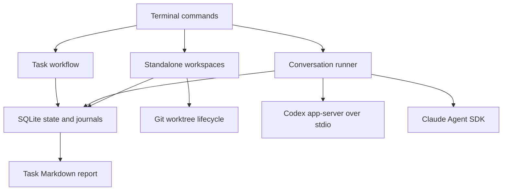

# Architecture and state contracts

This describes the implemented baseline as of 17 October 2026. [DESIGN.md](../DESIGN.md)
defines the intended product; [IMPLEMENTATION.md](IMPLEMENTATION.md) tracks delivery
sequence. Product requirements that appear there are not automatically implemented.

## Components



Tasks and conversations are currently separate records. There is no automatic path
from a conversation reply to task execution, evidence acceptance or completion.
Connecting them with task versions and workspace ownership is the next major step.

| File | Responsibility |
| --- | --- |
| `src/cli.ts` | Parse commands; task and conversation entry points; Ctrl+C handling |
| `src/store.ts` | SQLite schema, transactions, state snapshots and journal access |
| `src/workflow.ts` | Versioned brief approval, attempts, evidence, decisions and completion |
| `src/sessions.ts` | Claim a conversation, persist events, run one turn, stop and reconcile |
| `src/workspaces.ts` | Reserve a task workspace, create a standalone Git worktree, inspect and reconcile |
| `src/agents/types.ts` | Provider contract, reply validation, usage fields and subscription environment |
| `src/agents/codex.ts` | Installed Codex app-server initialization, threads, turns and notifications |
| `src/agents/claude.ts` | Official SDK streaming input, authentication, results and process shutdown |
| `src/process.ts` | Shell-free subprocess execution and bounded JSON-RPC requests |
| `src/doctor.ts` | Local executable/authentication discovery; optional Orca worktree lookup |
| `src/report.ts` | Markdown rendering from a task snapshot and its journal |
| `src/demo.ts` | Explicitly synthetic workflow demonstration |
| `src/probe.ts` | Opt-in live provider probes across separate controller processes |

The runtime is Node.js 24 or newer with TypeScript compiled to JavaScript. SQLite
and the test runner come from Node. Claude's SDK is the sole direct runtime npm
dependency and is pinned; it brings transitive dependencies and a native executable.
Codex and optional Orca are discovered separately. No browser server or installer
has been built.

## Persistence

Schema version 3 contains six tables:

| Table | Contents |
| --- | --- |
| `tasks` | Task id and current JSON state |
| `events` | Ordered task events with requirement version, timestamp, type and JSON data |
| `sessions` | Grampus session id and current JSON state |
| `session_events` | Ordered conversation events with timestamp, type and JSON data |
| `workspaces` | Workspace state with unique task id and canonical destination key |
| `workspace_events` | Ordered workspace lifecycle events with timestamp, type and JSON data |

State changes and associated events share a `BEGIN IMMEDIATE` transaction. SQLite
uses WAL, full synchronous writes, foreign keys and a five-second busy timeout.
History is append-only through the application interface. State is loaded from
snapshots rather than reconstructed by replaying events.

Version 1 and 2 journals gain the missing tables without losing history. Unknown
schema versions are refused. Older executables cannot open version 3 journals. Default
storage is outside the checkout; see [README.md](../README.md) for portable paths
and overrides. Retention expiry, backup tooling, settings transfer and task export/
import have not been implemented. Markdown task reports are the current export.

## Task workflow

A brief contains a title, intended outcome, distinct acceptance criteria and a plan.
Creation produces version 1 in `draft`. Approval must name the exact current version.
An approved task can start an attempt identified by a new UUID and the provider,
model and implementation session id supplied by the caller.

The main progression is `draft` → `ready` → `running` → `awaiting_verification` →
`complete`. Pending provisional decisions can produce `awaiting_decision`.
Failures, stop requests and uncertain recovery have separate states. A successful
implementation result does not itself complete the task.

Completion checks require:

- Approval for the current requirement version and a successful current attempt.
- Passing simplification, validation, independent review and acceptance verification
  evidence for that attempt and artifact reference.
- Verification covering every approved criterion, by its exact criterion text.
- Acceptance of every pending provisional decision.

Evidence has an id, kind, outcome, source, summary, attempt id, requirement version
and artifact reference. Review additionally identifies the reviewer. A different
session is required; using the same provider requires a recorded fallback reason.
This checks caller-supplied identities, not independent proof of provider isolation.

The latest accepted evidence of each kind determines that gate. Earlier failed or
skipped checks remain in the journal. The initial API does not enforce a complete
chronological review pipeline or run named repository checks. Validation and
verification cannot be established by an agent claim alone; synthetic evidence is
accepted only on tasks permanently marked synthetic.

Revising a settled task increments its version, removes approval and current attempt
evidence, and preserves pending decisions. An implementation retry receives a new
attempt id and clears the current evidence. Late, duplicate or mismatched results
are recorded as ignored. Evidence from a previous artifact cannot validate the new
artifact. Artifact references are currently supplied by trusted callers; hashing,
Git inspection and check execution are not implemented.

`Workflow.recover()` marks running or stop-requested attempts as uncertain. Its
caller must establish that the previous controller no longer owns the work; this
method does not discover or terminate processes. Stop confirmation requires an
explicit matching attempt and explanation.

## Standalone workspace lifecycle

`Workspaces.create()` requires a real, ready task and its exact approved version.
It resolves the repository/common Git directory, canonical destination, immutable
base commit and generated task branch. The destination is outside registered
worktrees and Git metadata. Native filesystem canonicalization handles Windows
short/long path aliases; destination keys also ignore case on Windows.

A transaction reserves the task and destination before invoking `git worktree add`.
The record includes the host, controller PID, Git PID when observed and whether
Git's exit was confirmed. Creation locks the worktree with its unique workspace id.
The controller verifies registration, branch, common directory, clean state and base
commit before moving `creating` to `ready`. This lock prevents ordinary Git pruning
and removal; it is not a worker execution lease. Uniqueness is enforced within one
journal; separate journals do not share a global concurrency limit.

Git failures retain the reservation in `recovery_required`. After a controller crash,
the state may still say `creating`. Recovery claims the record transactionally,
requires absent prior processes (or a confirmed Git exit after this controller's own
failed operation), and inspects Git without replaying creation. An unknown Git PID,
live or reused PIDs and another host block reconciliation. A completed checkout can
be adopted only if its original identity, clean base and approved version still match.
Missing, dirty or mismatched checkouts remain reserved for manual investigation.

Revising or starting an attempt is blocked while workspace creation is unsettled.
A ready workspace survives brief revision, but its old version cannot authorize a
new attempt. Automatic rebinding and release/removal are not implemented. Inspection
can report changed HEAD and dirty state without resetting user changes; it does not
produce acceptance evidence or reserve the workspace for agent execution.

Git runs without a shell and with a 30-second timeout. Inherited `GIT_*` environment
overrides are stripped so the explicit repository determines the index and worktree;
repository/user Git configuration still applies. Normal checkout hooks and filters
may run. Their process trees are not supervised by this slice. Orca-owned worktrees,
agent/session association, worker leases and shared scheduling remain separate work.

## Conversation lifecycle

Each conversation records its provider, provider session id, working directory,
observed model, latest reply and phase. An active run also records a unique run id,
execution hostname, controller PID and provider PID when observed.

1. Claim the conversation transactionally and record the prompt. Reject an existing
   active owner or unresolved recovery state.
2. Connect using subscription authentication. Create a provider session or resume
   the exact recorded id. Record process and model identity.
3. Start one turn and save output deltas, usage snapshots and the final result.
4. Close the owned provider process and confirm exit before releasing ownership.
5. Return to `idle`, enter `awaiting_answer`, or retain `interrupted`/`failed` status.
   An unconfirmed exit leaves `recovery_required` and blocks reuse.

A prompt returning a question ends the provider turn. The CLI can exit normally
and a later invocation can supply answers to every pending question id. These are
structured model replies, not native permission-request callbacks. A question's
choices are suggestions; text answers are supported.

Ctrl+C and deadlines persist `stop.requested` before asking the provider to
interrupt. A receipt is not a confirmed stop. If the turn does not settle during
the five-second interruption grace period, shutdown still attempts to close the
owned process. Late success cannot overwrite the user's interruption. Subprocess
exit is distinct from successful model completion.

The default turn timeout is 120 seconds and the maximum is 600 seconds. Automatic
inference retries are zero. Provider-internal retries may occur within the deadline.
After failure or interruption, a user sends an explicit new prompt; the controller
never silently replays the previous one.

Recovery checks that the recorded controller and provider PIDs are absent on the
recorded host. Unknown process identity or permissions, live processes, and PID
reuse conservatively block recovery. This is not a durable process supervisor,
heartbeat lease or cross-machine migration mechanism. It does not supervise
arbitrary tool subprocess trees. A missing provider PID currently requires further
investigation rather than an automatic reset.

## Provider replies and usage

Both adapters use this response shape:

```json
{
  "kind": "question",
  "text": "Choose the output format.",
  "questions": [
    { "id": "format", "prompt": "Which format?", "choices": ["Markdown", "JSON"] }
  ],
  "findings": []
}
```

`kind` is `message`, `question` or `review`. All fields are present; unused lists
are empty. Question ids must be distinct. Findings have `severity` (`blocking` or
`suggestion`), `description` and concrete `evidence`. Malformed or inconsistent
replies fail the turn. Review replies remain provider claims and do not directly
populate task evidence or authorize completion.

Usage events are cumulative provider-session snapshots, not increments to sum.
Keep the most recent applicable snapshot. Token counting semantics differ between
providers; this is not a cross-provider billing ledger. Claude exposes an estimated
USD amount. Codex cost and actual billed cost remain unknown. Missing measurements
remain `null`, and task reports still say usage is unknown because conversations
are not yet associated with tasks.

## Verification and current boundaries

`npm test` builds and runs offline tests against temporary databases, subprocesses
and protocol fixtures. It does not invoke live models. Test files cover workflow,
CLI persistence, process transport, sessions and Codex notification handling.
Both providers also passed explicit live probes; see
[INTEGRATION-EVIDENCE.md](INTEGRATION-EVIDENCE.md) for versions and observed behavior.

Only Windows has been tested. Orca worktrees, workspace release/rebinding, shared scheduling, task/session
association, real check runners, tool approvals, review arbitration, slice commits,
delivery integration, dashboard, installers and platform CI remain outstanding.
The implementation itself has not had an independent review.
