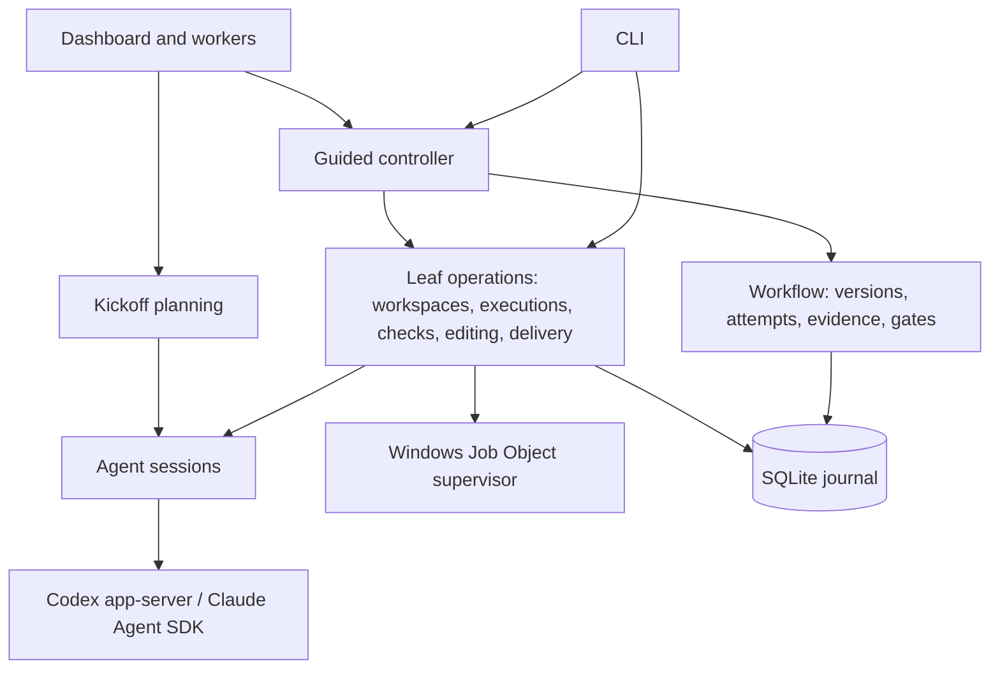

# Architecture

This describes the system as it is built. [DESIGN.md](../DESIGN.md) records product intent,
[WORKFLOW.md](WORKFLOW.md) describes automatic-mode behaviour in detail and [PLAN.md](PLAN.md) lists
the next changes. Archived checkpoint notes, with more protocol detail and their original rationale,
are in [history/ARCHITECTURE-CHECKPOINTS.md](history/ARCHITECTURE-CHECKPOINTS.md).

## Invariants

These hold across every component. Changes that weaken them are bugs.

- **The controller owns truth.** Task state lives in the SQLite journal and changes only through
  controller code. Agent replies, dashboard requests and CLI input are proposals that the controller
  validates. A model reply alone cannot pass a gate or complete a task.
- **Evidence is artifact-bound.** Every check, review, assessment and delivery names the exact
  requirement version, attempt and content digest it applies to. Changing the content invalidates
  earlier evidence; a newer failed or pending result is never hidden by an older pass.
- **Unknown is never success.** Missing output, an unconfirmed process exit, an unknown token count
  or an unverifiable process identity is recorded as unknown and blocks progress where proof is
  required.
- **No replay of uncertain dispatch.** Once a provider turn, command or Git write may have started,
  it is never automatically repeated. Recovery reconciles what happened from durable records and
  receipts, or stays blocked.
- **State and journal move together.** Every state change and its events are written in one `BEGIN
  IMMEDIATE` transaction.

## Components

The guided controller (`orchestration/guided/`) is a sequential state machine over leaf operations. Each
leaf is independently durable and recoverable, and the low-level CLI commands call them directly.

## From request to plan

A **kickoff** (`orchestration/kickoff.ts`, prompts in `orchestration/prompts/planner.ts`) is a planning conversation
stored as a session with `kickoff.*` events.
The planner receives the pinned base commit, approved reference folders and the repository-read
tools; it cannot edit files or run commands. It asks structured questions for consequential
ambiguity and finally returns a JSON guided plan. Planning answers bind to the displayed turn and
questions. Changing hints or references invalidates an earlier proposal. A separate best-effort turn
names the task for the sidebar (`orchestration/task-title.ts`).

Converting a proposal creates an unapproved guided task. `domain/guided-plan.ts` normalizes the plan once
and hashes it into an approval digest covering the brief, slices, file scopes, preparation,
validation and acceptance commands, expected output, providers, models, workflow and review
policies, selected context, references and delivery messages. Approval must name both the exact
requirement version and that digest. The controller, not the planner, decides repository, base,
workspace adapter and providers.

Plan validation simulates file existence through the ordered slices: edits and deletions must target
existing paths, creations must be absent (including Windows case collisions), and deleted paths
cannot be recreated later. Review must use the other provider from implementation.

## Workflow model

`domain/workflow.ts` holds the task record. A **brief** has a title, outcome, distinct criteria, plan and
optional 1 to 64 ordered **slices**, each naming the exact task criteria it delivers. Slices must
cover every criterion; the final slice is verified against all of them.

| Concept | Meaning |
| --- | --- |
| Version | Incremented on revision. Approval names one version |
| Attempt | One implementation try, with a fresh id; retries clear current evidence |
| Evidence | `simplification`, `validation`, `review` or `verification`, each `passed`, `failed` or `skipped`, with source `controller`, `agent` or `synthetic` |
| Gates | The latest evidence of each kind for the current attempt and artifact must pass, all active criteria must be mapped, and pending decisions must be accepted |
| Slice progress | Delivery of an intermediate slice records its commit, advances the index and clears the attempt |

Task phases are `draft`, `ready`, `running`, `stop_requested`, `recovery_required`, `stopped`,
`failed`, `awaiting_verification`, `awaiting_decision` and `complete`. Synthetic evidence is
accepted only on tasks permanently marked synthetic (the demo).

## Guided state machine

The guided state is saved in the task record. Each step journals its intent
(`guided.step_requested`) with the known result ids and the controller identity before calling a
leaf operation, then settles by adopting exactly one new result that matches that origin and
request.

| Stage | Handler (`orchestration/guided/stages/`) | Work |
| --- | --- | --- |
| `workspace` | `workspace.ts` | Create the task worktree (Git or Orca) |
| `execution` | `execution.ts` | Create the implementation execution and session, resuming the slice conversation when allowed |
| `preparation` | `preparation.ts` | Optional approved restore command, before scope |
| `scope` | `scope.ts` | Snapshot, verify size limits and build the exact edit policy |
| `implementation` | `implementation.ts` | Supervised native editing by the implementer |
| `refresh` | `preparation.ts` | Optional preparation again after editing, limited to the slice's file scope |
| `validation` | `checks.ts` | Run the approved validation command |
| `submission` | `submission.ts` | Submit the implementation with the latest passing check |
| `review_execution` | `execution.ts` | Create the review (or arbitration) execution |
| `review` | `review.ts` | Independent artifact review by the other provider |
| `assessment` | `assessment.ts` | Record the simplification assessment |
| `verification` | `checks.ts` | Run acceptance against the active criteria |
| `delivery` | `delivery.ts` | Verified local commit, then the next slice or `complete` |

Each handler has three parts: the result ids that already exist before dispatch, `perform` (dispatch
the leaf operation) and `settle` (adopt the result). `settle` returns a typed outcome (`advance`,
`wait` for a person, `stop` as blocked, `missing` result, or `rerouted` when a repair or arbitration
already sent the task back), and the controller (`controller.ts`) applies it as one journaled
change. The controller owns runner ownership, the drive loop, retry, recovery and revision; the exact
leaf requests that a step dispatches and later requires its result to match are built in one place
(`specs.ts`), and every agent prompt is in `prompts.ts`. Structured values are compared with
`domain/deep-equal.ts` (order-insensitive, `undefined` treated as absent, as in the stored JSON).

Statuses are `draft`, `ready`, `running`, `awaiting_scope`, `awaiting_assessment`,
`awaiting_answer`, `blocked`, `recovery_required` and `complete`.

In **automatic** mode (the default for new plans) scope is authorized by plan approval, review
follows submission, and the reviewer's explicit simplification verdict becomes agent evidence at
`assessment` before verification. Ordinary validation and acceptance failures return to
implementation with their evidence within `workflowPolicy.repairRounds`; blocking review findings
use the review repair allowance and then an optional fresh arbitrator. A repair that leaves the
failing artifact unchanged stops early. In **supervised** mode the controller stops at
`awaiting_scope` for file authorization and at `awaiting_assessment` after submission for a human
simplification assessment, then reviews; failed checks stop for a manual retry. The mode is part of
the approved plan and changes only through a revision. Details are in [WORKFLOW.md](WORKFLOW.md).

Every stop records a typed reason next to the human-readable note: `stopReason: { code, message, at }`
on the guided state, and `reasonCode` on the journal event that made the change. It is set exactly
while the status is `draft`, `awaiting_*`, `blocked` or `recovery_required`, and cleared whenever
work resumes. The codes are listed and documented in `orchestration/guided/stop-reasons.ts`: waits
(`APPROVAL_REQUIRED`, `SCOPE_AUTHORIZATION_REQUIRED`, `ASSESSMENT_REQUIRED`, `AGENT_QUESTION`, ...),
settled failures (`PREPARATION_FAILED`, `CHECKPOINT_CHANGED`, `CHECK_TIMEOUT`, `CHECK_NO_PROGRESS`,
`CHECK_REPAIR_EXHAUSTED`, `REVIEW_REPAIR_EXHAUSTED`, `ARBITRATION_UNRESOLVED`, `DELIVERY_FAILED`, ...)
and results that cannot be adopted (`RESULT_MISMATCH`, `OPERATION_NEEDS_RECOVERY`,
`SETTLEMENT_UNCONFIRMED`, ...). A failure without a specific code is `UNEXPECTED_ERROR` before dispatch
or `RECOVERY_REQUIRED` after it.

One guided controller runs per journal at a time. Its ownership has no expiry and is kept across an
uncertain shutdown. Stop requests are persisted and forwarded as an `AbortSignal` to the running
leaf.

## Persistence

`persistence/store.ts` uses Node's built-in SQLite with WAL, `synchronous=FULL`, foreign keys and a five-second
busy timeout. There is one schema, version 1, with twelve tables and no migrations. A new or empty
file gets the schema; any other version, or a version 1 file missing a table, is refused with a
clear error after a read-only inspection, so the file is never modified. The default journal is
`grampus.sqlite` in the data directory.

| Table | Contents |
| --- | --- |
| `tasks`, `events` | Task JSON state (including guided state and slice progress) and its ordered journal |
| `sessions`, `session_events` | Agent conversations, kickoffs and their events (prompts, tool calls, usage, replies) |
| `workspaces`, `workspace_events` | Worktree reservations, identities and lifecycle events |
| `executions`, `execution_events` | Immutable task/version/attempt/workspace/session bindings with a role |
| `execution_leases` | At most one current owner per workspace |
| `checks` | Command, before/after snapshots, process identities and result |
| `implementations` | Edit policy, dispatch boundary, process proof and snapshots per editing turn |
| `deliveries` | Checked snapshot, commit request, dispatch boundary and accepted commit |

State is loaded from snapshots rather than rebuilt from events. History is append-only through the
application interface. Deletion writes a tombstone (`orchestration/task-lifecycle.ts`); it never removes
workspaces or history. Full check output and supervisor receipts live beside the journal in
`<journal>.checks/`.

## Workspaces

`repository/workspaces.ts` reserves a task workspace in the journal before asking Git or Orca to create
anything, pins the base ref to a commit and never replays creation.

- **Git:** `git worktree add` on branch `grampus/<task-id>`, locked with the workspace id, at a
  destination outside existing worktrees. Inherited `GIT_*` variables are stripped and automatic
  CRLF conversion is disabled for the checkout command only.
- **Orca** (`repository/orca.ts`): one `worktree create` call with `--no-parent --setup skip`, without
  launching an agent. Grampus records Orca's worktree id and stable instance identity, and every
  later operation re-verifies that identity. Orca owns the worktree lifecycle; Grampus never edits
  Orca metadata or applies raw Git lifecycle writes to Orca worktrees. Remote Orca hosts are
  refused.

Recovery adopts a created worktree only when its identity, clean pinned base and approved version
all match. An unused failed standalone reservation can be released (metadata only). Worktree removal
is not automated.

## Executions, sessions and leases

An **execution** (`execution/executions.ts`) binds one attempt to a workspace and a fresh Grampus session in a
given role. Every turn or operation claims the workspace lease (`execution/execution-state.ts`) under a run id
and lease kind (`conversation`, `snapshot`, `check`, `submission`, `simplification`, `verification`,
`completion`, `implementation` or `delivery`). The lease is held until process exit is confirmed.
Session state, task outcome, journal events and lease release settle in one transaction, fenced on
the exact run id. There is no expiry or heartbeat takeover. Leases coordinate Grampus processes
sharing one journal; they do not lock out editors or other tools.

A session (`execution/sessions.ts`) records its provider, provider conversation id, model, phase and the
active run's controller and provider process identities. Each turn starts an owned provider process,
runs one turn and waits for exit. Within a slice, retries create new execution and evidence records
but may resume the same provider conversation; `execution/session-context.ts` starts a fresh one at the
configured turn or context-size threshold, or when the Codex toolset changed. Implementation and
review never share a conversation, and arbitration always starts fresh.

## Agent adapters

Both adapters return the same validated reply: `kind` is `message`, `question` or `review`, with
question ids, findings (`blocking` or `suggestion`, with evidence) and, for reviews, a
simplification verdict. Malformed replies fail the turn.

- **Codex** (`providers/codex.ts`) runs the installed `codex app-server` over stdio JSON-RPC
  (`process/process.ts`), forcing ChatGPT login and refusing other authentication. Threads start or resume
  with `approvalPolicy: untrusted` and a read-only sandbox, and the controller verifies both before
  inference. Repository tools are app-server dynamic tools. File edits arrive as
  `item/fileChange/requestApproval`; the controller checks each patch against the active turn and
  the exact edit policy, journals the decision and grants single-use approval. Command execution
  requests are declined. Codex is not version-pinned.
- **Claude** (`providers/claude.ts`) uses the pinned `@anthropic-ai/claude-agent-sdk` and its bundled
  executable, unless `GRAMPUS_CLAUDE_COMMAND` overrides it. It requires a first-party subscription
  and no API key source. Editing turns get native `Read`, `Edit` and `Write`, which a `PreToolUse`
  hook and permission callback restrict to authorized paths, plus the repository MCP server
  (`providers/claude-repository.ts`) and, when deletions are approved, an in-process delete tool
  (`providers/claude-files.ts`). `ToolSearch` and external MCP tools are allowed only during an active turn.
  Tool decisions are journaled before permission is granted.

Neither provider gets a shell. Configured MCP integrations stay available (`providers/integrations.ts` carries
source-project connections into worktrees); external actions need explicit task authorization.

## Repository access

`repository/repository-tools.ts` implements one controller-owned toolset for both providers:
`grampus_list_files`, `grampus_read_file`, `grampus_search`, `grampus_read_changes`,
`grampus_read_check`, `grampus_read_dependency` and `grampus_suggest_reference_folder`. Planning
reads immutable Git blobs at the pinned commit; execution reads the captured workspace inventory and
allows current bytes only for authorized paths; review reads the submitted snapshot. Handlers
recheck turn ownership and journal bounded results. Reference folders (`repository/reference-folders.ts`, up to
16) are read-only roots, pinned Git subtrees or hashed plain-folder inventories. Read access never
implies write scope. Budgets are in [REPOSITORY-CONTEXT.md](REPOSITORY-CONTEXT.md).

## Artifacts, checks and the Windows supervisor

A repository snapshot (`repository/artifacts.ts`, `repository/repository-evidence.ts`) hashes HEAD, index entries, the raw
bytes of tracked and non-ignored untracked files and discovered `AGENTS.md`/`CLAUDE.md` instructions
into a SHA-256 artifact digest. A stable capture takes two matching reads. Git plumbing reads raw
blobs without filters or diff drivers. Ignored dependencies, environment and external services are
outside the digest. Symlinks and submodules are refused.

Checks (`verification/checks.ts`) run an approved executable with literal arguments at the workspace root, with
no shell. The request and before-snapshot are durable before dispatch. On Windows, a hidden detached
Node host (`process/check-host.ts`) runs PowerShell, which compiles `process/native/check.cs` and starts the tool
directly inside a Job Object (kill-on-close, no breakaway). After the root exits the supervisor
waits up to 100 ms for the job to drain, terminates any remaining descendants and confirms zero
active processes before writing a flushed receipt. A check passes only with exit code zero, a
settled job and unchanged repository inputs. Timeouts are 100 to 600000 ms; output above 2 MiB
combined stops the job; the journal keeps a 64 KiB preview per stream and full logs stay on disk
(`verification/check-output.ts`). Acceptance (`domain/acceptance.ts`) also compares approved stdout, JSON, stderr and
file observations against retained output and the after-snapshot. Preparation reuses the same runner
with its own purpose and cannot supply validation or acceptance evidence.

Native editing (`execution/implementations.ts`, `execution/implementation-worker.ts`, `execution/edit-policy.ts`) runs the
provider in the same supervised process tree. After confirmed exit, only the authorized file
contents and named creations and deletions may have changed; HEAD, index, other files, modes and
instructions must be unchanged. Scope covers regular UTF-8 files up to 1 MiB each and 4 MiB per
slice, at most 64 paths.

## Delivery

Delivery (`execution/deliveries.ts`, `execution/delivery-worker.ts`, `execution/delivery-operation.ts`, `repository/delivery-git.ts`)
requires every gate on the current artifact. The supervised worker stages the checked worktree,
compares staged paths, modes and raw blob hashes with the checked snapshot, then commits with the
repository's own identity, hooks and signing, adding a unique `Grampus-Delivery` marker. The
controller verifies parent, marker, tree, index, working files and instructions before recording
delivery and slice progress in one transaction. `mode: "no_change"` proves an already satisfied
outcome without staging. For Orca, the instance identity is checked before staging, before
committing and after. Failures keep the index, files and any commit for inspection; there is no
reset, amend or push.

## Recovery

Recovery is explicit (`task-recover` and the per-operation `*-recover` commands) and follows the
same rules everywhere:

- The previous controller must be absent on the same host. Windows process creation times
  (`process/process-identity.ts`) distinguish a recycled PID from the original owner; unknown or live owners
  block recovery.
- A recorded pre-dispatch boundary proves nothing was launched and can be released without a
  receipt.
- After dispatch, a supervised operation needs a matching terminal receipt (`verification/check-recovery.ts`).
  PID absence alone never proves settlement.
- Settled results are adopted only if their origin and request match. Lost successes are recorded as
  interrupted, never accepted.
- Recovery never sends a provider turn, reruns a command or repeats a Git write, and does not start
  the next step automatically.

## Dashboard server

`server/ui-server.ts` serves the dashboard and a JSON API over the same journal; it is not a second
workflow engine.

- Listens on `127.0.0.1` only, port 4317 installed or 4318 development unless `config.json` sets
  `dashboardPort` ([CONFIGURATION.md](CONFIGURATION.md)).
- A random 32-byte token per launch is passed in the URL fragment and required as a bearer token on
  every API call (constant-time comparison).
- The `Host` header must match and any `Origin` must equal the local origin.
- Strict CSP (`default-src 'none'`, self-hosted scripts and styles only, `frame-ancestors 'none'`),
  `nosniff`, `no-referrer` and `no-store`. Assets are local; there is no CDN.
- Every task decision carries a **decision key** built from version, digest, status, stage,
  artifact, instructions digest, execution ids and, for answers, the exact turn and questions. The
  controller rechecks it, so a stale tab cannot approve a changed plan or authorize different bytes.
- Actions run in separate Node worker processes (`server/ui-worker.ts`) using the same controller, so
  restarting the server is never evidence that work stopped. Polling responses are cached by journal
  revision and exclude large snapshots.

## Configuration

Fixed bounds live in `config/limits.ts`, each documented with what it bounds. Operational values
(dashboard port, usage polling, defaults for new plans) live in `config/settings.ts`; an optional
`config.json` in the data directory overrides them and is validated strictly. The CLI loads it once at
startup and passes the loaded values to dashboard and implementation workers in their requests.
Defaults are copied into a plan when it is created, so settings never change an approved plan or
recorded evidence. Details are in [CONFIGURATION.md](CONFIGURATION.md).

## Usage accounting

Providers report cumulative usage per provider session. `reporting/task-usage.ts` keeps the latest snapshot
for each distinct session linked to a task (planning, naming, implementation, review) and sums
sessions once, separately per provider. Claude usage is sampled every 15 seconds (`usagePollIntervalMs`) during a turn and
replaced by the final result; interim snapshots are marked incomplete. Missing values stay unknown
and mark totals partial. Claude's estimated USD never becomes billed cost, which is always unknown.

## Limits

- Windows only. macOS and Linux supervision and installers are **Planned**.
- One guided task at a time per journal. A small parallel limit is **Planned**.
- Per-stage usage, turn and retry counters, health records and a server-side view model for the
  dashboard are **Planned** ([PLAN.md](PLAN.md)).
- No background scheduler, retention cleanup, push or pull request delivery.

## Module map

Paths are under `src/`. Folders group modules by responsibility; they are not strict layers.

| Folder | Files | Responsibility |
| --- | --- | --- |
| `/` | `cli.ts` | Command parsing and entry point (`dist/src/cli.js`, also the installed launcher target); Ctrl+C handling |
| `config/` | `runtime.ts` | Application root, version, installed or development channel, data directory, update |
| | `limits.ts` | Fixed, documented bounds bound into approval, evidence or recovery; not configurable |
| | `settings.ts` | Operational settings, their defaults and the validated optional `<data directory>/config.json` |
| | `environment.d.ts` | Typed declarations of the environment variables Grampus reads |
| `persistence/` | `store.ts` | SQLite schema, version check, transactions and journal access |
| `domain/` | `workflow.ts`, `workflow-policy.ts` | Briefs, versions, attempts, evidence, gates, slices and completion; workflow policy validation |
| | `guided-plan.ts` | Plan normalization, slice file simulation and approval digest |
| | `acceptance.ts` | Acceptance expectations and observations against retained output |
| | `deep-equal.ts` | Structural equality for stored JSON-shaped records |
| `orchestration/guided/` | `controller.ts` | Guided task controller: public API, runner ownership, drive loop, retry, recovery, revision |
| | `state.ts`, `keys.ts`, `stop-reasons.ts` | Guided state types; decision and question keys; typed stop reason codes |
| | `context.ts`, `specs.ts`, `prompts.ts` | Stage handler contract and result adoption; exact leaf requests; agent prompts |
| | `retry.ts`, `recovery.ts`, `revision.ts` | New attempts and explicit retry checks; leaf recovery; plan revision |
| | `stages/*.ts` | One handler per stage (see [Guided state machine](#guided-state-machine)) |
| `orchestration/` | `guided-status.ts` | Task views and next actions |
| | `kickoff.ts`, `prompts/planner.ts`, `planner-progress.ts`, `task-title.ts` | Planning conversations and planner prompts, live planner progress and task naming |
| | `task-lifecycle.ts` | Reset and delete with tombstones |
| `execution/` | `sessions.ts`, `session-context.ts` | Conversation turns, recovery and resume-or-fresh decisions |
| | `executions.ts`, `execution-state.ts` | Execution bindings, leases and settlement |
| | `edit-policy.ts`, `implementations.ts`, `implementation-worker.ts` | Edit scope, patch authorization and supervised editing |
| | `deliveries.ts`, `delivery-worker.ts`, `delivery-operation.ts` | Local commit delivery and verification |
| | `agent-timeout.ts` | Opt-in provider deadlines for low-level session and implementation commands; guided turns have none |
| `providers/` | `types.ts`, `index.ts` | Provider contract, reply validation, usage, connector |
| | `codex.ts` | Codex app-server threads, turns, approvals and dynamic tools |
| | `claude.ts`, `claude-repository.ts`, `claude-files.ts` | Claude SDK sessions, repository MCP server, scoped delete tool |
| | `integrations.ts` | MCP carry-over into worktrees |
| `repository/` | `workspaces.ts`, `orca.ts` | Git and Orca worktree lifecycle and identity |
| | `artifacts.ts`, `repository-evidence.ts` | Snapshots, artifact digests, instructions and review context |
| | `repository-context.ts`, `repository-tools.ts` | Pinned inventories, cache and the shared agent read tools |
| | `reference-folders.ts`, `installed-dependency.ts` | Reference roots and dependency source reads |
| | `delivery-git.ts` | Raw Git plumbing for delivery and reconciliation |
| `process/` | `process.ts`, `process-identity.ts` | Shell-free subprocesses, JSON-RPC, process creation times |
| | `check-process.ts`, `check-host.ts` | Supervisor control and its detached host |
| | `native/check.cs`, `native/check.ps1`, `native/process.ps1` | Job Object helper and process identity queries |
| `verification/` | `checks.ts`, `check-evidence.ts`, `check-output.ts`, `check-recovery.ts` | Checks and submission, check feedback, log paging, receipts |
| `reporting/` | `report.ts`, `task-usage.ts` | Markdown report; per-task usage aggregation |
| `health/` | `doctor.ts` | Readiness checks |
| `server/` | `ui-server.ts`, `ui-worker.ts` | Loopback dashboard server and action workers |
| `ui/` | `index.html`, `app.js`, `app.css`, `markdown.js`, `favicon.svg` | Browser client, served as static files |
| `probes/` | `*-probe.ts`, `multifile-fixture.ts`, `probe-interruption.ts` | Opt-in live and scale probes and their fixtures |
| | `demo.ts` | Synthetic demo |
