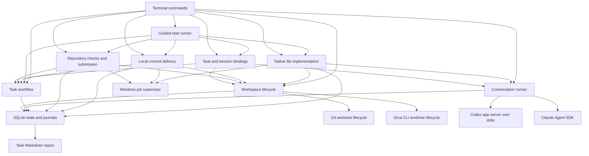

# Architecture and state contracts

This describes the implemented baseline as of 17 October 2026. [DESIGN.md](../DESIGN.md)
defines the intended product; [IMPLEMENTATION.md](IMPLEMENTATION.md) tracks delivery
sequence. Product requirements that appear there are not automatically implemented.

## Local dashboard and kickoff

The dashboard is a loopback HTTP surface over the existing journal, not a second
workflow engine. It serves checkout-local static assets and requires a per-launch
bearer token and exact local Host/Origin for API access. Repository and provider
content is rendered as escaped text. External script/style dependencies are absent.

Task views are collected under a journal transaction. Approval, authorization,
assessment, answers, retry and recovery carry the displayed decision key. The
controller rechecks it inside its ownership transaction; pending answers also bind
the session's exact turn and question contents. UI actions execute in separate
Node worker processes using `GuidedTasks`, so the HTTP server's lifecycle does not
replace worker identity or supply process-settlement evidence. Stop requests use
the same persisted control path. Reopening the dashboard starts no work.

Kickoff sessions use the existing read-only provider conversation lifecycle.
The controller supplies a pinned complete UTF-8 Git tree within the current review
limits, read through one batch blob operation. Consequential questions require
explicit answers. First-turn failures retain full protocol/repository context on
explicit continuation. User revision intent invalidates an earlier proposal before
dispatch. Planning answers bind to the displayed turn/questions; uncertain/live
owners are refused before a new user message is journaled. Generated CommonJS
inline checks receive syntax validation, without execution. Proposal conversion
binds its digest and creates only an unapproved guided task; selected repository,
base, workspace adapter, providers and time limits remain controller-authoritative.

The browser presents selected files and instructions, approved requirements and
per-slice criteria, decoded command arguments, output expectations, retained diffs,
check output, findings and a journal-derived report. Simplification remains an
explicit human assessment. No browser path supplies a missing gate or replays
provider inference/Git writes after restart. See [DASHBOARD.md](DASHBOARD.md).

## Components



Executions link task attempts to fresh conversation sessions and a workspace. Their
turns acquire exclusive workspace leases. There is still no automatic path from a
conversation reply to repository changes, evidence acceptance or task completion.

| File | Responsibility |
| --- | --- |
| `src/cli.ts` | Parse commands; task and conversation entry points; Ctrl+C handling |
| `src/guided-plan.ts` | Validate/freeze guided execution recipes, pin Git bases and hash complete approval inputs |
| `src/guided-tasks.ts` | Journal foreground step intent, serialize guided controllers, drive existing gates and reconcile results |
| `src/guided-status.ts` | Read saved progress, questions, findings and next commands for the CLI and future interface |
| `src/store.ts` | SQLite schema, transactions, state snapshots and journal access |
| `src/workflow.ts` | Versioned brief approval, attempts, evidence, decisions and completion |
| `src/sessions.ts` | Claim a conversation, persist events, run one turn, stop and reconcile |
| `src/workspaces.ts` | Reserve a task workspace, create through Git or Orca, inspect and reconcile |
| `src/orca.ts` | Resolve the Orca executable, validate local CLI responses and stable worktree identities |
| `src/executions.ts` | Atomically prepare and close versioned task/attempt/session bindings |
| `src/execution-state.ts` | Validate bindings, acquire/fence workspace leases and settle linked task outcomes |
| `src/checks.ts` | Lease repository operations, capture evidence, execute explicit checks and submit implementation |
| `src/implementations.ts`, `src/implementation-worker.ts` | Supervise native editing turns and reconcile process-tree settlement |
| `src/delivery-operation.ts` | Stage and commit checked content inside the supervised writer, with Orca identity/lease checks |
| `src/edit-policy.ts` | Validate explicit edit scope, authorize file tools and check resulting changes |
| `src/deliveries.ts`, `src/delivery-worker.ts`, `src/delivery-git.ts` | Bind reviewed content to local commits and recover delivery |
| `src/artifacts.ts` | Hash repository inputs and retain structured changes and discovered instructions |
| `src/check-process.ts` | Control the Windows supervisor and retain bounded command output |
| `src/check-host.ts` | Hidden detached host that forwards controller lifetime to the native helper |
| `src/check-recovery.ts` | Allocate receipt storage, validate completion proofs and check controller absence |
| `src/process-identity.ts`, `src/native/process.ps1` | Observe Windows process creation times and distinguish a recycled PID from its former owner |
| `src/repository-evidence.ts` | Collect stable workspace snapshots and bounded text review context |
| `src/repository-context.ts` | Cache pinned inventories, select text context and paginate path search |
| `src/context-probe.ts` | Offline file-count and byte-size scale probes |
| `src/native/check.ps1`, `src/native/check.cs` | Compile and run the Windows Job Object helper |
| `src/agents/types.ts` | Provider contract, reply validation, usage fields and subscription environment |
| `src/agents/codex.ts` | Installed Codex app-server initialization, threads, turns and notifications |
| `src/agents/claude.ts` | Official SDK streaming input, authentication, results and process shutdown |
| `src/agents/claude-files.ts` | In-process scoped deletion tool with active-turn and journal checks |
| `src/process.ts` | Shell-free subprocess execution and bounded JSON-RPC requests |
| `src/doctor.ts` | Local executable/authentication discovery; optional Orca worktree lookup |
| `src/report.ts` | Markdown rendering from a task snapshot and its journal |
| `src/demo.ts` | Explicitly synthetic workflow demonstration |
| `src/probe.ts` | Opt-in live provider probes across separate controller processes |

The runtime is Node.js 24 or newer with TypeScript compiled to JavaScript. SQLite
and the test runner come from Node. Claude's SDK is the sole direct runtime npm
dependency and is pinned; it brings transitive dependencies and a native executable.
Codex and optional Orca are discovered separately. No browser server or installer
has been built.

## Persistence

Guided tasks add an optional `guided` field to the existing task snapshot. The
complete normalized plan, approval digest, stage, checkpoint, pending leaf request
and controller identity are saved with their task journal events in existing
transactions. Schema 10 remains compatible; ordinary tasks do not acquire this
field. The guided controller never treats a provider response as a task-state API.

Schema version 10 contains twelve tables:

| Table | Contents |
| --- | --- |
| `tasks` | Task id and current JSON state |
| `events` | Ordered task events with requirement version, timestamp, type and JSON data |
| `sessions` | Grampus session id and current JSON state |
| `session_events` | Ordered conversation events with timestamp, type and JSON data |
| `workspaces` | Workspace state with unique task id and destination/reservation key |
| `workspace_events` | Ordered workspace lifecycle events with timestamp, type and JSON data |
| `executions` | Immutable task/version/attempt/workspace/session links, role and open/closed state |
| `execution_events` | Ordered binding, lease and turn outcome events |
| `execution_leases` | One current owner per workspace, with unique execution/run id |
| `checks` | Command specification, before/after snapshots, process ids and result per execution |
| `deliveries` | Checked snapshot, commit request, dispatch boundary, process settlement and accepted commit |
| `implementations` | Per-turn edit policy, dispatch boundary, process proof, provider result and before/after snapshots |

State changes and associated events share a `BEGIN IMMEDIATE` transaction. Nested
synchronous operations use savepoints so execution preparation can compose task and
session APIs atomically. An outer failure rolls back their state and journals. SQLite
uses WAL, full synchronous writes, foreign keys and a five-second busy timeout.
History is append-only through the application interface. State is loaded from
snapshots rather than reconstructed by replaying events.

Version 1–8 journals gain the missing tables without losing history. Version 4 added
Orca-aware workspace state: path/branch may be null until identity capture. The
unique key initially reserves the Orca repository/request name, then atomically
changes to the canonical destination. Standalone records retain their shape. The
version bump prevents older code from treating a pending Orca operation as a local
Git process. Version 5 adds execution bindings and leases without changing prior
records. Version 6 adds checks and distinguishes conversation, snapshot, check and
submission leases. Version 7 adds durable dispatch boundaries and receipt references,
read-only recovery markers, verification/completion operation kinds and acceptance
expectations. These extend JSON state without new tables. Missing legacy proof fields
are never inferred. Version 8 adds deliveries and a distinct delivery lease; older
read-only recovery cannot release it. Version 9 adds native implementation records,
an implementation lease kind and persistent editing-session mode. Older recovery
code cannot open this schema and mistake provider PID absence for tool-tree exit.
Version 10 adds explicit ordered slice plans and progress in task JSON without new
tables. The version fence prevents older controllers from treating an intermediate
delivery as whole-task completion. Legacy tasks retain their single-slice state.
Unknown schema versions are refused. Older executables cannot open version 10 journals. Default
storage is outside the checkout; see [README.md](../README.md) for portable paths
and overrides. Retention expiry, backup tooling, settings transfer and task export/
import have not been implemented. Markdown task reports are the current export.

## Task workflow

A brief contains a title, intended outcome, distinct acceptance criteria and a plan.
Creation produces version 1 in `draft`. Approval must name the exact current version.
An approved task can start an attempt identified by a new UUID and the provider,
model and implementation session id supplied by the caller.

The main progression is `draft` → `ready` → `running` → `awaiting_verification` →
`complete`. Pending provisional decisions can produce `awaiting_decision`.
Failures, stop requests and uncertain recovery have separate states. A successful
implementation result does not itself complete the task.

Completion checks require:

- Approval for the current requirement version and a successful current attempt.
- Passing simplification, validation, independent review and acceptance verification
  evidence for that attempt and artifact reference.
- Verification covering every approved criterion, by its exact criterion text.
- Acceptance of every pending provisional decision.

Evidence has an id, kind, outcome, source, summary, attempt id, requirement version
and artifact reference. Review additionally identifies the reviewer. A different
session is required; using the same provider requires a recorded fallback reason.
This checks caller-supplied identities, not independent proof of provider isolation.

The latest accepted evidence of each kind determines that gate. Earlier failed or
skipped checks remain in the journal. The initial API does not enforce a complete
chronological review pipeline. The explicit check runner supplies named command
results to this API. Validation and
verification cannot be established by an agent claim alone; synthetic evidence is
accepted only on tasks permanently marked synthetic.

Revising a settled task increments its version, removes approval and current attempt
evidence, and preserves pending decisions. An implementation retry receives a new
attempt id and clears the current evidence. Late, duplicate or mismatched results
are recorded as ignored. Evidence from a previous artifact cannot validate the new
artifact. Direct API callers still supply trusted references; the check CLI uses
verified content digests and actual command exit results before submission.

`Workflow.recover()` marks running or stop-requested attempts as uncertain. Its
caller must establish that the previous controller no longer owns the work; this
method does not discover or terminate processes. Stop confirmation requires an
explicit matching attempt and explanation.

## Sequential slice continuation

An optional brief `slices` array contains 1–64 ordered `{title, plan, criteria}`
entries. Each list names distinct exact task criteria; their union must cover all
task criteria. Approval binds the entire plan. New planned tasks have a `slice`
progress record with a zero-based current index and completed delivery references.
Existing tasks without progress retain their original single-slice behavior.

`activeCriteria` selects the intermediate slice's criteria, or every task criterion
for the final slice. Check mapping and gate coverage both use this selection.
Session context supplies the whole brief, current slice, prior delivered heads and
an instruction to implement only the current slice. Final review includes integration;
there is no separate automatic review scheduler or independent proof of review depth.

`sliceBlockers` checks the four gates and decisions for the current attempt;
`blockers` additionally requires delivery of all planned slices. Thus direct
completion cannot skip slice delivery. After repository and receipt verification,
delivery settlement releases the lease, saves its outcome and accepts the slice in
one SQLite transaction. An intermediate slice appends `{index, attemptId, artifact,
deliveryId, outcome, commit, head}`, increments the index, clears current attempt and
evidence, and sets `ready`. The final slice appends the same proof and completes the
task. Detailed evidence remains in the journal and execution records. Any journal
failure rolls back the progress, delivery acceptance and lease release together.

Starting the next slice is explicit and creates a fresh execution/session/attempt.
Old attempt bindings fail even between delivery and the next start. The original
workspace base and Orca identity remain unchanged, so diffs include cumulative task
changes and final review can inspect integration. Initial continuation verifies raw
HEAD/index/files and unchanged instructions at the last delivered HEAD. Retry attempts
retain partial edits, stay on the current slice and require that delivered HEAD.
These checks do not prevent external writers after inspection.

Delivery receipt recovery invokes the same atomic settlement and advances once;
no provider or Git command is replayed. Failed or uncertain delivery cannot start
the next slice. An explicit no-change delivery records the unchanged HEAD instead
of a commit. Revisions reset progress and approval while retaining journal history;
workspace rebinding after a revision remains unsupported.

## Standalone workspace lifecycle

`Workspaces.create()` requires a real, ready task and its exact approved version.
It resolves the repository/common Git directory, canonical destination, immutable
base commit and generated task branch. The destination is outside registered
worktrees and Git metadata. Native filesystem canonicalization handles Windows
short/long path aliases; destination keys also ignore case on Windows.

A transaction reserves the task and destination before invoking `git worktree add`.
The record includes the host, controller PID, Git PID when observed and whether
Git's exit was confirmed. Creation locks the worktree with its unique workspace id.
The controller verifies registration, branch, common directory, clean state and base
commit before moving `creating` to `ready`. This lock prevents ordinary Git pruning
and removal; it is not a worker execution lease. Uniqueness is enforced within one
journal; separate journals do not share a global concurrency limit.

Git failures retain the reservation in `recovery_required`. After a controller crash,
the state may still say `creating`. Recovery claims the record transactionally,
requires absent prior processes (or a confirmed Git exit after this controller's own
failed operation), and inspects Git without replaying creation. An unknown Git PID,
live or reused PIDs and another host block reconciliation. A completed checkout can
be adopted only if its original identity, clean base and approved version still match.
Missing, dirty or mismatched checkouts remain reserved for manual investigation.

Revising or starting an attempt is blocked while workspace creation is unsettled.
A ready workspace survives brief revision, but its old version cannot authorize a
new attempt. Automatic rebinding and release/removal are not implemented. Inspection
can report changed HEAD and dirty state without resetting user changes; it does not
produce acceptance evidence or reserve the workspace for agent execution.

Git runs without a shell and with a 30-second timeout. Inherited `GIT_*` environment
overrides are stripped so the explicit repository determines the index and worktree;
repository/user Git configuration still applies. Normal checkout hooks and filters
may run. Their process trees are not supervised by this slice. Task-linked turns use
the execution ownership mechanism below; shared scheduling remains separate work.

## Orca workspace lifecycle

Orca is the authority for its tracked worktrees. The adapter checks the installed
CLI's creation controls, resolves the registered Git repository, and validates local
worktree identity responses before mutation. An explicit base ref is pinned to a
commit. A task reservation and unique request name/marker are durable before the
single `worktree create` call. Orca selects path and branch; Grampus requests no parent,
skips Orca setup hooks and does not request an agent or activate the view.

The response is validated and bound to the reservation before readiness checks.
Grampus records the full worktree id, stable identity key and instance id, plus the
observed path and branch. Inspection requires those identities, Orca's local host,
the repository's Git common directory and actual worktree registration to match.
No raw Git worktree lifecycle writes or extra Git locks are applied to Orca worktrees.
Grampus-owned native editing and supervised Git staging/commits are supported inside
the verified checkout. Orca remains the authority for creation, identity, archival
and removal. The installed CLI has no commit command; ordinary Git commits run under
Grampus supervision and do not change Orca metadata or start Orca-managed agents.

CLI exit/timeout is not Orca host completion. Recovery first excludes another live
Grampus controller, then uses Orca's read-only list/show interfaces. An uncaptured
identity requires exactly one matching name and marker from a complete local listing,
with the exact requested base ref. Captured identity is looked up directly and cannot
be replaced by a new instance at the same path. All creation recovery additionally
requires a clean checkout at the pinned commit and the current approved task version.
Unknown outcomes remain reserved; no create call is replayed.

The fixed CLI deadline is 120 seconds. There is no automatic application start,
executable fallback, host switching, creation retry or workspace removal. Normal
Orca terminal defaults and Git hooks/filters can still have side effects. Readiness
does not prove all host background activity finished, and provides no execution
lease or tool-process supervision. Remote hosts are rejected. Version rebinding
remains future work; task-linked turns acquire a separate execution lease below.

## Execution bindings and workspace ownership

`Executions.create()` inspects the workspace and verifies its exact approved version.
One transaction creates a fresh session, starts an implementation attempt (or selects
the current successful attempt for review), and journals the permanent binding.
Review records pin the attempt's artifact reference and require a recorded reason
for same-provider fallback. Preparing a binding makes no inference call.

`Sessions.claim()` checks the binding's version, attempt, role, workspace and session
directory. It atomically claims the session and inserts a workspace lease containing
execution/session/run ids, controller PID and host. The workspace primary key and
unique execution/run ids prevent duplicate owners across controllers sharing the DB.
Another active or uncertain session in that directory also blocks acquisition,
including legacy unlinked sessions. New unlinked sessions there cannot bypass the
lease. Different workspace ids remain independently runnable.

The runner verifies current Git/Orca identity while holding the lease, before provider
connection. Each prompt includes the approved brief and binding context, saved with
the turn request. Cancellation during workspace inspection prevents provider dispatch
and waits for the bounded inspection commands to settle. Provider session/model
identity stays in the session; the task's implementation model is updated when observed.
For linked attempts, `Agent.sessionId` is the Grampus session id; the provider's resume
id remains a separate session field. `provider-default` labels an unresolved model
request until an observed model arrives. `headAtCreation` is informational, not
verified implementation evidence.

Settlement fences on the exact session run and lease token. Session state, linked task
outcome, journal events and lease release commit together. A successful conversation
does not finish an implementation attempt. Failure marks it failed; confirmed interrupt
or recovery marks it stopped. Ordinary review conversations leave evidence unchanged;
explicit artifact reviews additionally follow the evidence protocol below.
Unconfirmed exit retains the lease and marks the session, plus an implementation task,
as requiring recovery. A startup promise still pending after cancellation is uncertain
even if no PID was observed. A late connection is closed without receiving the prompt;
that alone does not erase the retained recovery state.

There is no expiry or heartbeat takeover. Recovery requires absent controller and
provider PIDs on their recorded host, then releases both owners in one transaction.
Unknown/reused/live PIDs remain blocked. Late events cannot release a newer run's
lease. Task revision, replacement attempts, completion, direct result/evidence writes
and generic task recovery cannot bypass active/uncertain execution ownership.

Idle execution closure can stop its unfinished implementation attempt and permanently
disable that session binding; it cannot force-release a lease. Questions retain the
same attempt/session across ordinary turns. Failed/interrupted implementation attempts
require fresh execution preparation, preserving old contexts as history. A task
revision or replacement attempt invalidates older bindings without rewriting them.

This is cooperative ownership within one journal, not a filesystem lock against
editors, external Orca agents or other journals. There is no global worker limit.
The repository check runner shares these leases and supplies validation evidence.

## Repository checks and content evidence

`Checks` reuses the exact task/version/attempt/session/workspace binding. Snapshot,
check and submission operations claim the workspace under a distinct run id and
lease kind; conversation claims cannot bypass them. Check specifications are trusted
caller input, not parsed provider replies. An implementation role and current running
attempt are required for check execution and submission.

Before dispatch, capture the current Git/Orca identity and two matching repository
snapshots. Each snapshot binds HEAD, index entries, raw bytes of baseline/tracked and
nonignored untracked files, and discovered instructions into a SHA-256 digest. The
structured diff preserves changed files' old/new bytes and Git blob identities.
Binary content is base64. Deleted files are explicit. Git plumbing reads the tree
and blobs without clean filters, textconv or external diff drivers. Identity checks
omit `git status` on this path, and Git fsmonitor is disabled for inspection commands.

Root and Git-visible nested `AGENTS.md`/`CLAUDE.md` plus ancestor copies are displayed
and hashed. The specification must contain both the inspected artifact and instruction
digest. This detects stale inputs; interpreting instructions and selecting sufficient
checks remains the caller's responsibility. Ignored dependencies/generated output,
external services, environment variables, additional rule formats and external editors
are outside this guarantee. The snapshot is two matching reads, not an atomic OS
snapshot or a proof that a command never temporarily changed a file. Regular files and
a resolved index are required; submodules and symlinks are refused. Limits are 32 MiB
per input file and 4 MiB of retained structured changes; aggregate repository bytes
are not capped by the context budget.

The command request and before-snapshot are durable before dispatch. The initial
supervisor runs on Windows 10+ through Windows PowerShell `Add-Type`, using checked-in
C# and no new npm runtime dependency. A hidden detached Node host owns PowerShell;
it survives the controller's libuv parent-exit job, forwards input closure/cancellation,
drains broken output pipes and has its own bounded watchdog. PowerShell needs a normal
hidden-console launch, so it runs as that host's child. The native helper creates the tool directly inside an unnamed
Job Object via `PROC_THREAD_ATTRIBUTE_JOB_LIST`, avoiding the suspended-process
assignment gap. Kill-on-close is enabled, breakaway is disabled, and only tool stdin
(NUL) and output handles are inherited. Arguments use Windows CRT quoting; no shell
is implied. The workspace root is the working directory; the environment is inherited.

The supervisor observes timeout, controller pipe closure and cancellation. It checks
the job's active process count, terminates remaining descendants, and confirms zero
before reporting settlement. A signalled root handle may precede the job's accounting
update. The helper observes a cancellable drain of at most 100 ms after root exit,
capped by the original tool deadline. Zero active processes are still required for
success; a zero-exit root whose children remain beyond that window fails and its
job is terminated. The same final zero-count confirmation precedes every receipt.
A helper crash closes the job handle but supplies no controller confirmation:
the durable lease remains unless an earlier matching completion receipt exists. Job ownership covers ordinary child creation; delegating
to a service, WMI or an external agent is outside this boundary. It is not a sandbox.

Keep the first 64 KiB from each output stream, with truncation flagged. A monitored
2 MiB combined disk-output threshold stops the job (polling may overshoot that
threshold). The tool deadline is 100–600000 ms, plus a bounded helper startup/shutdown
allowance. Journaled checks retain output and receipts in `<database>.checks/` beside
the journal. Standalone process probes remove their temporary output when possible.
No retention cleaner is implemented.

Confirmed failures/interruption release the lease and leave implementation open for
an explicit new command. Unconfirmed dispatch/shutdown retains the lease and marks
recovery required; a controller crash may leave the durable check marked running.
There is no command replay, PID-only force-release or macOS/Linux supervisor yet.
Explicit recovery follows the protocol below; conversation recovery cannot release
these leases.

Passing requires exit code zero, normal tool/job exit and unchanged before/after
inputs. `execution-finish` then checks current content again and accepts only the
latest passing result from that execution. Releasing its lease, finishing the attempt
and recording controller validation are one transaction. Newer failed/interrupted
checks cannot be hidden by selecting an older passing one. This is an explicit caller
decision that implementation is ready, not automatic acceptance verification. The
other three completion gates remain unsatisfied until separately assessed. Explicit
review, verification and completion now revalidate the submitted content as below.
Native provider repository tools and review arbitration remain future work.

### Durable recovery protocol

New checks persist `dispatch=not_requested` with their claim. Before invoking the
runner they allocate a unique receipt directory and token, then atomically persist
`dispatch=requested`, its receipt identity and the dispatch event. A crash before that
transaction cannot have launched a tool. A crash after it requires terminal proof.

After settling its Job Object and closing tool handles, the native helper writes a
receipt containing protocol version, check id, token, host supervisor/tool ids, reason,
exit code and `exitConfirmed`. It uses a write-through temporary file, `Flush(true)`
and same-directory rename before emitting the final pipe message. An absent/partial
receipt cannot prove settlement. The receipt token prevents mixing operations, not
tampering by the local account that already owns the journal. Receipt and output
retention remain local; no live process is adopted or force-killed during recovery.

`check-recover` requires the same host, an absent controller, the exact lease/run,
and either a recorded pre-dispatch boundary or a matching terminal receipt plus an
exited supervisor. New Windows workspace leases retain the controller's exact
creation FILETIME as a decimal string; new receipts retain the supervisor's creation
time. If a PID exists again, a bounded local observation can prove its creation time
differs from that recorded owner. Matching live owners and unknown observations
remain blocked. Legacy records without creation times still require PID absence.
These optional fields preserve schema 10 and receipt protocol 1 compatibility;
ordinary conversation and workspace-creation recovery retain their PID-only rules.
Recovery never kills the replacement process or uses identity alone as tool-settlement
proof. Delivery/implementation recovery captures the new controller identity before
releasing its transaction for further inspection. Check recovery releases ownership and
records interruption without accepting success, even for a lost exit-zero reply.
Implementation returns from uncertain state to running for an explicit fresh check;
a pending task stop becomes stopped. Verification recovery records a skipped gate.
State, evidence, journal events and lease release share one transaction. Legacy checks
without proof remain blocked, as does a killed supervisor that left no receipt.

`execution-recover` applies only to new snapshot/submission/simplification/completion leases marked
as read-only by this protocol. These operations never launch repository-writing tools;
after controller absence their interrupted reads cannot accept evidence or complete
a later transaction. Recovery releases their exact lease and records no result. It
cannot be used for command or conversation ownership.

### Artifact review, acceptance and completion

`execution-review` enables artifact evidence explicitly; ordinary conversations retain
their previous behavior. A fresh review binding pins the current successful digest.
Before inference, the controller captures the workspace, checks the digest and supplies
the approved supporting-file selection, all changed UTF-8 files, discovered
instructions and before/after evidence. Context is bounded to 512 KiB and 256 files;
complete serialized review input is bounded to 2 MiB. Omitted-file counts and the
full hashed-inventory digest remain explicit. Legacy tasks without a selection
still use bounded full-repository context.
File hashes are rechecked while building context; binary/larger input is refused.
The final prompt is journaled. Provider tools remain disabled and the repository is
treated as untrusted supplied content. This scope excludes ignored dependencies and
external behavior just as the artifact digest does.

A new review first records a pending/skipped gate atomically with claiming the session.
After confirmed provider shutdown, content is verified again. A structured review
with a nonempty summary and no blocking findings records an agent review pass;
blocking findings or execution/content failures record failure. Questions, interruptions
and non-review replies remain skipped. Session settlement, lease release and evidence
acceptance are atomic. Uncertain shutdown keeps ownership and the pending gate, so
recovering the conversation cannot resurrect an older pass. Same-provider fallback
continues to require a recorded reason. Question answers must use artifact review mode
again to produce artifact evidence; ordinary session-answer alone cannot pass the gate.

`execution-verify` operates through the submitted implementation binding. Its command
specification must map every approved criterion exactly and supply `expectedStdout`.
It checks the submitted artifact before dispatch, then requires the usual command
success conditions plus exact decoded stdout and available, untruncated output. Selection of
the command and meaningful expected behavior remains a trusted caller responsibility;
the mapping itself is not semantic proof. Every new verification request makes its
gate pending, and actual failure/skipped outcomes supersede prior passes.

`execution-complete` claims a read-only completion lease, verifies current content,
then atomically releases the lease and applies all workflow gates and decision checks.
It creates no commit or external delivery. Simplification remains a separate trusted
assessment. Direct `Workflow` API calls remain a trusted boundary; the CLI does not
continuously watch for edits after completion.

Windows lifecycle references: [Job Objects](https://learn.microsoft.com/en-us/windows/win32/procthread/job-objects)
and [atomic job assignment at process creation](https://devblogs.microsoft.com/oldnewthing/20230209-00/?p=107812/).
Receipt writes use [.NET file flushing](https://learn.microsoft.com/en-us/dotnet/api/system.io.filestream.flush).
The host lifetime accounts for [libuv's Windows parent-exit job](https://github.com/libuv/libuv/blob/v1.x/src/win/process.c).

## Conversation lifecycle

Each conversation records its provider, provider session id, working directory,
observed model, latest reply and phase. An active run also records a unique run id,
execution hostname, controller PID and provider PID when observed.

1. Claim the conversation transactionally and record the prompt. Reject an existing
   active owner or unresolved recovery state.
2. Connect using subscription authentication. Create a provider session or resume
   the exact recorded id. Record process and model identity.
3. Start one turn and save output deltas, usage snapshots and the final result.
4. Close the owned provider process and confirm exit before releasing ownership.
5. Return to `idle`, enter `awaiting_answer`, or retain `interrupted`/`failed` status.
   An unconfirmed exit leaves `recovery_required` and blocks reuse.

A prompt returning a question ends the provider turn. The CLI can exit normally
and a later invocation can supply answers to every pending question id. These are
structured model replies, not native permission-request callbacks. A question's
choices are suggestions; text answers are supported.

Ctrl+C and deadlines persist `stop.requested` before asking the provider to
interrupt. A receipt is not a confirmed stop. If the turn does not settle during
the five-second interruption grace period, shutdown still attempts to close the
owned process. Late success cannot overwrite the user's interruption. Subprocess
exit is distinct from successful model completion.

The default turn timeout is 120 seconds and the maximum is 600 seconds. Automatic
inference retries are zero. Provider-internal retries may occur within the deadline.
After failure or interruption, a user sends an explicit new prompt; the controller
never silently replays the previous one.

Recovery checks that the recorded controller and provider PIDs are absent on the
recorded host. Unknown process identity or permissions, live processes, and PID
reuse conservatively block recovery. This is not a durable process supervisor,
heartbeat lease or cross-machine migration mechanism. It does not supervise
arbitrary tool subprocess trees. A missing provider PID currently requires further
investigation rather than an automatic reset.

## Provider replies and usage

Both adapters use this response shape:

```json
{
  "kind": "question",
  "text": "Choose the output format.",
  "questions": [
    { "id": "format", "prompt": "Which format?", "choices": ["Markdown", "JSON"] }
  ],
  "findings": []
}
```

`kind` is `message`, `question` or `review`. All fields are present; unused lists
are empty. Question ids must be distinct. Findings have `severity` (`blocking` or
`suggestion`), `description` and concrete `evidence`. Malformed or inconsistent
replies fail the turn. Review replies remain provider claims and do not directly
populate task evidence or authorize completion.

Usage events are cumulative provider-session snapshots, not increments to sum.
Keep the most recent applicable snapshot. Token counting semantics differ between
providers; this is not a cross-provider billing ledger. Claude exposes an estimated
USD amount. Codex cost and actual billed cost remain unknown. Missing measurements
remain `null`. Task reports still say usage is unknown because aggregation across
linked sessions is not implemented; provider snapshots remain in session journals.

## Verification and current boundaries

`execution-simplify` records an explicit trusted assessment of the submitted artifact.
Its JSON includes artifact and instruction digests, outcome and a bounded nonempty
summary. A new request records pending evidence and claims a read-only lease in one
transaction. Matching current content permits the supplied assessment to be recorded
with lease release atomically; failed inspection or a crash leaves the gate pending.
Recovery releases ownership without manufacturing an assessment. The controller
verifies identity and freshness, not the semantic quality of the caller's judgment.

The opt-in standalone task probe applies only an allowlisted one-line Codex response,
then exercises real checks, simplification, live Claude review, exact-output
acceptance and supervised local delivery. Its `--native` variant uses supervised
Claude file tools and independent Codex review; `--native-codex` uses Codex patches
and independent Claude review.

## Guided foreground task runner

`task-new` validates a complete recipe before storing a draft. It pins the source
base to a commit and normalizes workspace/executable paths. A digest covers the
brief, ordered slice execution configurations, scopes, validation and acceptance
commands, expected output, provider/model choices and local delivery requests.
`task-approve` names both the exact requirements version and this digest; ordinary
brief approval alone cannot authorize a guided recipe. Later brief/version or
recipe changes invalidate continuation.

The runner prepares a workspace and fresh execution, then stops at a concrete
scope/instructions checkpoint. `task-authorize` uses those exact content digests;
it does not refresh changed inputs silently. The provider implementation, actual
validation and submission run through existing supervised APIs. Simplification
remains a separate explicit outcome and summary. A passing assessment continues
through independent other-provider review, acceptance and local delivery. The
next slice prepares another scope checkpoint; final review and acceptance retain
the existing whole-task requirements. Explicit no-change recipes skip editing
inference while keeping every completion gate.

Each side-effecting step records intent before entering a leaf API, including the
known result ids and original controller PID/creation time. Recovery matches new
leaf results to that origin and to the exact authorized policy, command or delivery
request. A result whose contents or origin differ is not adopted. Known failures
stop progression. An uncertain leaf, lost progress update or journal failure after
a leaf returns retains both pending intent and guided ownership for explicit
recovery; even a verified commit is never repeated to reconstruct runner progress.
Recovered results do not start the next step automatically. Missing leaf dispatch
can only ready an explicit later command, using the leaf APIs' durable-before-launch
contracts. Read-only scope collection can be repeated after explicit recovery.

An assessment supplied before the leaf starts is persisted with its original
artifact and instructions. Recovery can preserve that declaration for an explicit
continuation. A started assessment without a settled verdict returns to a fresh
assessment checkpoint; it cannot restore an earlier pass. Retrying a settled
checkpoint/failure uses a fresh execution/session and fresh gates, preserves partial
files, carries review feedback and never resets Git. Already-created approved paths
become existing-file actions on the new scope; already-removed approved deletion
paths are omitted. No additional path is authorized by that conversion.

A transaction admits one guided controller per journal. Its controller identity
has no expiry and remains reserved across uncertain shutdown. The stop flag is
observed by ordinary code, with AbortSignal forwarded to the existing supervised
process runners. No LLM polling, automatic inference retry or background scheduler
is added. Low-level commands and other journals are outside the global guided
limit; their existing workspace leases still apply.

The readable status view includes next commands, pending questions/findings and
underlying recovery commands. Terminal control characters in repository prose
are escaped. JSON exposes retained snapshots and results for the local dashboard.
Repository review limits are checked before guided editing inference. The CLI
accepts authored JSON briefs and the dashboard can prepare them conversationally.
Automatic repair/arbitration and recipe rebinding are not implemented by this runner.

## Native implementation contract

`execution-implement` claims an approved standalone or local Orca implementation execution and
marks its fresh Claude or Codex session as editing-only. It snapshots current content and
checks an explicit policy's artifact/instruction digests, existing writable paths
and optional exact creation/deletion paths. Deletion targets must be existing
snapshot files with unchanged bytes and cannot also be writable/creation paths.
Creation targets must be absent, snapshot-visible
Git paths with existing regular parent directories; links and aliases are rejected.
Intent and dispatch are persisted before the Windows supervisor launches a worker.
The worker reconnects the exact provider session, verifies the snapshot again and
supplies the approved brief, permitted files and discovered repository instructions.

The Claude SDK exposes Read, Edit and Write, with a global PreToolUse hook checking
every request and a permission callback as an additional check. StructuredOutput
is separately allowed after reply-schema validation. Tool decisions are journaled
before permission. Invalid paths, unknown tools/options, non-text/oversized files,
links, control files and unapproved writes are denied. A nonempty deletion policy
also registers one in-process SDK MCP tool, `mcp__grampus_files__delete_file`. It
rechecks active-turn ownership and exact unchanged regular-file scope in its actual
handler, journals authorization before unlinking and records `tool.deleted` after
success. An SDK permission hook alone cannot invoke this effect. The handler uses
no shell, recursive removal, external service or separate tool process. Zod is
declared directly at the already-installed pinned SDK peer version for its schema.
Without deletion paths this server is absent. Native settings and configured MCP
servers load normally; approved source-project MCP definitions carry into isolated
worktrees. External tools and ToolSearch require active-turn ownership. The provider
cannot run native shell or delegation tools. These are provider-tool restrictions, not an OS sandbox;
file-path inspection and execution are not atomic against external editors.

Codex remains in a read-only sandbox with shell disabled and configured MCP connections enabled. Thread start
or resume explicitly routes approvals to the client and verifies the returned policy,
reviewer and sandbox before starting inference. Approved file contents are supplied
as bounded JSON (768 KiB total). The RPC transport defaults to rejecting server
requests; its synchronous handler grants only a single `accept` for a current
`item/fileChange/requestApproval`. It matches thread/turn/item identities to a pending
fileChange item, incorporates pre-approval patch updates, validates the whole change
set and journals the decision before responding. A turn permits at most 64 distinct
patch items. Decisions consume the item; completion and interruption invalidate
pending approvals. Duplicates, stale identities, root grants, unknown fields,
unapproved additions/deletions, moves and unapproved paths are denied. Additions
require an absent exact `create` path; subsequent updates may use that same path.
Deletions require an exact existing `delete` path with unchanged snapshot bytes;
updates and additions at deletion-only paths are refused.
Commands are declined;
other tool/permission requests receive the default RPC error. No session-wide grant
is sent. Ordinary conversation sessions cannot switch to native editing.

The parent owns the session/workspace lease while the worker writes fenced provider
events into the same durable journal. The complete provider process tree runs in the
Windows Job Object. Confirmed exit is followed by a snapshot comparison: only named
file contents and explicit additions/removals may change; HEAD, index, other membership,
modes and instruction digest must remain unchanged. A deletion target may remain
unchanged or be absent; task acceptance determines whether removal is required.
Deleted untracked files may disappear from membership; tracked deletions retain
their snapshot tombstones and baseline bytes in the diff. New files must remain bounded
regular UTF-8 text, without links or executable modes, and visible in the final snapshot.
A successful result keeps the attempt running and creates no
validation, review or acceptance evidence. The result and lease settlement are atomic.
Partial or rejected changes, including deletions, are preserved for investigation.

Editing sessions cannot switch to ordinary conversation/resume commands. Questions
continue through the implementation command with answers and a newly acknowledged
policy. Failure/interruption requires a fresh attempt. Native recovery rejects
PID-only conversation recovery and needs an absent same-host controller plus a
matching supervisor receipt after dispatch. Recovery always records interruption,
even after a lost successful result; it never retries inference or accepts task gates.
Pre-dispatch recovery runs no tools. Missing settlement proof retains ownership.

Current scope is existing and explicitly named new/deleted UTF-8 files, at most
256 KiB each and 64 combined paths across `files`, `create` and `delete`. Existing
policies and schema 9 journals remain compatible. Root grants remain disabled.
Directory creation/removal, other platforms and provider
shell tools are not enabled. References: Claude [permission evaluation](https://code.claude.com/docs/en/agent-sdk/permissions)
and [tool hooks](https://code.claude.com/docs/en/agent-sdk/hooks), plus the SDK's
[in-process custom tools](https://code.claude.com/docs/en/agent-sdk/custom-tools); Codex
[app-server approvals](https://learn.chatgpt.com/docs/app-server) and schemas generated
from the installed app-server define the scoped patch protocol.

## Local delivery contract

`execution-deliver` requires every gate on the current submitted artifact before
claiming a delivery lease. The Windows worker runs under the same Job
Object supervisor as checks. Intent and dispatch boundaries are durable before any
Git write. It uses normal staging/commit configuration, with no identity overrides,
and checks staged paths, modes and raw blob hashes against the submitted snapshot.
Windows retains indexed executable modes; new files use mode 100644. Git filters
that transform checked bytes fail this initial strict comparison.

For Orca workspaces, the request adds a durable journal/execution/workspace/instance
binding. The worker reads the saved delivery request and rejects any mismatch, stale
lease, closed execution or unready workspace. It asks Orca to inspect the exact local
instance before snapshot collection, before staging and before committing. The
parent's final snapshots and recovery also verify Orca identity. Read-only Orca CLI
calls run inside the supervised tree; CLI exit is never used as proof that an Orca
host mutation stopped, because no host mutation is requested during this operation.
The optional request binding is additive; existing standalone schema 9 deliveries
remain readable and recoverable without migration.

An exact parent, branch, message and operation marker identify the resulting commit.
The controller verifies its full tree and index plus unchanged working file hashes
and instruction digest. Git object inspection uses raw blobs/commit data, avoiding
filtered diff and signature helpers. Task completion and accepted delivery commit
share a transaction with lease release. Original evidence remains bound to its
pre-commit digest; the delivery record maps that evidence to the verified commit.

An optional delivery spec/request `mode` selects `commit` (the default) or explicit
`no_change`. No-change runs the same supervised worker and receipt protocol but
performs only inspection: raw HEAD tree and index paths, modes and blob hashes must
match the checked files, and HEAD/branch and the entire snapshot digest must remain
unchanged. The worker and controller both verify this, including repeated Orca
identity checks. It never stages or invokes commit hooks. Successful settlement
records `outcome: no_change` with `commit: null`; ordinary commits record
`outcome: committed`. The saved request identifies the unchanged HEAD and the spec
message explains the choice. All four gates and pending decisions apply equally.
An empty diff never converts a failed commit request into no-change success.

Recovery first requires an absent same-host controller and, for dispatched work,
a matching terminal supervisor receipt. It claims reconciliation ownership before
asynchronous inspection. A successful settled command can be accepted only after
all commit/content checks pass again. Other settled outcomes release ownership as
interrupted/failed without accepting a commit. Missing proof remains blocked; no Git
write is replayed. A crash before dispatch releases the lease without invoking Git.
For explicit no-change requests, successful receipts permit adoption only after
rechecking the original HEAD, index, working files and instructions. Recovery never
reruns the worker. The additive mode/outcome fields require no schema migration;
legacy requests without a mode retain commit verification.

Failures preserve staged changes and any unaccepted commit, including hook effects;
there is no automatic rollback, amend or lock removal. A rejected artifact needs
fresh implementation and gates. The supervisor covers ordinary tool descendants,
not external services. Git configuration/hooks and the local journal remain trusted.
Concurrent external editors and Orca agents are not locked out. Other-platform
supervision and automatic slice scheduling are not implemented.

`npm test` builds and runs offline tests against temporary databases, subprocesses
and protocol fixtures. It does not invoke live models. Test files cover workflow,
CLI persistence, process transport, sessions and Codex notification handling.
Both providers also passed explicit live probes; see
[INTEGRATION-EVIDENCE.md](INTEGRATION-EVIDENCE.md) for versions and observed behavior.

Only Windows has been tested. Workspace release/rebinding, shared scheduling,
other-platform check runners, broader provider tools, review arbitration, Orca session coordination,
multi-slice scheduling, installers and platform CI remain outstanding.
The dashboard and kickoff received independent source review. Full release-wide
independent review remains part of the release gate.

## Multi-file pilot checkpoint

The opt-in `multifile-probe` helper uses existing workflow APIs for a two-file library
and CLI task. It stores its submission checkpoint in the task journal, including the
execution, artifact/instruction digests, validation id and expected acceptance output.
The independent check program is retained in the validation specification, outside
the native provider's writable scope. Continuation uses that saved specification.

A caller must inspect the generated code and supply an explicit simplification
assessment. The default assessment is skipped. After a passing assessment, the helper
atomically journals continuation intent before starting independent review, acceptance
or delivery. A second continuation is refused, including after a crash. This is a
manual pilot checkpoint, not a scheduler or automatic operation recovery. Ordinary
execution/check/delivery recovery remains available, with its existing proofs and
no-replay rules. No additional completion authority is granted to the helper.

The pilot can use a standalone or local Orca workspace, preserving the ordinary
workspace identity and tool policy contracts. Its opt-in interruption mode starts
the ordinary implementation CLI as a child and observes the first file edit. It
verifies that the durable lease belongs to that exact child before killing the
controller. The supervisor settles the provider tree and supplies the existing
terminal receipt. A fresh CLI process performs normal receipt-based recovery.
The observer verifies preserved partial contents, unchanged HEAD, released ownership,
no new implementation runs/provider activity and no completion evidence. It does
not accept a settled turn or two completed file edits as an interruption success.
The task is stopped, not resumed automatically. Fault injection lives in the pilot
helper; the production controller/recovery protocol is unchanged.

`--create-library` starts the same pilot without summary.cjs, placing that path in
the exact creation policy and keeping cli.cjs in existing-file scope. Checkpoints
retain creation metadata for continuation; earlier checkpoints remain readable.
The option also works with the interruption observer, which waits for creation
before killing its owned controller and preserves the partial file during recovery.

`--delete-obsolete` adds a tracked obsolete.cjs and an explicit approved removal
criterion. Its independent oracle rejects retained files, empty replacements and
directory replacements. The saved check/expected output and deleted-file metadata
drive ordinary continuation and verified delivery. Combined with interruption mode,
the observer waits for deletion first, requires the implementation files to remain
unfinished and checks both retained bytes and absences across receipt recovery.

`--slices` uses a fixed two-slice version of the same brief and fixture. Library
acceptance has its own oracle; final acceptance reuses that oracle plus all command
checks. Native scope is one file per slice. Each execution creates a separate
assessment/checkpoint, and finish intent is fenced per execution rather than once
for the whole task. Assessment and result files are retained per slice.

After first-slice delivery, `--next <task-id> --db <journal>` verifies pilot origin,
the unchanged approved brief and ready slice progress. It records intent before
creating a fresh execution with the original provider/model. The ordinary execution
API still checks last-delivered HEAD and raw workspace state. A lost next-slice start
cannot be replayed through this helper; inspect and recover through the normal CLI.
The helper does not start a later slice automatically, invent simplification passes
or recover provider work by replay. Sliced mode is separate from file-lifecycle and
fault-injection variants.

## Autonomous repository exploration

New guided plans approve repository-read access independently of exact write scope.
`repository-tools.ts` owns a shared list/read/literal-search implementation. Codex
uses app-server dynamic functions and turn-bound `item/tool/call` handling; Claude
uses an in-process SDK MCP server whose handlers recheck active ownership. Both
journal bounded results. There is no provider shell grant. Planning reads immutable
Git blobs; execution reads the captured workspace inventory and hashes, allowing
current contents only for explicitly writable paths. Review reuses its verified
snapshot and retains the final full-artifact recheck. Resumption restores provider
tools while every tool handler uses the current controller's source and ownership.

Starting file hints are optional. New plan normalization enables exploration and
checks file actions against the pinned inventory; it no longer requires edit paths
to appear in hints. Existing saved recipes keep their original capability and digest.
The browser starts planning directly, shows read activity, and always supplies exact
file-action contents at authorization even when no hints were provided.

`reference-folders.ts` resolves approved external folders as pinned Git subtrees
or checked plain-folder inventories. The repository tools route explicit
`reference-N` roots to these read-only sources and journal their source identities.
An agent's folder suggestion is a journal event, not a new capability. Kickoff
reference edits invalidate the candidate and bind the selected roots into approval.

`integrations.ts` carries source-project MCP connections into isolated worktrees
while respecting disabled servers. Codex sanitizes unset configuration fields before
creating thread overrides; Claude inherits native settings plus approved source
project servers. Both report sanitized connection status. Claude permits native
ToolSearch and external MCP calls only during an active turn, separately from
the controller's scoped file tools.

`task-lifecycle.ts` handles reset/delete transactionally, checks displayed decision
keys and refuses live or uncertain owners. Deletion writes a tombstone and revokes
approval; it never deletes filesystem workspaces or history. Reset creates a new
kickoff from the original request and current source/reference baselines, then
tombstones the old task. The browser starts the new planning turn explicitly as
part of the confirmed reset action. Failure leaves the original task available.

### Initial supporting context and full verification

New guided plans bind an exact supporting-file selection and pinned inventory digest.
`repository-context.ts` caches immutable Git-tree metadata, reads selected blobs in
one batch and provides bounded path-search pages. `repository-evidence.ts` always
adds changed files and instructions to review context, verifies supplied file hashes
and records omissions. Supporting text grants no write permission. Complete raw
repository snapshots still bind checks and delivery. Delivery hashes Git blobs in
bounded batches and edit-scope validation uses indexed lookups.

The dashboard caches compact views by SQLite data version plus local write count,
so external controller commits invalidate cached state. Full file inventories and
delivery snapshots stay out of polling responses; reports load on demand.
Read [repository context and scale](REPOSITORY-CONTEXT.md) for budgets, remaining
limits and the reproducible offline scale probe.
