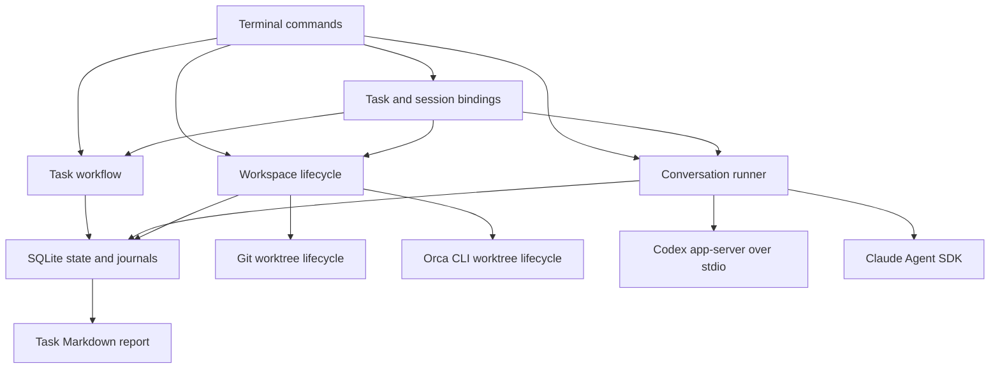

# Architecture and state contracts

This describes the implemented baseline as of 17 October 2026. [DESIGN.md](../DESIGN.md)
defines the intended product; [IMPLEMENTATION.md](IMPLEMENTATION.md) tracks delivery
sequence. Product requirements that appear there are not automatically implemented.

## Components



Executions link task attempts to fresh conversation sessions and a workspace. Their
turns acquire exclusive workspace leases. There is still no automatic path from a
conversation reply to repository changes, evidence acceptance or task completion.

| File | Responsibility |
| --- | --- |
| `src/cli.ts` | Parse commands; task and conversation entry points; Ctrl+C handling |
| `src/store.ts` | SQLite schema, transactions, state snapshots and journal access |
| `src/workflow.ts` | Versioned brief approval, attempts, evidence, decisions and completion |
| `src/sessions.ts` | Claim a conversation, persist events, run one turn, stop and reconcile |
| `src/workspaces.ts` | Reserve a task workspace, create through Git or Orca, inspect and reconcile |
| `src/orca.ts` | Resolve the Orca executable, validate local CLI responses and stable worktree identities |
| `src/executions.ts` | Atomically prepare and close versioned task/attempt/session bindings |
| `src/execution-state.ts` | Validate bindings, acquire/fence workspace leases and settle linked task outcomes |
| `src/agents/types.ts` | Provider contract, reply validation, usage fields and subscription environment |
| `src/agents/codex.ts` | Installed Codex app-server initialization, threads, turns and notifications |
| `src/agents/claude.ts` | Official SDK streaming input, authentication, results and process shutdown |
| `src/process.ts` | Shell-free subprocess execution and bounded JSON-RPC requests |
| `src/doctor.ts` | Local executable/authentication discovery; optional Orca worktree lookup |
| `src/report.ts` | Markdown rendering from a task snapshot and its journal |
| `src/demo.ts` | Explicitly synthetic workflow demonstration |
| `src/probe.ts` | Opt-in live provider probes across separate controller processes |

The runtime is Node.js 24 or newer with TypeScript compiled to JavaScript. SQLite
and the test runner come from Node. Claude's SDK is the sole direct runtime npm
dependency and is pinned; it brings transitive dependencies and a native executable.
Codex and optional Orca are discovered separately. No browser server or installer
has been built.

## Persistence

Schema version 5 contains nine tables:

| Table | Contents |
| --- | --- |
| `tasks` | Task id and current JSON state |
| `events` | Ordered task events with requirement version, timestamp, type and JSON data |
| `sessions` | Grampus session id and current JSON state |
| `session_events` | Ordered conversation events with timestamp, type and JSON data |
| `workspaces` | Workspace state with unique task id and destination/reservation key |
| `workspace_events` | Ordered workspace lifecycle events with timestamp, type and JSON data |
| `executions` | Immutable task/version/attempt/workspace/session links, role and open/closed state |
| `execution_events` | Ordered binding, lease and turn outcome events |
| `execution_leases` | One current owner per workspace, with unique execution/run id |

State changes and associated events share a `BEGIN IMMEDIATE` transaction. Nested
synchronous operations use savepoints so execution preparation can compose task and
session APIs atomically. An outer failure rolls back their state and journals. SQLite
uses WAL, full synchronous writes, foreign keys and a five-second busy timeout.
History is append-only through the application interface. State is loaded from
snapshots rather than reconstructed by replaying events.

Version 1–4 journals gain the missing tables without losing history. Version 4 added
Orca-aware workspace state: path/branch may be null until identity capture. The
unique key initially reserves the Orca repository/request name, then atomically
changes to the canonical destination. Standalone records retain their shape. The
version bump prevents older code from treating a pending Orca operation as a local
Git process. Version 5 adds execution bindings and leases without changing prior
records. Unknown schema versions are refused. Older executables cannot open
version 5 journals. Default
storage is outside the checkout; see [README.md](../README.md) for portable paths
and overrides. Retention expiry, backup tooling, settings transfer and task export/
import have not been implemented. Markdown task reports are the current export.

## Task workflow

A brief contains a title, intended outcome, distinct acceptance criteria and a plan.
Creation produces version 1 in `draft`. Approval must name the exact current version.
An approved task can start an attempt identified by a new UUID and the provider,
model and implementation session id supplied by the caller.

The main progression is `draft` → `ready` → `running` → `awaiting_verification` →
`complete`. Pending provisional decisions can produce `awaiting_decision`.
Failures, stop requests and uncertain recovery have separate states. A successful
implementation result does not itself complete the task.

Completion checks require:

- Approval for the current requirement version and a successful current attempt.
- Passing simplification, validation, independent review and acceptance verification
  evidence for that attempt and artifact reference.
- Verification covering every approved criterion, by its exact criterion text.
- Acceptance of every pending provisional decision.

Evidence has an id, kind, outcome, source, summary, attempt id, requirement version
and artifact reference. Review additionally identifies the reviewer. A different
session is required; using the same provider requires a recorded fallback reason.
This checks caller-supplied identities, not independent proof of provider isolation.

The latest accepted evidence of each kind determines that gate. Earlier failed or
skipped checks remain in the journal. The initial API does not enforce a complete
chronological review pipeline or run named repository checks. Validation and
verification cannot be established by an agent claim alone; synthetic evidence is
accepted only on tasks permanently marked synthetic.

Revising a settled task increments its version, removes approval and current attempt
evidence, and preserves pending decisions. An implementation retry receives a new
attempt id and clears the current evidence. Late, duplicate or mismatched results
are recorded as ignored. Evidence from a previous artifact cannot validate the new
artifact. Artifact references are currently supplied by trusted callers; hashing,
Git inspection and check execution are not implemented.

`Workflow.recover()` marks running or stop-requested attempts as uncertain. Its
caller must establish that the previous controller no longer owns the work; this
method does not discover or terminate processes. Stop confirmation requires an
explicit matching attempt and explanation.

## Standalone workspace lifecycle

`Workspaces.create()` requires a real, ready task and its exact approved version.
It resolves the repository/common Git directory, canonical destination, immutable
base commit and generated task branch. The destination is outside registered
worktrees and Git metadata. Native filesystem canonicalization handles Windows
short/long path aliases; destination keys also ignore case on Windows.

A transaction reserves the task and destination before invoking `git worktree add`.
The record includes the host, controller PID, Git PID when observed and whether
Git's exit was confirmed. Creation locks the worktree with its unique workspace id.
The controller verifies registration, branch, common directory, clean state and base
commit before moving `creating` to `ready`. This lock prevents ordinary Git pruning
and removal; it is not a worker execution lease. Uniqueness is enforced within one
journal; separate journals do not share a global concurrency limit.

Git failures retain the reservation in `recovery_required`. After a controller crash,
the state may still say `creating`. Recovery claims the record transactionally,
requires absent prior processes (or a confirmed Git exit after this controller's own
failed operation), and inspects Git without replaying creation. An unknown Git PID,
live or reused PIDs and another host block reconciliation. A completed checkout can
be adopted only if its original identity, clean base and approved version still match.
Missing, dirty or mismatched checkouts remain reserved for manual investigation.

Revising or starting an attempt is blocked while workspace creation is unsettled.
A ready workspace survives brief revision, but its old version cannot authorize a
new attempt. Automatic rebinding and release/removal are not implemented. Inspection
can report changed HEAD and dirty state without resetting user changes; it does not
produce acceptance evidence or reserve the workspace for agent execution.

Git runs without a shell and with a 30-second timeout. Inherited `GIT_*` environment
overrides are stripped so the explicit repository determines the index and worktree;
repository/user Git configuration still applies. Normal checkout hooks and filters
may run. Their process trees are not supervised by this slice. Task-linked turns use
the execution ownership mechanism below; shared scheduling remains separate work.

## Orca workspace lifecycle

Orca is the authority for its tracked worktrees. The adapter checks the installed
CLI's creation controls, resolves the registered Git repository, and validates local
worktree identity responses before mutation. An explicit base ref is pinned to a
commit. A task reservation and unique request name/marker are durable before the
single `worktree create` call. Orca selects path and branch; Grampus requests no parent,
skips Orca setup hooks and does not request an agent or activate the view.

The response is validated and bound to the reservation before readiness checks.
Grampus records the full worktree id, stable identity key and instance id, plus the
observed path and branch. Inspection requires those identities, Orca's local host,
the repository's Git common directory and actual worktree registration to match.
No raw Git writes or extra Git locks are applied to Orca worktrees.

CLI exit/timeout is not Orca host completion. Recovery first excludes another live
Grampus controller, then uses Orca's read-only list/show interfaces. An uncaptured
identity requires exactly one matching name and marker from a complete local listing,
with the exact requested base ref. Captured identity is looked up directly and cannot
be replaced by a new instance at the same path. All creation recovery additionally
requires a clean checkout at the pinned commit and the current approved task version.
Unknown outcomes remain reserved; no create call is replayed.

The fixed CLI deadline is 120 seconds. There is no automatic application start,
executable fallback, host switching, creation retry or workspace removal. Normal
Orca terminal defaults and Git hooks/filters can still have side effects. Readiness
does not prove all host background activity finished, and provides no execution
lease or tool-process supervision. Remote hosts are rejected. Version rebinding
remains future work; task-linked turns acquire a separate execution lease below.

## Execution bindings and workspace ownership

`Executions.create()` inspects the workspace and verifies its exact approved version.
One transaction creates a fresh session, starts an implementation attempt (or selects
the current successful attempt for review), and journals the permanent binding.
Review records pin the attempt's artifact reference and require a recorded reason
for same-provider fallback. Preparing a binding makes no inference call.

`Sessions.claim()` checks the binding's version, attempt, role, workspace and session
directory. It atomically claims the session and inserts a workspace lease containing
execution/session/run ids, controller PID and host. The workspace primary key and
unique execution/run ids prevent duplicate owners across controllers sharing the DB.
Another active or uncertain session in that directory also blocks acquisition,
including legacy unlinked sessions. New unlinked sessions there cannot bypass the
lease. Different workspace ids remain independently runnable.

The runner verifies current Git/Orca identity while holding the lease, before provider
connection. Each prompt includes the approved brief and binding context, saved with
the turn request. Cancellation during workspace inspection prevents provider dispatch
and waits for the bounded inspection commands to settle. Provider session/model
identity stays in the session; the task's implementation model is updated when observed.
For linked attempts, `Agent.sessionId` is the Grampus session id; the provider's resume
id remains a separate session field. `provider-default` labels an unresolved model
request until an observed model arrives. `headAtCreation` is informational, not
verified implementation evidence.

Settlement fences on the exact session run and lease token. Session state, linked task
outcome, journal events and lease release commit together. A successful conversation
does not finish an implementation attempt. Failure marks it failed; confirmed interrupt
or recovery marks it stopped. Review outcomes leave implementation evidence unchanged.
Unconfirmed exit retains the lease and marks the session, plus an implementation task,
as requiring recovery. A startup promise still pending after cancellation is uncertain
even if no PID was observed. A late connection is closed without receiving the prompt;
that alone does not erase the retained recovery state.

There is no expiry or heartbeat takeover. Recovery requires absent controller and
provider PIDs on their recorded host, then releases both owners in one transaction.
Unknown/reused/live PIDs remain blocked. Late events cannot release a newer run's
lease. Task revision, replacement attempts, completion, direct result/evidence writes
and generic task recovery cannot bypass active/uncertain execution ownership.

Idle execution closure can stop its unfinished implementation attempt and permanently
disable that session binding; it cannot force-release a lease. Questions retain the
same attempt/session across ordinary turns. Failed/interrupted implementation attempts
require fresh execution preparation, preserving old contexts as history. A task
revision or replacement attempt invalidates older bindings without rewriting them.

This is cooperative ownership within one journal, not a filesystem lock against
editors, external Orca agents or other journals. There is no global worker limit,
repository command runner, tool-process-tree supervision or automatic evidence.

## Conversation lifecycle

Each conversation records its provider, provider session id, working directory,
observed model, latest reply and phase. An active run also records a unique run id,
execution hostname, controller PID and provider PID when observed.

1. Claim the conversation transactionally and record the prompt. Reject an existing
   active owner or unresolved recovery state.
2. Connect using subscription authentication. Create a provider session or resume
   the exact recorded id. Record process and model identity.
3. Start one turn and save output deltas, usage snapshots and the final result.
4. Close the owned provider process and confirm exit before releasing ownership.
5. Return to `idle`, enter `awaiting_answer`, or retain `interrupted`/`failed` status.
   An unconfirmed exit leaves `recovery_required` and blocks reuse.

A prompt returning a question ends the provider turn. The CLI can exit normally
and a later invocation can supply answers to every pending question id. These are
structured model replies, not native permission-request callbacks. A question's
choices are suggestions; text answers are supported.

Ctrl+C and deadlines persist `stop.requested` before asking the provider to
interrupt. A receipt is not a confirmed stop. If the turn does not settle during
the five-second interruption grace period, shutdown still attempts to close the
owned process. Late success cannot overwrite the user's interruption. Subprocess
exit is distinct from successful model completion.

The default turn timeout is 120 seconds and the maximum is 600 seconds. Automatic
inference retries are zero. Provider-internal retries may occur within the deadline.
After failure or interruption, a user sends an explicit new prompt; the controller
never silently replays the previous one.

Recovery checks that the recorded controller and provider PIDs are absent on the
recorded host. Unknown process identity or permissions, live processes, and PID
reuse conservatively block recovery. This is not a durable process supervisor,
heartbeat lease or cross-machine migration mechanism. It does not supervise
arbitrary tool subprocess trees. A missing provider PID currently requires further
investigation rather than an automatic reset.

## Provider replies and usage

Both adapters use this response shape:

```json
{
  "kind": "question",
  "text": "Choose the output format.",
  "questions": [
    { "id": "format", "prompt": "Which format?", "choices": ["Markdown", "JSON"] }
  ],
  "findings": []
}
```

`kind` is `message`, `question` or `review`. All fields are present; unused lists
are empty. Question ids must be distinct. Findings have `severity` (`blocking` or
`suggestion`), `description` and concrete `evidence`. Malformed or inconsistent
replies fail the turn. Review replies remain provider claims and do not directly
populate task evidence or authorize completion.

Usage events are cumulative provider-session snapshots, not increments to sum.
Keep the most recent applicable snapshot. Token counting semantics differ between
providers; this is not a cross-provider billing ledger. Claude exposes an estimated
USD amount. Codex cost and actual billed cost remain unknown. Missing measurements
remain `null`. Task reports still say usage is unknown because aggregation across
linked sessions is not implemented; provider snapshots remain in session journals.

## Verification and current boundaries

`npm test` builds and runs offline tests against temporary databases, subprocesses
and protocol fixtures. It does not invoke live models. Test files cover workflow,
CLI persistence, process transport, sessions and Codex notification handling.
Both providers also passed explicit live probes; see
[INTEGRATION-EVIDENCE.md](INTEGRATION-EVIDENCE.md) for versions and observed behavior.

Only Windows has been tested. Workspace release/rebinding, shared scheduling,
real check runners, tool approvals, review arbitration, slice commits,
delivery integration, dashboard, installers and platform CI remain outstanding.
The implementation itself has not had an independent review.
